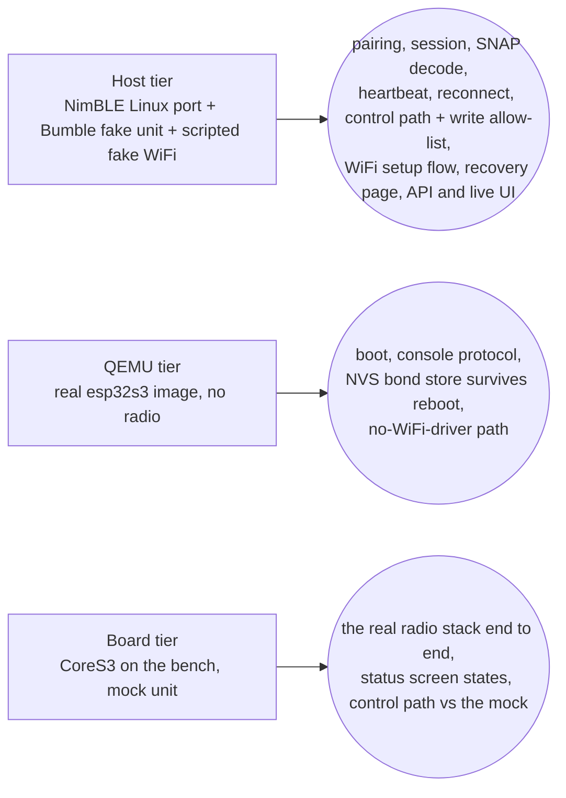
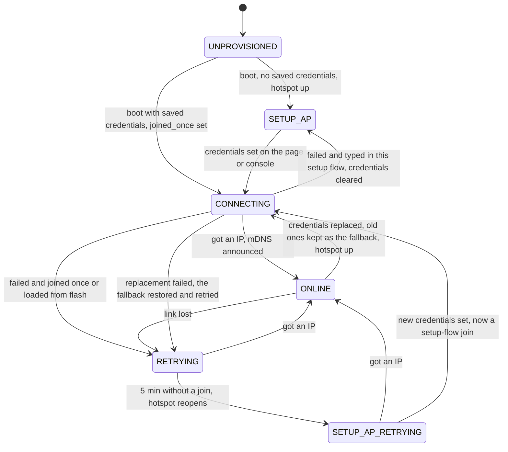
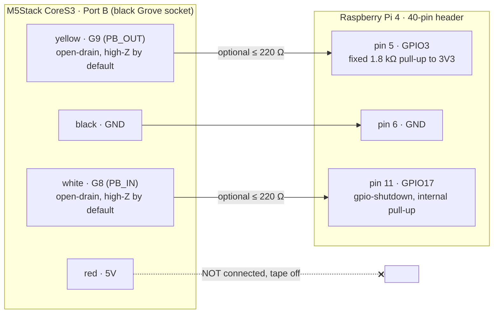

# ESP32 firmware (satellite)

The satellite is ESP-IDF + NimBLE firmware for an ESP32-S3 board, the M5Stack
{term}`CoreS3 <Satellite>`. It pairs with the {term}`camper unit`, reads it and controls it
independently of `calictl` and {term}`buspi`. It is the device target of the pairing state machine
(`calictl/pairing.py`, `R_PAIRING_SM`) that the web wizard runs.

The full build and porting detail (every NimBLE/Bumble adaptation, exact pins, warnings policy) is
in [`firmware/README.md`](https://github.com/ckeller42/open-california/blob/main/firmware/README.md)
in the repository. This page is the reference and traceability view. The C headers' API is on
the [firmware C API](firmware-api.rst) page.

## Overview

What the satellite does:

- **Reads** every function of the unit's vehicle variant over one held BLE link, also while the van
  is parked. It re-reads water every 30 s and runs the same water guard as calictl.
- **Controls** five functions: cooler, camping mode, lighting (the wake-up light included, with the
  web page's clock), air heater and energy mode. The bytes are the ones `calictl.control` builds,
  held identical by golden vectors, through one write allow-list. It never controls the roof
  ([Control path](#control-path)).
- **Answers** a write whose link dropped after the frame went out as *{term}`unconfirmed`*: the unit
  may have applied it.
- **Serves** the calictl web UI, a JSON state API and a WiFi recovery page. It joins a WiFi network
  that is set up through its own hotspot and captive portal
  ([Network: WiFi setup and the web UI](#network-wifi-setup-and-the-web-ui); owner how-to
  [How to put the ESP32 satellite on your WiFi](howto-esp-wifi-setup.md)).
- **Pairs** from its web page with calictl's wizard. The unit serves several centrals at once, so
  the satellite pairs and runs while buspi stays connected.
- **Runs on its own**: firmware update from GitHub, time from SNTP or the unit's clock, a log of
  every unit frame on the microSD card, the auto camper restore, waking and halting buspi
  ([Running without buspi](#running-without-buspi)).
- **Shows** its status on the CoreS3 screen, which wakes on a touch, a hand near or motion and
  follows the room light. It reads its own battery.
- **Sensors:** reads external BLE sensors (Govee, Victron) behind a switch.

Its characteristic-value writes are the `1003` {term}`liveness heartbeat <Heartbeat>` (the same one
the Pi build uses to keep reads fresh) and the control frames of the five functions.

**Proof.** Reading, pairing, the held link and control (cooler, wake-up light, door contact) are
live-verified on the real unit; the bytes are calictl's, which equal the real app's. Everything is
also host-tier tested (a NimBLE host build against a fake unit), boots in QEMU, and runs on a CoreS3
bench against the mock unit. The dated rows are in the
[evidence ledger](business-logic/evidence-ledger.md).

## Three test tiers



The three tiers run without the van. The van itself (the real unit) is the last step; its results
are the DEVICE rows of the [evidence ledger](business-logic/evidence-ledger.md).

| Tier | What it proves | What it cannot prove | Run locally |
|---|---|---|---|
| **Host + Bumble** (CI `firmware-host-e2e`) | The firmware's C code — pairing runner, session, console — driving the **real upstream NimBLE host stack** (Linux port) over HCI-over-TCP against a Bumble virtual controller linked to the repo's fake unit (`tools/fake_unit_peripheral.py`). Proves pairing (KEYBOARD_ONLY + MITM + SC), bond persistence and reconnect, the full `SNAP` read-all against `calictl.protocol.decode`, the 1003 heartbeat, notification push, link-drop recovery, and that the unit sees no control write while no command is sent. The control path (`tests/firmware/test_control_e2e.py`): every app-recorded cooler/camping/lighting/air-heater/energy action sent through `POST /api/command` reaches the fake unit byte-exact, with the lighting commit ≥ 300 ms after its frame; the app's wake-up edits too, the REQUEST_CONFIG pull included; the console `set` too. Roof, stairs, a wake-up without the page's clock and unknown commands write nothing, and a roof, `1003`, wrong-length or empty frame handed straight to the transport write is refused (the allow-list choke point). `403` over the setup hotspot, `409` while a command runs, an ATT refusal is `502` with no commit, the heartbeat keeps ticking through commands. | Nothing about the real esp-nimble port or a real radio: this is upstream NimBLE 1.10 on Linux, not the ESP-IDF-vendored esp-nimble 1.6-based stack (gap documented in `firmware/README.md` Pins). | `firmware/host/fetch_nimble.sh && make -C firmware/host cali-host && python -m pytest tests/firmware -v` (Linux only, needs a 32-bit toolchain — see `firmware/README.md` "Host build notes" for the Docker recipe on macOS) |
| **QEMU boot** (CI `firmware-qemu`) | The **real ESP-IDF image** (compiled for the esp32s3) boots in Espressif's QEMU: the console line protocol on the no-controller path, and the NVS-backed bond store (`cali_kv_*`) surviving a reboot, including a CRC-broken record recovering as "unpaired" instead of crashing. | Bluetooth. QEMU's esp32s3 machine has no radio and no BT low-power clock, so `esp_bt_controller_init` asserts (a reboot loop) instead of returning an error. The QEMU probe build (`CONFIG_CALI_QEMU_PROBE`) therefore skips `nimble_port_init()` and runs the no-controller fallback (`LOG ble: controller unavailable`, the console still answers) — the path a board takes when its radio fails to init. | `docker run --rm -v "$PWD":/project -w /project/firmware espressif/idf:v6.1 bash -c '. $IDF_PATH/export.sh >/dev/null && idf.py -B build-qemu -D SDKCONFIG=build-qemu/sdkconfig -D SDKCONFIG_DEFAULTS="sdkconfig.defaults;qemu/sdkconfig.qemu" build && cd /project && pip install -q pytest && CALI_QEMU=1 python -m pytest tests/firmware/test_qemu_boot.py -v'` |
| **Host web e2e** (CI `firmware-host-e2e`, `tests/firmware/test_web_e2e.py`) | `cali-host --http PORT --fake-wifi SCRIPT`: the WiFi runner, captive DNS and web endpoints on the same 100 ms tick as the BLE session, over `net_host.c` (POSIX sockets on 127.0.0.1 + a scripted fake WiFi radio) and the Bumble fake unit. Proves the setup flow (fresh boot -> setup mode -> POST credentials -> station), a wrong password falling back to setup with the credentials cleared, a failed replacement while online returning to the old network (`reverted`) and a good one moving, an online `GET /api/wifi` scanning once per interval and not while BLE pairs, saved credentials reconnecting after a restart + `DELETE /api/wifi`, `/api/state` equal to the console's `SNAP` after pairing, a WiFi loss leaving the BLE link and heartbeat alone, the page rendering in Chromium (EN + DE), the setup flow clicked in Chromium (a wrong password shows the wrong-password text, the right one the `http://calictl-esp.local` link; EN + DE), and the pairing wizard over `/api/pairing` in station mode and over the setup hotspot (`test_pairing_web_e2e.py`: wrong passcode, pairing screen closed, stale bond, `409 busy`, clicked in Chromium EN + DE). | The real esp_wifi/lwIP/mdns stack, a real phone's captive-portal detection, radio coexistence — the fake WiFi only replays the script's outcomes. | `tools/ci.sh firmware` (Linux; on a Mac see `firmware/README.md` "Host build" for the Docker recipe) |
| **QEMU no-WiFi-driver** (CI `firmware-qemu`, `test_qemu_boot.py::test_no_wifi_driver_boots_and_serves_nothing`) | The QEMU image is built with `CONFIG_CALI_WIFI=n` (no esp_wifi call compiled in): it logs `LOG wifi: driver unavailable` once, keeps WiFi off (`status` has no `wifi` member, `wifi status` -> `LOG wifi: not enabled`), listens on nothing, and does not reboot — the same path a board takes when `esp_wifi_init`/`esp_wifi_start` fails. | Anything about a working WiFi driver (QEMU's esp32s3 has no WiFi). | The QEMU command above |
| **Board** (bench, not CI) | The real CoreS3 on a Linux bench against the mock camper unit (`tools/applab/fake_unit_ble.py` on a USB BLE dongle) and a second WiFi stick: flashing from `flasher_args.json`, the USB-Serial/JTAG console, esp-nimble passkey pairing + reconnect by bond, the setup hotspot -> `POST /api/wifi` -> station join, and the spec's seven status-display states (setup, joining, online, pairing, connected, stale, link lost) + dimming by remote `screenshot` (`tools/esplab_display_walk.sh`). **The control path:** `tools/esplab_control_walk.py --url http://calictl-esp.local --fifo … --record …` against the mock unit — every app-recorded action byte-exact at the mock, the app's wake-up edits and a wake-up card edit from Chromium included; the roof refused with no `1401`; console `set`; `403 setup_mode` over the real setup hotspot; the heartbeat through commands; the 30 s water re-read; a fridge toggle from the UI in Chromium. **The pairing wizard:** unpair/reset, pair in station mode and over the setup hotspot's `/app`, a wrong passcode retried, `403` for a control write over the hotspot. **Probe before replace:** *Connect now* with the unit's pairing screen closed keeps the working bond (no passkey, `SNAP` flows); after the unit forgot its bonds a passkey re-pair bonds afresh; with the unit gone the bond is kept and the satellite reconnects on its own once it is back. BOARD rows in the [evidence ledger](business-logic/evidence-ledger.md). | The real camper unit (the bench has only the mock; the van's DEVICE rows cover the real unit), a phone's captive portal, the van's radio environment, the water *stale push then correct read* ordering (not stageable with the mock's console; session-fake tier only). | `tools/esplab_display_walk.sh` on the bench (header lists its env); `firmware/README.md` "Status display" |
| **Pure-C unit tests** (in the normal `test`/`pytest` job, no BLE) | The pairing state machine (`pairing_sm.c`) replays the same golden vectors as `calictl.pairing`; the runner and the session+console compile and run against scripted fake transports on any host with a C compiler (macOS included). The network pieces too: the WiFi SM replays `tests/vectors/wifi_sm.json` from its Python twin (`tools/wifi_sm_ref.py`), the HTTP core (`http_core.c`), captive DNS (`captive_dns.c`), web handlers (`web.c`, incl. `POST /api/command` against a fake sequencer), JSON writer and the host `cali_net` (`net_host.c`) each run under a small C driver, and the WiFi runner runs next to the BLE session in `test_session_fake.py`. The control twin (`control.c`) replays every vector of `tests/vectors/control.json` byte for byte and its allow-list is scanned exhaustively (`test_control_parity.py`; the Linux host tier repeats both with an i686 `-m32` build, the ESP32-S3's 32-bit `long`); the sequencer (`control_run.c`) runs against the scripted transport in `test_session_fake.py` (arming, one at a time, ATT error, link drop, late ACK, interleaved heartbeat/notify, the follow delay). | Real NimBLE call sequencing (that's the host tier's job); real sockets under load; any radio. | `python -m pytest tests/firmware/test_pairing_sm_parity.py tests/firmware/test_runner_fake.py tests/firmware/test_session_fake.py tests/firmware/test_wifi_sm_parity.py tests/firmware/test_http_core.py tests/firmware/test_captive_dns.py tests/firmware/test_web_handlers.py tests/firmware/test_json.py tests/firmware/test_net_host.py tests/firmware/test_control_parity.py -v` |

### CI jobs (`.github/workflows/ci.yml`)

| Job | Runs |
|---|---|
| `test` (the normal matrix) | `tests/firmware`'s pure-C tests (pairing + WiFi SM parity, runner fake, session fake incl. the control sequencer, HTTP core, captive DNS, web handlers incl. `POST /api/command`, JSON, host `cali_net`, the control twin's vector parity + allow-list scan) via `-m "not linux_only"` — no BLE, runs on every Python version; plus the control vectors' freshness (`tests/test_control_vectors.py`) and the satellite UI e2e over a stub (`tests/e2e/test_satellite.py`) |
| `codec-parity` | `gen_c_dict` / `gen_codec_vectors` / `gen_control_vectors --check` and the C parity modules (`test_control_parity.py` among them) with `gcc` |
| `firmware-host-e2e` | The NimBLE-Linux + Bumble end-to-end tier, incl. the WiFi/web e2e, the control path (`test_control_e2e.py`) and the page in Chromium with a live fridge toggle reaching the fake unit (`tools/ci.sh firmware`) |
| `firmware-build` | Compiles the release esp32s3 image against ESP-IDF's real esp-nimble; uploads the flashable images |
| `firmware-release` | Push to `main` only: uploads `cali_fw.bin` + `manifest.json` to the `esp-latest` prerelease (the `latest` OTA channel, `R_FW_OTA`; the `stable` channel's `esp-stable` release comes from the separate `esp-stable.yml`, run by `promote_stable.sh`), plus the first-flash `cali_fw_full.bin` and `cali_fw.elf` (symbols for a panic backtrace, `R_FW_PANIC_CAPTURE`); with `coverage-badge` the only ci.yml jobs with `contents: write` (`esp-stable.yml`'s job has it too) |
| `firmware-qemu` | Builds the QEMU-probe variant (no WiFi driver) and boots it in QEMU |

`firmware-build` (container `espressif/idf:v6.1`, uploads the images + `flasher_args.json`) does
not run the image anywhere. It proves that `cali_core` + `cali_ble_nimble` (unchanged from the host
build) compile clean against ESP-IDF's real esp-nimble under the host's `-Wall -Wextra -Werror`
strictness.

## Console line protocol

Identical on the host build (stdin/stdout) and the device (the USB-Serial/JTAG console; UART0 in
the QEMU image) — `firmware/components/cali_core/include/cali_console.h`:

- **In**, one command per line: `pair` (start pairing), `passkey N` (the code the unit displays,
  ignored unless waiting for one), `forget` (drop the bond), `status` (reprint `STATE`), `quit`
  (host only — exits the process; no-op on the device), the WiFi commands `wifi set <ssid>
  <psk>`, `wifi status`, `wifi forget`, `wifi scan` (see [the network section](#network-wifi-setup-and-the-web-ui);
  `LOG wifi: not enabled` while WiFi is off), the sensor probe `sensors [on|off|add …|remove …]`
  ([External sensors](#external-sensors-r_fw_sensors)), and `set <function> <what> [value]` — a control
  command in calictl's `set` vocabulary (`set cooler power on`, `set lighting kitchen 5`,
  `set lighting save_profile 3 amber`; the value is the rest of the line, `""` when absent), see
  [Control path](#control-path). The console is physical access (USB), so `set` works in every WiFi
  mode; it answers `LOG control: <fn>/<what> …` lines — `sending` then `sent`, or `refused: <reason>`,
  `bad value`, `no such control`, `not ready (no armed link or no state yet)`, `busy`, or a
  failure (`failed: the unit refused the write`, `failed: write not issued`, `failed: link lost`,
  `timed out`). Further commands: `ble …` ([BLE modes](#ble-modes-r_fw_ble_mode)), `ota …`
  ([Firmware update](#firmware-update-from-github-r_fw_ota)), `pi …` ([Pi wake](#pi-wake-r_fw_pi_wake)).
- **Out**, one line each: `STATE {json}` (the pairing state machine's snapshot — the same keys as
  calictl's `/api/pairing`; the `status` command's line gains a `"wifi"` member once WiFi runs),
  `SNAP {"t":ms,"fn":{...}}` (every function the session holds a frame for, `codec_decode`d, in
  `CODEC_CHARS` order), `LOG text` (everything else).

`STATE` mirrors calictl, not the link: after a boot with a stored bond the pairing state machine is
`idle` (address = the bonded identity) before any link is up. Whether the session holds a
connection is a separate matter the console does not report — the same split calictl's
`/api/pairing` and `/api/state` `_meta` make. A link drop while waiting for a passkey ends
`WAITING_PASSKEY` only through the 60 s timeout, in the C port and in `calictl/pairing.py` alike
(golden-vector parity).

## BLE session

`firmware/components/cali_core/session.c` holds one link to the bonded unit.

**Read-all.** The read pass follows `calictl.device.read_all`, gated by the unit's vehicle variant
as the app gates it (`R_FW_VARIANT_GATE`):

1. On a boot's first link the session reads `1004` (vehicle) first. Its `CarVariant` says which
   functions the unit has: the roof is T7 only; satellite antenna, stairs, living-room heater and
   roof air-condition are Grand California only; energy, water, air heater and cooler are T7 and
   Grand California; every other function is on every variant. Any other `CarVariant` value counts
   as a T7, as in the app.
2. It subscribes every notifying {term}`state char <GATT characteristic>` of that variant
   (`1001` general and `f001` are never subscribed, as in the app) and starts the 1003 heartbeat.
3. It reads every function of the variant at once — the heartbeat warm-up before the read pass is
   0 ms by default (`R_FW_BLE_WARM`): a read at connect equals one after the heartbeat ran. The
   home screen's functions come first (energy, water, cooler, camping mode, vehicle, lighting, air
   heater, general: `session.c` `READ_FIRST`), so a GUI opened on a dropped link fills in its main
   values first (`R_FW_BLE_IDLE`); then the rest in `CODEC_CHARS` order. Each read's frame shows in
   `/api/state` as it arrives.

A reconnect uses the stored `1004`. When no variant is known (the `1004` read failed), the session
subscribes and reads every function (`LOG session: variant unknown — …`); with a known variant it
logs what it skips (`LOG session: variant 0 — skipping …`).

A read completion and a notification both replace the function's frame, so the **last frame to
arrive wins** — the app's order (it subscribes, then reads, and one decoder takes both; calictl
`R_READ_LAST_FRAME_WINS`). A stale water push on the subscribe therefore never hides the correct
read. The first `SNAP` of a link follows the read pass.

**Water re-read.** While the link stays up, **water (`1302`) is re-read every
`CALI_SESSION_WATER_REREAD_MS` (30 s)** after the read-all; its completion replaces the frame and
prints a `SNAP`. 30 s is calictl's `POLL_INTERVAL`, at which calictl reads 1302 on every poll. The
satellite has no other periodic re-read (it holds one link and otherwise lives on notifications), so
this is the one timer. A parked latch served at connect is corrected on the same link, with no
reconnect. This is a calictl rule, not the app's: the app has no 1302 re-read timer (its only
periodic re-reads are screen pollers for 1102/1602/1902/1004 while those screens are open); it gets
a fresh 1302 read on every reconnect instead.

**Water guard.** The same rule as calictl's `freshness.implausible_water_drop`: the unit reports
1 L whenever it is {term}`not measuring <Water latch>`, so a fresh drop to that latch is held
(baseline in NVS `water_good`; see `value-freshness.md`), and a new level is adopted only after 5 s
unchanged — the unit's ~4 s ramp from 1 L to the real value once it measures
(`freshness.settle_water`). The satellite links `csrc/ports.c`, one C water guard, parity-tested
against calictl. `/api/state` flags a held reading (`water_held`, `water_held_age_ms`).

### ATT requests from the unit (GATT server)

The unit is a GATT client too: right after every connect it sends the {term}`central` an
**{term}`ATT Exchange MTU Request`** (Client RX MTU 247). BlueZ and Android answer it. A central-only
IDF v6.1 build has no NimBLE {term}`GATT server` (`BT_NIMBLE_GATT_SERVER` depends on
`BT_NIMBLE_ROLE_PERIPHERAL`); esp-nimble then discards the request unanswered
(`ble_att.c` `ble_att_rx_handle_unknown_request`), the unit's 30 s ATT transaction timeout expires
and it ends the link with HCI `0x13`. So `sdkconfig.defaults` enables the peripheral role for its
GATT server only (no advertising, no service registered), matching the host syscfg the host tier
proves (`BLE_ROLE_PERIPHERAL 1`). Guarded by `tests/firmware/test_sdkconfig_gatt_server.py`; the
fake unit can send the same request and hang up unanswered after 30 s
(`tools/fake_unit_peripheral.py` `mtu_request` knob, off by default, `T_FAKE_UNIT_MTU_REQUEST`). With
the request answered, the satellite holds its link with the van parked and locked (live-verified,
[evidence ledger](business-logic/evidence-ledger.md)).

A held link without heartbeats is not dropped either: the `1003` heartbeat arms writes, it does
not keep the link alive.

### Reconnect, backoff and cooldown

A lost link is reconnected by bond on a backoff that starts at 1 s and doubles to a 60 s cap, like
calictl's supervisor.

- **Backoff reset.** The backoff resets to 1 s only when the lost link had held for
  `CALI_SESSION_STABLE_MS` (60 s), not at link-up. With the camping master off the unit ends every
  link ~1–31 s after it comes up, so each such short link doubles the delay up to 60 s
  (`T_FW_SESSION_SHORT_LINK_BACKOFF`).
- **Cooldown.** No reconnect, backoff or a command's nudge, comes sooner than
  `CALI_SESSION_UNIT_COOLDOWN_MS` (7 s) after a link was lost (`T_FW_SESSION_UNIT_COOLDOWN`). With
  camping off the unit cuts every link that starts less than 6 s after it ended the previous one,
  about 1.2 s in.
- **Commands.** A command reconnects as soon as it may: `cali_session_connect_now` makes a pending
  reconnect due (never before the cooldown ends). A command on a down link answers
  `503 not_connected`; the web UI retries it every 2 s for up to 45 s (`CMD_LINK_WAIT_MS`) and shows
  "Connecting…". The wait covers the rest of the cooldown, the connect (the NimBLE transport's own
  connect timeout is 10 s), GATT discovery (about 6 s on every reconnect) and the read pass. Caching
  the GATT handles across reconnects would save the discovery.
- **Page open.** A page open in `hold` waits out the delay (≤ 60 s). A page that moves an
  idle-policy session from `off` to `hold` connects at once (the mode change clears the pending
  reconnect and resets the backoff), except during the power-save rest below.
- **Watchdogs.** `CALI_SESSION_CONNECT_TIMEOUT_MS` (20 s, twice the transport's connect timeout)
  fires only when the transport's verdict got lost; `CALI_SESSION_ENC_TIMEOUT_MS` (15 s) bounds
  the encryption.
- **{term}`Power-save rest`.** When the unit itself ends the link (HCI 0x13) while camping mode is off and
  no shore power feeds it, the satellite does not reconnect, as the app does
  (`R_FW_BLE_REST`). The web UI shows the app's card "Disconnected to save energy" with a
  *Reconnect* button. Every other loss takes the backoff above.

The web UI's status pill says "live" only while the link takes commands (`device.link.ready`: the
read pass is done and the heartbeat is armed), "power saving" during the rest.

The ~30.5 s drop of a held link with camping off is the unit's own timer, not a request the
satellite leaves unanswered: the unit ends an idle BlueZ link with camping off at the same time,
and holds it with camping on. Nothing in the satellite causes it; the backoff above is the
handling. The measurements (drop counts, delays, the tap-to-accept times) are in the
[evidence ledger](business-logic/evidence-ledger.md).

## BLE modes (`R_FW_BLE_MODE`)

```{eval-rst}
.. req:: BLE link modes
   :id: R_FW_BLE_MODE
   :status: open

   The session runs in one of three :term:`BLE modes <BLE mode>` (``cali_session_set_mode``; console ``ble mode
   hold|quiet|off``). ``hold`` is the default: link held, 1003 heartbeat every 600 ms. ``quiet``:
   link held, the heartbeat runs only while a read-all warms up or reads, or a control command is in
   flight (a switch to ``quiet`` mid-command keeps it to the last frame). ``off``: no link and no
   reconnect (a drop is not retried, boot does not connect). Only ``hold`` is ready for a control
   write (``cali_session_ready``): a command in ``quiet`` or ``off`` (``cali_session_connect_now``)
   switches back to ``hold`` (``why`` ``command``) and answers ``not_connected``; the client's retry
   is accepted once the heartbeat has run ``CODEC_ARM_DELAY_MS`` again (and, from ``off``, the link
   is back and read). Outside ``hold`` the Pi wake sees the ignition as unknown and an auto-camper
   restore waits. A new pairing starts in ``hold`` (``pairing``). Each change logs ``evt ble_mode``;
   dropping an up link for ``off`` logs ``link_down`` with reason ``ble_off``.

.. req:: BLE probe
   :id: R_FW_BLE_PROBE
   :status: open

   ``cali_session_probe`` (console ``ble probe``, a :term:`Probe`) runs one fresh read-all now: it connects first
   when the link is down, runs the heartbeat through the warm-up, reads every function, logs ``evt
   probe`` and returns to the mode (``off``: disconnect). A probe that cannot connect logs
   ``ok:false`` and is not retried. The probe writes nothing but the 1003 heartbeat.

.. req:: BLE power experiment
   :id: R_FW_BLE_EXP
   :status: open

   ``ble exp <phase_min> [HH-HH]`` (console; ``POST /api/ble {"exp_min":N,"from":H,"to":H}``) runs
   the night experiment: inside the window (default 22-06, Europe/Berlin local time from SNTP or the
   unit's clock) it cycles the modes ``hold -> quiet -> off -> hold …``, each ``phase_min`` (1-720)
   long, with a probe at the end of every phase; outside the window the mode is ``hold``. Without a
   wall clock it is refused (``no_time``). A viewer (``GET /api/state``, or the page load ``GET /`` / ``/app``), a mode change from outside
   (a control command in ``quiet`` or ``off``, ``ble mode``, ``/api/ble``, pairing — also while the
   phase-end probe runs) or, on an up link, the van's ignition (terminal 15, ``cali_ac_ignition``)
   ends the running phase as ``aborted`` and returns to ``hold``; the cycle then holds 10 min
   (``CALI_BX_IDLE_MS``, renewed by every further viewer poll and every tick with the ignition on, so a
   night drive never reaches the next phase) and goes on with the next phase. The unit's own advert is
   the sleep indicator: a sensor window (``sensors on`` only — no window runs otherwise) that sees an
   advert whose address is the bond's identity (resolved by the controller, or an RPA resolving with
   the bond's IRK) logs ``evt unit_adv`` ``seen:true`` on the first sighting, ``seen:false`` after
   ``CALI_BX_GONE_MS`` (3 scan periods + one window, 185 s) without one (also from the start, when
   never seen). A reappearance in ``quiet`` or ``off`` after a ``seen:false`` logged in that same mode
   **with the link down** is a wake (door, ignition) and counts as activity. The first sighting is not,
   and neither is a sighting after a gone logged with the link up, nor the adverts after the link
   drops (our ``hold -> off`` disconnect, the unit dropping a ``quiet`` link). Each phase end logs
   ``evt ble_phase`` with its ``dur_ms``, start/stop ``evt ble_exp``; stopping or restarting
   mid-phase logs that phase ``aborted`` first; a refused phase-end probe logs ``evt probe`` with
   ``ok:false``, reason ``refused``. ``ble exp off`` (``{"exp_min":0}``) ends it in ``hold``; a
   reboot ends it too (not persisted). ``tools/esplab/soak_report.py`` polls ``/api/state`` and so
   counts as a viewer: do not run it during an experiment night.

.. req:: BLE idle policy
   :id: R_FW_BLE_IDLE
   :status: open

   ``POST /api/ble {"idle_min":N}`` (0-60, stored in NVS key ``ble_idle``, read at boot; missing = 0;
   the Satellite settings' *Connection* select) sets how the session idles. ``0`` (the default) =
   ``hold``: the link stays up. ``N`` > 0: the link is held while someone is active and dropped
   otherwise — activity is a viewer (the page load ``GET /`` or ``/app``, so the reconnect starts while the
   page loads; ``GET /api/state``: the web UI polls it every 2 s; not ``/api/ble`` or ``/api/log``), a mode the
   policy did not set (a control command in ``off`` switches to ``hold``, ``ble mode``, ``/api/ble``),
   the van's ignition (terminal 15) on an up link (also during a probe), or a new setting; after
   ``CALI_BX_IDLE_MS`` (10 min) without one the mode goes ``off`` (``evt ble_mode`` ``why`` ``idle``),
   and every ``N`` minutes while ``off`` a :term:`Probe` reads every function (``evt probe``; skipped
   with no bond). Activity during a probe lets it finish, then ``hold``. A running experiment
   (``R_FW_BLE_EXP``) owns the session; the policy waits and holds 10 min after it ends. Outside
   ``hold`` the Pi wake and an auto-camper restore see the ignition only through a probe (``R_FW_BLE_MODE``),
   so they react up to ``N`` minutes late; a GUI opened while ``off`` shows the last probe's data until
   the reconnect (≈1 s) and the read-all (≈6 s) are done. The reasons for the policy are in
   ``docs/business-logic/DECISIONS.md``.

.. req:: Power-save rest: no reconnect while camping is off
   :id: R_FW_BLE_REST
   :status: implemented
   :tags: esp32

   The session follows the app's rule for an unexpected disconnect. When the unit ends the link
   itself (``DISCONNECTED`` with HCI 0x13 "remote user terminated", raw ``19`` or NimBLE's ``531``)
   and the stored frames say camping mode off (1202 ``State`` 0) and no shore power (1602
   ``StateLandAfs`` neither 1 *active* nor 2 *standby*), the session enters *rest*: no
   reconnect, ``evt rest`` ``on:true``. The satellite adds three conditions of its own: the
   ignition is known off on that link (an engine-on van is the auto camper's armed state, and the
   Pi wake needs the ignition edge), no camping restore is owed (``R_FW_AUTO_CAMPER``), and no
   control command is in flight (its reconnect confirms it). A timeout, a loss the satellite
   caused, camping on, shore power active or standby, the ignition on or unknown, or a frame that is
   missing take the ordinary backoff.

   Rest ends on a control command (``cali_session_connect_now``) or ``POST /api/ble
   {"connect":true}`` (409 ``not_paired`` without a bond), each a reconnect after the 7 s cooldown;
   on a rest probe whose read pass no longer meets the conditions; on a viewer with recent input
   (``R_FW_BLE_VIEWER_KEEP``); on pairing or a forget. A mode change alone (``/api/ble`` ``mode``,
   ``ble mode``, the idle policy's viewer -> ``hold``) never connects out of rest.

   While resting, the session runs one :term:`Probe` every ``rest_poll_min`` minutes
   (``POST /api/ble {"rest_poll_min":N}``, 0-240, stored in NVS key ``ble_rest``, read at boot;
   missing = **30**; 0 = no probe; the Satellite settings' *Read while in power-save mode*). The
   probe connects, runs one read pass, and the satellite drops its own link right after it
   (``link_down`` reason ``rest``), so the unit is woken for seconds, not for its 30 s timer. A read
   that shows camping on, shore power or the ignition on keeps the link and ends the rest. A
   command during the probe ends the rest and keeps the link too. A probe whose link drops before its read pass ends leaves the rest when the frames it already read show camping on (``1202`` ``State`` 1) or shore power active or standby; any other drop stays in rest. A probe that cannot connect stays
   in rest and tries again at the next interval. In mode ``off`` the rest poll waits. The rest poll
   is the only wake while resting: the idle policy's and the experiment's probes are skipped.

   ``/api/state`` reports ``device.link.rest`` and ``device.link.rest_next_s`` (seconds to the next
   probe, ``null`` when not resting or with the poll off); ``device.ble.rest_poll_min`` the
   setting.

.. req:: A visible page keeps the satellite reconnecting after the power-save hang-up
   :id: R_FW_BLE_VIEWER_KEEP
   :status: implemented
   :tags: esp32

   A *viewer* is a ``GET /api/state`` within the last 10 s (``CALI_SESSION_VIEWER_MS``). The web UI
   polls every 2 s only while the page is visible, so a hidden or closed page stops counting within
   10 s. While a viewer is active and the page had user input in the last 10 min
   (``CALI_SESSION_INPUT_IDLE_MS``), the unit's power-save hang-up (the ``R_FW_BLE_REST`` conditions)
   does not start the rest. The session reconnects after the unit's 7 s cooldown instead, and the
   backoff stays at its minimum across these planned hang-ups, so one cycle is about 37 s. The app
   does not do this: it never reconnects after that hang-up. The satellite does, only while someone
   looks at the page.

   User input is ``POST /api/ble {"active":true}`` (the page sends it on a pointer or key press, at
   most once per 30 s), a page load (``GET /``, ``/app``), ``GET /api/state?seen=1``, a control
   command or the Reconnect button. The page adds ``?seen=1`` to its deliberate polls only: the
   first poll after the page loads, after the page becomes visible again, and after a user action. Its
   2 s background poll and any other client's ``GET /api/state`` are no input, so a script that
   polls the satellite now and then (``tools/esplab/soak_report.py``) counts as a viewer for 10 s but
   never keeps it out of rest. After 10 min without input the next hang-up starts the rest, also
   with the page visible; input then ends that rest.

   A viewer with recent input that arrives while the session rests ends the rest at once (not in
   mode ``off``) and reconnects after the cooldown. The ``/api/state`` reply that counts the viewer
   already reports ``rest: false``. ``device.link.redial`` is ``true`` from such a planned hang-up (or
   that end of the rest) until the new link takes commands; any other loss clears it. Without a
   viewer the rest and all its no-rest conditions (a command in flight, the ignition on or unknown,
   a camping restore owed, camping on, shore power active or standby) work as in ``R_FW_BLE_REST``.

   When a reconnect out of the rest never brings a link up (the unit deep-sleeps, so the connects
   fail or time out), the first such failure after the viewer is gone re-enters the rest (``evt
   rest`` ``why`` ``unreachable``) instead of backing off without end. While the viewer stays, or a
   command is in flight, the backoff goes on.

.. req:: BLE warm-up knob (measurement)
   :id: R_FW_BLE_WARM
   :status: open

   ``POST /api/ble {"warm_ms":N}`` (0-5000) sets how long the 1003 heartbeat runs before the next
   read pass (``cali_session_set_warm_ms``; default **0**). Not stored: a reboot restores the
   default. A read pass at connect and one after the heartbeat ran are byte-identical for every
   function but the unit clock's seconds (live-verified, evidence ledger), so the firmware reads at
   once; calictl's 2 s ``HEARTBEAT_WARMUP_S`` (``CODEC_HEARTBEAT_WARMUP_MS``) would delay a page
   opened on a dropped link (``R_FW_BLE_IDLE``). The knob stays for a re-check.
```

**The unit's advert match** ({term}`Sleep indicator`, `R_FW_BLE_EXP`). `ble_nimble.c` `adv_event`
matches the unit by address only: the advertiser's identity (a controller-resolved RPA is reported
typed 2/3) or its RPA resolving with the bond's IRK, against the stored bond. No address leaves the
transport (`CALI_TEV_UNIT_ADV` has no payload, `evt unit_adv` carries only `seen`). The host tier
proves it against the Bumble fake's RPA (`T_FW_BLE_EXP_ADV_E2E`). A gone logged with the
link up arms no wake. On the van the unit also advertises while connected (live,
[evidence ledger](business-logic/evidence-ledger.md)). To check the match near the van: `sensors on`, the link
in `off`, then read `unit_adv_seen_ms_ago` from `GET /api/ble`. The advertised local name (`VWCAMPER…`) is no
substitute: it is not unique, so a second California on the same campsite would read as "our unit
is awake".

## Network: WiFi setup and the web UI

The firmware joins a WiFi network and serves on port 80, in every WiFi mode, the calictl web UI (over
the setup hotspot it opens on its WiFi-setup screen), a JSON state API, `POST /api/command` (station
mode only) and a minimal WiFi recovery page (`/device`). The host tier (`cali-host --http`) and the
device run the same C code. Owner-facing steps:
[How to put the ESP32 satellite on your WiFi](howto-esp-wifi-setup.md).

**Pieces** (`firmware/components/cali_core/`, all platform-free C99, no malloc, reaching the network
only through the `cali_net_t` socket/WiFi table in `include/cali_net.h`):

| File | Role |
|---|---|
| `wifi_sm.c` | The WiFi provisioning/connectivity state machine — a line-for-line C twin of `tools/wifi_sm_ref.py` (no strings, radio or clock; time only as `WEV_TICK`'s argument). |
| `wifi_run.c` | The WiFi runtime: feeds `cali_net` events + ticks into the SM, runs its actions on `cali_net`, the captive DNS and the kv store, and owns the one BLE-coex gate (scans). |
| `http_core.c` | A single-connection HTTP/1.1 responder (below). |
| `captive_dns.c` | The setup hotspot's DNS: every A query answered with `192.168.4.1`, plus the table of OS captive-portal probe paths. |
| `web.c` | The endpoints, the UI bundle and the recovery page. |
| `snapshot.c` | The `fn` object shared by the console's `SNAP` and `/api/state`. |
| `status.c` (`include/cali_status.h`) | `cali_status_get()`: one `cali_status_t` snapshot (pairing state + bonded address, link up, last-`SNAP` age, WiFi mode/SSID/IP/RSSI/last failure, uptime, fw). `/api/state`'s `device` block and the screen both read it, so they cannot disagree. |
| `display_model.c` (`include/cali_display_model.h`) | The pure status-display model: a `cali_status_t` in, three rows (colour + EN/DE text), the footer mode and the brightness out — no LVGL, no clock (`R_FW_STATUS_DISPLAY`). |
| `components/cali_display/` (board build only) | The CoreS3 painter: the `espressif/m5stack_core_s3` board package + LVGL, ticked every `DISPLAY_REFRESH_MS` from the main loop, plus the `screenshot` console command (`shot.c`). Excluded from the host and QEMU builds (`CONFIG_CALI_DISPLAY`). |

Platforms: `components/platform/host/net_host.c` (POSIX sockets on 127.0.0.1 + a scripted fake WiFi,
`cali_net_host.h`) and `components/platform/esp/net_esp.c` (esp_wifi + esp_netif + lwIP sockets +
the `espressif/mdns` component, pinned `==1.13.1`). The constants are generated into
`csrc/net_consts.h` from `tools/wifi_consts.py` (`R_NET_CONSTS_SINGLE_SOURCE`): setup SSID
`calictl-esp-setup`, passphrase `calictl-setup`, address `192.168.4.1`, hostname `calictl-esp`
(DHCP + mDNS `calictl-esp.local`, `_http._tcp` on port 80), `NET_AP_CLOSE_MS` 30000,
`NET_RETRY_MIN_MS` 1000 -> `NET_RETRY_MAX_MS` 60000, `NET_SETUP_AFTER_MS` 300000, page poll
`NET_PAGE_POLL_MS` 2000, `NET_JSON_MAX` 8192, SSID 1–32 bytes, PSK 8–63 bytes.

### The WiFi state machine



Not drawn: `CREDS_FORGET` (console `wifi forget`, `DELETE /api/wifi`) goes from **every** state to
`SETUP_AP` — station stopped, credentials erased, hotspot up. Rules the diagram compresses:

- **Retry.** In `RETRYING`/`SETUP_AP_RETRYING` the station re-joins on a backoff that starts at
  1000 ms and doubles to a 60000 ms cap; saved credentials are **never** wiped by a failure there.
- **Credentials from flash count as "joined once".** Booting with saved credentials and an
  unreachable router retries forever — after 5 min the setup hotspot opens alongside
  (`SETUP_AP_RETRYING`), the retries go on. Only credentials typed in the current setup flow are
  cleared by a failed join (a typo never bricks setup: back to `SETUP_AP`, hotspot still up).
  "Saved" means saved **and joined**: kv `wifi_ok` is `0` from `wifi set`/`POST /api/wifi` until the
  first IP makes it `1`. Credentials that never joined (a typo, then a power cut before the failure)
  boot through `SETUP_AP` into a setup-flow join instead, so a failure clears them. A missing
  `wifi_ok` key counts as joined.
- **Hotspot close.** Once `ONLINE`, a hotspot that is still up closes 30000 ms later (the phone that
  did the setup gets to see the "connected as" answer first).
- **Replacing credentials** (`wifi set` or a `POST /api/wifi` while online/retrying/mid-join,
  `R_FW_WIFI_ROLLBACK`): when the current credentials have joined (`joined_once` 1) the runner keeps
  them **in RAM** as the fallback and feeds `WEV_CREDS_REPLACE` (`CONNECTING` with `joined_once` 2 =
  `WIFI_REPLACING`: station down, hotspot up, join the new ones). If that join fails (`not_found`,
  `auth`, `other`, or the 30 s join timeout), `WACT_RESTORE_PREV` puts the old credentials back —
  RAM and kv (`wifi_ok` `1`) — and the SM retries them as a joined network (`RETRYING`, 1 s); once it
  is back the hotspot closes 30 s later. `GET /api/wifi` then says `"reverted":true` with
  `last_error` = the replacement's reason, until the next `POST /api/wifi`/`wifi set`/forget. A
  replacement that joins drops the fallback; so does any IP, a forget and a setup-flow credential
  set. With no joined network to fall back to (first setup, a setup-flow join in progress, over the
  setup hotspot) it is a setup-flow join: a typo clears the new credentials and stays in setup.
  **RAM, not kv:** a reboot during the one replacement join (at most the 30 s timeout) boots the
  new, unjoined credentials as a setup-flow join, and a failure then clears them, so the old network
  is lost. This is accepted over keeping a second PSK copy in flash. The fallback's passphrase is
  never logged.
- **Mode** reported by the page and console (`cali_wifi_mode`): `setup` in `SETUP_AP` /
  `SETUP_AP_RETRYING`; `station` in `ONLINE`, and in `CONNECTING`/`RETRYING` when `joined_once` is 1;
  `off` otherwise (`UNPROVISIONED` = WiFi off, and a setup-flow or replacement join in progress).

Console lines (`LOG wifi: …`, exact texts from `cali_wifi_run.h`/`console.c`): `setup hotspot up
(calictl-esp-setup)`, `setup hotspot closed`, `joining <ssid>`, `online <a.b.c.d>`, `lost`,
`failed <not_found|auth|other>`, `credentials cleared`, `credential erase failed`, `credentials
replaced, reconnecting`, `replacement failed, back to <ssid>`, `storing the restored credentials
failed`, `setup hotspot failed to start`, `captive DNS unavailable`; from `wifi set`
also `usage: wifi set <ssid> <psk>`, `bad ssid`, `bad psk`, `storing credentials failed`; before the
WiFi runtime booted `not enabled`; on the device also `driver unavailable`. `wifi status` answers `LOG wifi:
<setup|station|off> ssid=<ssid|-> ip=<a.b.c.d|-> rssi=<dBm|-> scan=<n>`. The passphrase is never
printed: the console does not echo input, an unknown/mistyped `wifi` line is logged by its first
word(s) only, and the line buffers are wiped after every command (on the ESP the console queue's
slot keeps its copy until a later line reuses it).

**Where the credentials live:** the kv store keys `wifi_ssid` / `wifi_psk` — NVS namespace `cali`
on the device (esp_wifi's own NVS copy is off: `WIFI_STORAGE_RAM`, `CONFIG_ESP_WIFI_NVS_ENABLED=n`),
`<store>/wifi_ssid.kv` / `wifi_psk.kv` on the host — in plain text (CRC-framed, not encrypted), per
the project's trusted-LAN stance.

**BLE coexistence:** WiFi events never reach the BLE session or its heartbeat — they share only the
tick. The one gate is scans: `cali_wifi_run_scan()` holds a scan back while a BLE pairing flow is
**active** (runner state not idle/bonded/error — a failed pairing does not block it) and starts it
on the first tick after the flow ends.

**Station-mode scan:** `GET /api/wifi` asks for a scan over the setup hotspot **and while `ONLINE`**
(*Change network…* lists networks) — never while a join runs (`CONNECTING`/`RETRYING`), at most one
per `NET_SCAN_MIN_INTERVAL_MS` (30 s, `cali_wifi_run_scan_auto`), and held while BLE pairs (above).
An ESP-IDF scan while associated takes the radio off the station's channel for each scanned channel.
`net_esp.c`'s scan config bounds that: an {term}`active scan` at the default
{term}`per-channel dwell` (IDF requires the default with Bluetooth on; a {term}`passive scan` would
dwell longer per channel), back on the home channel for `NET_SCAN_HOME_DWELL_MS` (100 ms) between
channels, `coex_background_scan` so it returns home under BLE coexistence too. So the station keeps
its AP association and buffered traffic resumes on each return; a page request in flight can see a
few hundred ms of extra latency. BLE is time-sliced by the coex scheduler, not stopped, so the `1003`
heartbeat is expected to keep its period ([network watch items](#network-watch-items-board-only) 1
and 9).

**Size:** the WiFi stack (net80211, wpa_supplicant + PSA crypto, lwIP, pp/phy, mdns) adds about
615 KB to the release image. `partitions.csv` gives the app **two 3 MB OTA slots** on the 16 MB
flash ([Firmware update from GitHub](#firmware-update-from-github-r_fw_ota)). Details:
`firmware/README.md` "WiFi build".

### Endpoints (`web.c`, contract in `include/cali_web.h`)

**HTTP caching.** Every static answer (`/`, `/app`, `/device`, the manifest, the icons) carries a
strong `ETag`: the quoted FNV-1a 64 of the exact bytes served (`web.c` `set_static`), so it changes
with them on any build, a dirty local one included. A `GET` whose `If-None-Match` lists it (or is
`*`; weak `W/` matches too) is answered `304 Not Modified` by the HTTP core: no body, no
`Content-Type`/`Content-Length`, `ETag` and `Cache-Control` kept. The HTML and the manifest stay
`no-cache` (revalidated on every load, so an OTA shows at once; an unchanged UI costs a ~200 B
304 instead of the whole bundle). Dynamic JSON (`/api/state`, `/api/wifi`, `/api/pairing`) is
`Cache-Control: no-store`, so the browser cache never answers for it. The plain `/api/state` (not
`?diag=1`) also carries a **weak `ETag`** (`R_FW_STATE_ETAG`): FNV-1a 64 over the reply without the
values of the members that tick on their own (`STATE_TICKING` in `web.c`: `uptime_ms`,
`last_snap_age_ms`, `rest_next_s`, `halt_last_s`, `halt_in_s`, `last_s`, `age_s`,
`water_held_age_ms`, `remaining_ms`, the WiFi `rssi` and the CoreS3 battery's `mv`, `pct`,
`runtime_min`: the RSSI jitters by a dBm on almost every poll). A poll whose
`If-None-Match` still matches gets the body-less 304, after the viewer and `?seen=1` input reached
the session as for a 200, so an unchanged state costs headers only. The shared UI sends the ETag it
got from its second poll on (a `?diag=1` poll none); on a 304 it keeps its state and counts every
age and countdown in it on from its own clock (repainted every 10 s), so a sensor still turns stale
and the Pi's shutdown countdown still runs while every poll is a 304. A state over a minute old is
polled without its ETag (`STATE_REFRESH_MS`): the full reply refreshes the members no clock counts on
(the WiFi `rssi`, the CoreS3 battery's `mv`, `pct`, `runtime_min`), at about 4.5 KB a minute. The
page reads a 304's empty body to its end, so the request finishes normally. buspi's `calictl/web.py` does the
same for its static `calictl/webui/` files (a SHA-256 prefix tag, `no-cache`) and for `/api/state`
(the same `STATE_TICKING`, `tests/test_state_etag_parity.py`, `no-store`), and gzips its JSON API
replies for a client that sends `Accept-Encoding: gzip` (`Vary: Accept-Encoding`).

| Method + path | Answer |
|---|---|
| `GET /`, `GET /app` | 200 `text/html; charset=utf-8` in **every** WiFi mode — the calictl web UI bundle, `app_bundle_gen.h`'s `WEB_APP_HTML_GZ` with `Content-Encoding: gzip` and `Cache-Control: no-cache` (see [the satellite UI](#the-satellite-ui-r_fw_shared_ui)). In setup/off mode the app opens on its **WiFi setup** screen by itself (the captive portal lands here). `/app` is the same (the manifest's `start_url`). Every static answer here and below carries a strong `ETag` (see *HTTP caching* above). |
| `GET /device` | 200 `text/html` in every mode, `Cache-Control: no-cache` — the **WiFi recovery page**: a way back onto WiFi if the UI fails. Plain HTML with a few lines of inline JS, EN + DE inline (by `navigator.language`), no external file, ~6 KB (`NET_HTTP_BODY_MAX` 8192 is its budget, flash only, `tests/test_web_strings.py`): the WiFi mode/network (`GET /api/wifi`), a join form (the scanned networks + "Other network…" with a name field, password with *Show password*, `POST /api/wifi`), the result with the `http://calictl-esp.local/` link, and *Open the camper UI* (`/`). `strings_gen.h`'s `WEB_INDEX_HTML`, generated from `firmware/web/index.html` by `tools/gen_c_dict.py`. One source of bytes on both tiers; no `EMBED_FILES`, no LittleFS. |
| `GET /manifest.webmanifest`, `/sw.js`, `/apple-touch-icon.png`, `/icon-192.png`, `/maskable-icon-192.png`, `/favicon.ico`, `/favicon-32x32.png`, `/favicon-16x16.png` | 200 in **every** WiFi mode, the manifest `Cache-Control: no-cache`, the icons `max-age=86400` (never `immutable`: their URLs never change), each with an `ETag` — the home-screen files the UI bundle links (`application/manifest+json`, `image/png`, `image/x-icon`): `firmware/web/pwa_assets_gen.h`, generated by `tools/gen_c_dict.py` (`pwa_assets`) from the same `calictl/webui/` files buspi serves. The icons are byte-for-byte; the manifest is derived — only the icons served here (no 512 px, flash) and `start_url` `/app`, the UI in every mode. About 70 KB of flash, outside the bundle's `WEB_APP_GZ_MAX`. Plus `/sw.js` (`text/javascript`, `no-cache`), the offline shell's service worker, registered only on HTTPS (`R_UI_PWA_OFFLINE`). |
| `GET /api/pairing` | 200 calictl's `pairing_snapshot()`: `{"state","attempts","error","address","radio_busy":false}` — the console `STATE` members (one emitter, `cali_snapshot_pairing`); `address` = the bonded identity while bonded, or idle/error with a stored bond. |
| `POST /api/pairing` | calictl's wizard request `{"action":"start"\|"passkey"\|"cancel"\|"reset","value":"<6 digits>","confirm":true}`, in **every** WiFi mode (connection management, not a control write). web.py's checks in its order, calictl's error bodies `{"error":<code>}`: 400 `bad_json` (the fixed-shape parser: unknown keys, a non-string `action`, a non-bool `confirm`), 400 `bad_action`, 400 `confirm_required` (reset without `confirm:true`), 400 `bad_passkey` (not a 6-digit **string**), then 409 `busy` for `start`/`reset` while a control command is pending (the single link is in use). Then the runner — `start` = console `pair` (idempotent: ignored unless idle/error), `passkey` = `passkey N` (ignored unless waiting), `cancel` (only while a flow runs, scanning … verifying; otherwise a no-op, so a stale cancel never drops a bonded link), `reset` = `forget` (drops the bond) — and 200 with the post-action snapshot. Deliberate differences from calictl: Content-Type is not checked (calictl: 415), unknown keys / a non-string `action` / a non-bool `confirm` are `bad_json`, a `cancel` outside a flow changes nothing. |
| `GET /api/state` | 200 JSON `{"fn","device"}` — `fn` = the `SNAP` object (every function the session holds a frame for, `codec_decode`d, `CODEC_CHARS` order); `device` = `pairing {state,address}`, `link {up,ready,rest,rest_next_s,last_snap_age_ms}` (`ready` = commands are accepted: the read pass is done and the heartbeat armed; `rest` = the power-save rest, `rest_next_s` = seconds to its next probe or `null`, `R_FW_BLE_REST`), `wifi {mode,ssid,ip,rssi}`, `control {writes}` (`POST /api/command` accepted: station mode), `uptime_ms`, `fw`, `ota {state,available_sha,progress_pct,error,channel}` (`R_FW_OTA`; `channel` `stable`/`latest`), `time {source,synced,boot}` (`R_FW_TIME`), `sd {state,total_mb,free_mb,dropped}` (`R_FW_SD_LOG`), `battery {pct,mv,usb,charging,runtime_min}` (`R_FW_BATTERY`; each `null` when unknown — host, QEMU), `auto_camper {enabled,state}` (`R_FW_AUTO_CAMPER`; `state` `idle`/`armed`/`restoring`), `pi_wake {enabled,last_s,reason,halt_after_min,halt_soc_pct,halt_in_s,halted,halt_last_s,halt_reason,batt_low}` (`R_FW_PI_WAKE`, `R_FW_PI_HALT`; `last_s` = seconds since the last wake pulse, `reason` `ignition`/`manual`, both `null` before the first; `halt_in_s` = seconds until the automatic halt, `null` while driving, halted or with no limit; `halt_last_s`/`halt_reason` (`timer`/`battery`/`manual`) `null` before the first halt; `batt_low` = the battery guard's reading), `ble {mode,exp,idle_min,rest_poll_min}` (`R_FW_BLE_MODE`, `R_FW_BLE_EXP`, `R_FW_BLE_IDLE`, `R_FW_BLE_REST`; `mode` `hold`/`quiet`/`off`, `exp` `null` or `{on,phase_min,from,to,phase,remaining_ms}` — `phase`/`remaining_ms` `null` between phases; every `GET /api/state` counts as a viewer and holds the experiment, [BLE modes](#ble-modes-r_fw_ble_mode)), `display {state,brightness_pct,sensor,auto,prox_wake,motion_wake,min,max,offset}` (`R_FW_DISPLAY_WAKE`; the live members `null` without a screen — host build, QEMU), `ux {enabled}` (the "Send usage data" switch, [UX telemetry](#ux-telemetry-r_ux_telemetry)), `experimental {sensors}` (the sensor track switch, [Sensor switch](#sensor-switch-r_fw_experimental)), `water_held` (`fn.water` is the held last-plausible reading), `water_held_age_ms` (only while held and the baseline was measured on this boot — an NVS-restored one has no time; the UI shows "🕒 measured 2 h ago"). Top-level `ext {<alias>:{type,<fields…>,age_s}}` (`type` first: `govee` / `victron_mppt` / `victron_battery`) (`R_FW_SENSORS`, [External sensors](#external-sensors-r_fw_sensors)) **only while** `exp_sensors` is on — off, the key is absent. **`?diag=1`** adds the diagnostics the page never shows by default ([Diagnostics on request](#diagnostics-on-request-r_fw_state_diag)): top-level `t` (= `uptime_ms`), `time.up` (the log's `up` now), `sd.last_seq`, `res {heap_free_kb,heap_min_kb,psram_free_kb,cpu_pct}` ([Device resources](#device-resources-deviceres)), `ble.probing` and `ble.unit_adv_seen_ms_ago` (ms since a sensor window last saw the bonded unit's own advert, `null` before the first sighting of the boot — the live check of the sleep indicator, no address), `display.lux`/`prox`/`motion` (the raw sensors; `motion` = the accel change in mg, `null` without a BMI270 reading) and `display.dfs`/`pm` (the live `esp_pm` config read each time — `true` when min < max, `pm` `"40-240"` MHz — `null` without PM: host, a build without `CONFIG_PM_ENABLE`). Built whole in one handler call into the `NET_JSON_MAX` (8192 B) buffer (a full 14-function snapshot is ~4.5 KB); overflow -> 500 + `LOG http: overflow`. |
| `GET /api/wifi` | 200 JSON `{"mode","ssid","ip","rssi","last_error","reverted","scan":[{"ssid","rssi","secure"}]}` (the last scan's list, up to 16); `last_error` is why the last join failed (`"not_found"`, `"auth"`, `"other"`) or `null` (none yet, or cleared by new credentials or by joining); `reverted` is `true` after a failed replacement put the previous network back (`ssid` = that network, `last_error` = the replacement's reason, kept across its rejoin) until the next POST or forget — the web UI turns both into one sentence; in setup mode and while `ONLINE` it also asks for a fresh scan for the next GET (at most one per 30 s, held while BLE pairs). |
| `POST /api/wifi` | Body exactly `{"ssid":"…","psk":"…"}` (fixed-shape parser). SSID 1–32 bytes, PSK 8–63 bytes (open networks unsupported) -> stored in the kv store, handed to the runner -> 200 `{"ok":true}`; else 400 `{"ok":false,"error":"json"|"ssid"|"psk"}`, a kv failure 500 `"store"`. |
| `DELETE /api/wifi` | Forget the WiFi (-> `SETUP_AP`) -> 200 `{"ok":true}`. |
| `POST /api/command` | calictl's control request `{"function","what","value","confirm"}` plus the optional `local_now` (the page's clock for `lighting wakeup`, see [Control path](#control-path)) (`value` a string, integer or null — booleans/fractions/nesting 400 `bad_json`). **Station mode only**: anywhere else 403 `setup_mode` (never over the setup hotspot). Then web.py's 400 `missing_function_or_what` / `confirm_required` (airheater, roof), then the sequencer (`cali_control.h`): accepted -> the answer waits for the write ACKs (`CALI_HTTP_PENDING`, <= `CALI_CTL_DEADLINE_MS`) -> 200 `{"ok":true,"applied":null,"state":null,"error":null,"function":fn}` (`applied` never true: no readback; plus `"unconfirmed":true` when the link dropped after a frame went out — it may have landed) or 502 `write_failed` / 504 `write_timeout`; a gate or "Only via buspi or the app" -> 200 `{"ok":true,"applied":false,"refused":<text>,…}`; 400 `bad_value` / `unknown_control`, 409 `busy`, 503 `not_connected`. The core caps a pending answer at `CALI_HTTP_PENDING_MAX_MS` (2 x the deadline; 504 text/plain) so a handler that never answers cannot wedge the single connection. Full status table under [Control path](#control-path). |
| `GET /api/log?since=<seq>&max=<n>` | One page of the SD log for buspi's `calictl esp-ingest` (`R_FW_LOG_API`, [below](#sd-log-r_fw_sd_log)), in every WiFi mode: 200 `application/x-ndjson`, the record lines with `seq > since`, oldest first, at most `max` (default 2000) and what fits the 400 KB PSRAM page buffer, then the trailer `{"next":<last seq sent, or since>,"more":<bool>,"boot":<current boot>,"lost":<n>}`. 400 `bad_value` (any other query), 503 `no_card` / `sd_read`, 409 `busy`, 405 `method`. |
| `POST /api/ota` | `{"action":"check"\|"install"}` (`R_FW_OTA`, [Firmware update from GitHub](#firmware-update-from-github-r_fw_ota)): starts the OTA task -> 200 `{"ok":true}` at once, progress in `/api/state` `device.ota`. Station mode only (403 `setup_mode`), 400 `bad_json`/`bad_action`, 409 `busy`, 503 `ota_unavailable` (host build, QEMU). `{"channel":"stable"\|"latest"}` (never together with `action`) stores the release channel (kv `ota_channel`) -> 200 `{"ok":true}`, the next check uses it, `device.ota.channel`; 400 `bad_value` for another string, 500 `store` (works without OTA I/O too). |
| `POST /api/auto_camper` | `{"enabled":<bool>}` (exactly that object; serve's endpoint, `R_FW_AUTO_CAMPER`): saves the toggle -> 200 `{"ok":true,"auto_camper":<bool>}`. Station mode only (403 `setup_mode`), 400 `bad_json`, 500 `store`. |
| `POST /api/pi_wake` | `{}` or no body (`R_FW_PI_WAKE`, [Pi wake](#pi-wake-r_fw_pi_wake)): one manual wake, GPIO9 low 200 ms -> 200 `{"ok":true}`; 409 `busy` while a pulse is in progress. Station mode only (403 `setup_mode`), 400 `bad_json` (any other body). |
| `POST /api/pi_halt` | `{}` or no body (`R_FW_PI_HALT`, [Pi halt](#pi-halt-r_fw_pi_halt)): one manual halt, GPIO8 low 500 ms -> 200 `{"ok":true}`; 409 `busy` while either Pi line is low. Station mode only (403 `setup_mode`), 400 `bad_json` (any other body). |
| `POST /api/pi_wake_setting` | any non-empty subset of `{"enabled":<bool>,"halt_after_min":0..1440,"halt_soc_pct":0..100}`, each key once (`R_FW_PI_WAKE`, `R_FW_PI_HALT`): Satellite settings' "Wake on ignition" switch and the two shutdown selects -> kv `pw_ign` / `ph_min` / `ph_soc` -> 200 `{"ok":true,"pi_wake":<bool>,"halt_after_min":n,"halt_soc_pct":n}`. Station mode only (403 `setup_mode`), 400 `bad_json` (an unknown or repeated key, a wrong type, `{}`), 400 `bad_value` (out of range), 500 `store` (keys saved before the failing one stay saved). |
| `POST /api/display` | `{"auto"?,"prox_wake"?,"motion_wake"?,"min"?,"max"?,"offset"?,"dfs"?}` (`R_FW_DISPLAY_WAKE`, [Screen wake and brightness](#screen-wake-and-brightness-r_fw_display_wake)): merged into the stored settings -> 200 `{"ok":true}`. `dfs` (bool) is not a setting: it switches the CPU's dynamic frequency scaling at once and is never stored (a boot starts at the sdkconfig default) — the touch-read A/B knob ([Touch read diagnostics](#touch-read-diagnostics)); `device.display.dfs`/`pm` show the live result. Station mode only (403 `setup_mode`), 400 `bad_json` (another key, a key twice, a non-bool flag, a non-integer percent), 400 `bad_value` (min 1–50, max 20–100, min < max, offset −50…50), 500 `store`; a body with only `dfs` stores nothing, and 500 `pm` when PM exists but the new config did not take. |
| `POST /api/ux` | The web UI's usage beacon (`R_UX_TELEMETRY`, [UX telemetry](#ux-telemetry-r_ux_telemetry)): calictl's `web.ux_batch` shape and rules. Station mode only (403 `setup_mode`), body > 2048 B 413 (the core's 2 KB request buffer answers most of those first); "Send usage data" off -> 204, nothing recorded; not exactly the shape -> 400 `{"error":"bad_ux"}` (calictl's body); else one SD record per event and 204. Content-Type is not checked (a beacon string is text/plain). |
| `POST /api/ux_setting` | `{"enabled":<bool>}` (exactly that object): Satellite settings' "Send usage data" switch -> kv `ux_on` -> 200 `{"ok":true,"ux":<bool>}`. Station mode only (403 `setup_mode`), 400 `bad_json`, 500 `store`. |
| `POST /api/experimental` | `{"sensors":<bool>}` (exactly that object): Satellite settings' "Sensors" switch (`R_FW_EXPERIMENTAL`) -> kv `exp_sensors` -> 200 `{"ok":true,"sensors":<bool>}`; applied at once, no reboot; `LOG exp: sensors on\|off`. Station mode only (403 `setup_mode`), 400 `bad_json`, 500 `store`. |
| `GET /api/sensors` | `R_FW_SENSORS` ([External sensors](#external-sensors-r_fw_sensors)), every WiFi mode: 200 `{"configured":[{id,type,alias,last_seen_s,value,has_key}],"seen":[{id,type,model,rssi}],"scan":"ok"\|"paused"}` (`value` = the fields object while the last reading is < 10 min old, else `null`; `last_seen_s` `null` before the first reading) and a kick (a window soon). 404 `{"ok":false,"error":"disabled"}` while `exp_sensors` is off. |
| `POST /api/sensors` | Exactly one of `{"add":<id>,"alias"?:"…","key"?:"<32 hex>"}`, `{"remove":<id>}`, `{"id":<id>,"alias":"…"}` (rename) — keys in any order, each once, ids 0–65535 -> 200 the `GET` body. 400 `bad_json` (not one of those shapes), `bad_alias` (not `[a-z0-9_-]{1,16}`, taken, or omitted for a type already configured), `bad_key` (not 32 hex digits), `key_mismatch`, `unknown_id` (not seen in the last 10 min for `add`; not configured for `remove`/rename), `full` (16); 500 `store`. Every WiFi mode (the setup hotspot too); 404 `disabled` while the flag is off. |
| `GET /api/ble` | 200 the `device.ble` object `{"mode","probing","exp","idle_min","rest_poll_min","unit_adv_seen_ms_ago"}` (`R_FW_BLE_EXP`, `R_FW_BLE_IDLE`, `R_FW_BLE_REST`, [BLE modes](#ble-modes-r_fw_ble_mode)). |
| `POST /api/ble` | any of `{"mode":"hold"\|"quiet"\|"off"}`, `{"probe":true}`, `{"exp_min":1..720,"from"?:0..23,"to"?:0..23}` (the night experiment; window default 22-06 Berlin time), `{"exp_min":0}` (stop it, back to `hold`), `{"idle_min":0..60}` (the idle policy, stored in NVS: `R_FW_BLE_IDLE`), `{"warm_ms":0..5000}` (the read pass's heartbeat warm-up, not stored: `R_FW_BLE_WARM`), `{"rest_poll_min":0..240}` (the power-save rest's probe interval, stored in NVS: `R_FW_BLE_REST`), `{"connect":true}` (leave the rest and reconnect after the 7 s cooldown: `R_FW_BLE_REST`); keys combinable, each once -> 200 the new `device.ble`. Station mode only (403 `setup_mode`), 400 `bad_json` (an unknown or repeated key, a wrong type, none of `mode`/`probe`/`exp_min`/`idle_min`/`warm_ms`/`rest_poll_min`/`connect`), 400 `bad_value` (another mode, a number out of range), 409 `no_time` (`exp_min` without a wall clock: no SNTP and no unit clock; nothing applied), 409 `busy` (a probe already runs or no bond), 409 `not_paired` (`connect` without a bond), 500 `store` (`idle_min` or `rest_poll_min` not stored). |
| other method on `/api/state`, `/api/wifi`, `/api/command`, `/api/ota`, `/api/auto_camper`, `/api/pi_wake`, `/api/pi_halt`, `/api/ble` (GET/POST only), `/api/pi_wake_setting`, `/api/display`, `/api/ux`, `/api/ux_setting`, `/api/experimental`, `/api/sensors` or `/api/pairing` | 405 `{"ok":false,"error":"method"}` |
| an OS captive-portal probe path (setup mode) | 302 `Location: http://192.168.4.1/` — `/generate_204`, `/gen_204` (Android), `/hotspot-detect.html`, `/library/test/success.html` (Apple), `/connecttest.txt`, `/ncsi.txt` (Windows), `/canonical.html`, `/success.txt` (Firefox) |
| any other path | setup mode: 302 `Location: /`; station mode: 404 |

**HTTP core** (`include/cali_http.h`):
one connection at a time, one request per connection, every response `Connection: close`;
requests up to `NET_HTTP_REQ_MAX` (2048 B) of headers, no chunked bodies (400), 413/431 on
oversize; the response is streamed across as many ticks as the socket needs (`tcp_send` "would
block" = retry next poll — never blocks, never spins); a connection idle for `CALI_HTTP_IDLE_MS`
(5000 ms) is closed — one that has sent no byte yet after `CALI_HTTP_FIRST_BYTE_MS` (1000 ms), so a
preconnect or captive-portal probe cannot hold the core for 5 s — except while a handler's answer
is pending (`CALI_HTTP_PENDING`, below). The page polls `/api/state` every 2000 ms; while a command
pends the single connection is held, so a poll waits up to the command's deadline (the UI shows
"Sending…", never the offline banner).

**Transfer speed.** `http_core`'s `pump()` writes until the socket's send buffer is full and resumes
on the next 100 ms tick, so the throughput is the send buffer per 100 ms.
`CONFIG_LWIP_TCP_SND_BUF_DEFAULT` is 23040 B (16 x MSS), so the UI bundle goes out in a few ticks
(lwIP's default 5760 B would make it send-buffer-bound at about 57 KB/s). WiFi modem sleep stays on
(IDF requires it with BT + WiFi coexistence); it adds a round trip to each request, not a limit on
throughput.

### The pairing wizard (`R_FW_PAIRING_WIZARD`)

The satellite pairs from its web page with the **same** wizard calictl serves on buspi (the *No
camper unit is paired yet* banner's *Pair…*, Device status → *Pair…*, or the `#pair` deep link):
`/api/pairing` answers in calictl's contract, so `calictl/webui/app.js` runs it unchanged. The
endpoint is a thin mapping onto the runner the console drives — `start` = `pair`, `passkey` =
`passkey N`, `reset` = `forget`, plus `cancel` — so the console and the page can never disagree
(both read one emitter). It works over the **setup hotspot** too: there the UI opens on WiFi setup,
which shows the unpaired banner's *Pair…* (or the wizard) right there, read-only (controls stay
station-only). Only the device-specific hints differ from buspi's: no Pi scanner, daemon or
`CALICTL_ADDR` advice; instead *until the satellite connects*, *stop a Raspberry Pi with calictl
near the van*, *Saved on the satellite — survives a restart*. `radio_busy` is always `false` (no
co-resident scanner). When a flow ends without a new bond — cancelled, failed (`error`) or reset —
the session reconnects by a kept bond as at boot, like calictl's poll resuming once the flow is
idle/error. `start`/`reset` are `409 busy` while a control command holds the link.

**Handover from a live session.** NimBLE has one connection slot. *Pair now* on a satellite whose
session holds a link waits for that link's drop to complete before it connects
(`T_FW_PAIRING_HANDOVER_CONNECT`), so no attempt is lost. A pairing scan started while the session
has a pending reconnect (a bond kept, the unit out of reach) first cancels the pending connect:
`t_start_scan` defers the scan to the cancel's completion, so `ble_gap_disc` is never refused as
busy.

**Probe before replace** (as calictl's `pairing_bluez.connect` / `_probe_bond`): starting the
wizard never destroys a working bond. When the unit the scan found is the one the bond is for
(its resolvable address resolves with the bond's IRK — `ah()`, PSA crypto), the transport
connects by the bonded identity and `pair()` first re-encrypts with the stored key. A key that
works is **kept**: `ENC_OK` without SMP, the runner reads `1004` and the flow ends `bonded` — even
with the unit's "Gerät verbinden" screen closed. Only proof that the key is stale drops it: the
unit answers the encryption with an authentication-class status (HCI `0x05` / `0x06`) — the bond is
deleted and a fresh SMP pairing runs on the same link — or hangs up for that reason (NimBLE first
reports the drop as an encryption result `BLE_HS_ENOTCONN`; the probe waits for the disconnect
reason), and the runner's retry pairs afresh. Anything else (an unreachable unit =
`connect_failed`, a link lost for another reason such as `0x13`, a timeout) keeps the bond, and
the retry probes again; unlike calictl, a link that came up but never encrypted is not taken
as proof (NimBLE reports a definite status; the user still has *Unpair…*).

**One bond only.** A unit no stored bond matches (another camper) is paired as a new unit. Once a
pairing is verified (`bonded`: encrypted, the auth char read — the runner's `PERSIST_BOND`, any
pair path: console `pair` or the wizard) the transport deletes every other stored bond
(`keep_only_bond`, `LOG ble: dropped the bond of another unit`), so the next boot reconnects to the
unit just paired and `address` is its identity. A pairing that fails or is cancelled before that
keeps the old bond.

**Address match.** The match runs over **every** stored bond: by identity, compared
type-agnostically (a controller that resolved the address reports it typed
`PUBLIC_ID`/`RANDOM_ID`, the bond is stored typed public/random), or by the RPA resolving with that
bond's IRK; a PSA failure is logged (`LOG aes: psa_… failed`, once per boot) and the unit treated as
unbonded. On the CoreS3 the ESP32-S3 controller already resolves the unit's address in the scan (the
bond's IRK is on its resolving list), so the advertising report carries the identity with a
*resolved* address type and the identity match fires (`LOG pair: the unit found is our bonded peer
…`, then `pair: probing the stored bond`). The host-side `ah()` path matters only on a controller
that does not resolve; PSA `ah()` is checked on the board against the Core spec sample vector
(Mbed TLS 4). An SMP pairing that starts (passkey, repeat-pairing) ends the probe, so its encryption
result is never reported as "the stored bond works". Logs show the raw HCI code (`0x06`), not
NimBLE's wrapped `0x206`. Board-verified: evidence ledger, "ESP32 satellite probe before replace —
BOARD rows".

### The satellite UI (`R_FW_SHARED_UI`)

`GET /` serves calictl's own web UI in every WiFi mode — the same `calictl/webui` bytes buspi serves,
inlined into one document by `tools/gen_c_dict.py` (`render_app_bundle`), gzipped with `mtime=0`
(reproducible bytes) into `firmware/web/app_bundle_gen.h`; `--check` compares the decompressed
document, so a stale bundle fails CI. The gzipped bundle must stay under `WEB_APP_GZ_MAX`
(98,304 B); it is about 74 KB.

The browser does the interpretation: the firmware's raw `/api/state` goes through
`calictl/webui/semantics.js`, the JavaScript twin of `calictl/semantics.py`, pinned to it by the
golden vectors in `tests/vectors/semantics.json`. `adaptSatellite` turns the body into the daemon's
state shape and synthesizes `_meta`; `online` = snapshot age ≤ 90 s (`SAT_OFFLINE_S`, 3 × the 30 s
water re-read), the same instant the CoreS3 screen goes stale (`DISPLAY_STALE_MS`).

**Live controls.** `_meta.read_only` is the inverse of the firmware's `device.control.writes`
(`writes` is true in station mode). With `writes` true the controls are **live** — the page POSTs
calictl's `/api/command` body and requests nothing but `/`, `/api/state`, `/api/command`, the
wizard's `/api/pairing` and the home-screen manifest + icons (the icons cached a day, then
revalidated) — except the pop-top roof, which stays greyed with the hint `Only via buspi or the
app`. Without it (setup mode, or a firmware without the field) every control is greyed and the
"Satellite — display only" banner shows. The UI sends at most one `/api/state` poll at a time
(WebKit would otherwise stack one per tick on the single-connection core while a command pends).

**Answers as sentences.** `403 setup_mode` → "Controls work only on your home WiFi — not over the
setup hotspot", `409 busy` → "The satellite is still sending the previous command — try again in a
moment", `503 not_connected` → "Not connected to the camper unit yet — try again in a few seconds"
(after the UI's own retries, [Reconnect, backoff and cooldown](#reconnect-backoff-and-cooldown));
every other code shows `Command failed: <code>`. A success is "✓ Applied" once the unit's state
shows the sent value, otherwise "Sent — the unit didn't confirm it" (no readback on the satellite,
see [Control path](#control-path)).

**The wake-up card** shows the config the unit last reported (the latch keys in `fn.lighting`, also
from a previous link). Until the unit has reported one it shows *Wake-up settings not known yet —
the unit has not reported them*: only the time is live (empty, never an invented 00:00) and an edit
sends the time alone, so the sequencer pulls the config and writes with it, or refuses with
`WAKEUP_UNKNOWN`, which the page shows; the switch, areas, brightness and lead time stay disabled
(empty fields would look like "no area set"). The same holds on the daemon's page. Every edit sends
`local_now` (so does the daemon's page, which ignores it) and is confirmed from the unit's state —
time, switch, areas, brightness and lead time all matching — else "Sent — the unit didn't confirm
it".

**German texts.** The four satellite-only strings have no app counterpart, so their German texts
are proposals (`strings.de.js`): *Nur über buspi oder die App*, *Steuerung nur im eigenen WLAN —
nicht über den Einrichtungs-Hotspot*, *Der Satellit sendet noch den vorherigen Befehl — gleich noch
einmal versuchen*, *Noch nicht mit der Camper-Einheit verbunden — in ein paar Sekunden noch einmal
versuchen*. The two wake-up refusals (no app string either) are owner-confirmed: *Das Wecklicht
braucht die Uhrzeit der Webseite — dort einstellen* (the clock reason) and
*Wecklicht-Einstellungen noch nicht bekannt (die Einheit hat sie nicht gemeldet): Ein/Aus mit
angeben* (`WAKEUP_UNKNOWN`, which calictl answers too).

**Screens.** Device and WiFi details are the calictl UI's ⋮ menu "Device status"; its Satellite
card's *Satellite settings ›* opens the **Satellite settings** screen (satellite only,
`#satsettings`): WiFi (current network, *Change network…*), Camper unit, Restore camping, Screen,
Firmware update, Advanced (Send usage data, Sensors). Over the setup hotspot the app
lands on the **WiFi setup** screen (`#wifisetup`: the join form, the pairing entry, the hotspot
explained once); once the satellite runs in station mode it shows Home, unless the join was made
there (it keeps the result and the `http://calictl-esp.local` link). Every screen is in the URL hash
(`#devicestatus`, `#satsettings`, `#wifisetup`, `#<function>`), so a reload stays on it; `#pair`
opens the wizard. The `/device` recovery page (Endpoints, above) is the fallback if
the UI ever fails.

**Limits:**

- No roof from the satellite, and no `applied: true` — the UI confirms from the unit's reported
  state instead ([Control path](#control-path)).
- The wake-up light takes the browser's clock unchecked: a phone or laptop with a wrong clock or
  time zone sets a wrong wake-up time, as the app would.
- UI changes reach the satellite with a firmware update (the bundle is compiled in).

The first-load times measured on the bench and in the van are in the
[evidence ledger](business-logic/evidence-ledger.md).

## Control path

The satellite sends control frames for **five functions — cooler (`1101`), camping mode (`1201`),
lighting (`1501`), energy (`1601`), air heater (`1701`)** — and nothing else. **Not the roof:** it
answers the refusal `Only via buspi or the app` (the UI greys it with the same words), an owner
decision: a motor on a satellite with no ignition gate of its own. Every lighting command is
carried: `door_contact`, `profile`, `save_profile N [colour]` (with the SET_COLOR preface), the
zones, `power`, `all` and `wakeup` (below).

**The wake-up light** (`R_FW_WAKEUP`). The edit needs a clock and the unit's current wake-up config.
The satellite gets them like this:

- **The clock is the web page's.** The shared UI adds `local_now` to every `lighting wakeup`
  request: the browser's wall clock read as UTC, `Math.floor((Date.now() - new
  Date().getTimezoneOffset() * 60000) / 1000)`, the same "local time packed as UTC" the app uses, so
  the unit wakes at the HH:MM the user typed in the browser's own time zone. calictl accepts and
  ignores it; the C twin's wake-up builder (`control.c` `cali_ctl_plan`) uses it as its only clock
  (no SNTP, no time-zone setting). `local_now` must be a JSON integer ≥ `1767225600` (the start of
  2026 as a UTC epoch), else `400 bad_value`; missing or `null` → refused with *the wake-up light
  needs the time from the web page — set it there*. There is no skew check: a wrong browser clock
  gives a wrong wake-up time, as in the app. The console `set lighting wakeup …` has no page, so it
  is always refused with that clock reason.
- **The rest of the edit comes from the unit's own config.** The session latches the unit's
  lighting config (wake-up time + light value, {term}`door contact`, stored
  {term}`favourites <Favourite>` — a C twin of `semantics.lighting_config`, held to it by
  `T_FW_LIGHT_CFG_PARITY`) from every 1502 frame the unit sends (READ or NOTIFY), never from a
  write. The latch is **shown across links** (`/api/state` `fn.lighting` carries the four raw latch
  keys, interpreted by `semantics.js`, so the wake-up card keeps its values over a reconnect) but
  **gates and fills commands per link**: a previous link's config never fills an edit on the new
  one. A change of the bonded identity (forget, or a bond to another unit) drops the stored frames
  and the latch, so another unit's config is never shown. The favourite gate reads the same latch.
- **The REQUEST_CONFIG pull, inside one command** (as calictl does). When the edit needs a config
  field this link has not seen, the sequencer first writes `LIGHT_REQUEST_CONFIG` + the commit
  (after `CODEC_FOLLOW_DELAY_MS`), waits up to `CODEC_CONFIG_PULL_MS` (2000 ms) for the unit's
  reply, re-plans with `local_now` + the seconds elapsed, then writes the wake-up frame + its commit
  — or, still unknown, refuses with `WAKEUP_UNKNOWN` (*wake-up config not known yet (the unit has
  not reported it): give on|off with the edit*) and writes nothing more. The default-filled frame,
  which would silently disarm a phone-set alarm, is never written. A pulling command has one
  deadline of `CALI_CTL_DEADLINE_MS` + `CODEC_CONFIG_PULL_MS` = 6 s, under the HTTP core's 8 s
  pending cap; the sequencer stays `busy` for all of it.

**Python is the authority** (`R_FW_CONTROL_TWIN`). `tools/gen_c_dict.py` emits every constant,
table and gate text the C twin needs into `csrc/control_consts.h` (the allow-list `CALI_CTL_CHARS`
with each function's control char + exact frame length, `CALI_LIGHT_COMMIT`, zone/colour/mode
tables, `CALI_REASON_*` = `control.REASON_*`), and `tools/gen_control_vectors.py` asks
`control.command_precondition` / `build` / `preface_for` / `commit_for` over a value grid × state
variants and over every app-recorded action, in `device.actuate`'s write order, into
`tests/vectors/control.json`. `control.c` (`cali_ctl_plan`) is a hand-written C99 port of the five
builders and the gates and must reproduce every vector byte for byte
(`tests/firmware/test_control_parity.py`); both generators have `--check`, so a wording or builder
change in Python fails CI until the header/vectors are regenerated. The satellite's bytes equal
calictl's, and calictl's equal the app's on every recorded action: the cooler frames put every
untargeted field at the app's leave-unchanged value (`State=3` in the level/mode/timer frames), and
the real app's cooler, lighting and camping frames on the real unit are byte-identical to calictl's
(CAPTURE, [evidence ledger](business-logic/evidence-ledger.md)). A value that is not
`on`/`off`/`true`/`false`/`1`/`0` for an on/off command is refused, never read as OFF, and cooler
`night_on`/`night_off` are refused while no cooler state is known — the same `REASON_*` texts on
both sides.

**Allow-list choke point** (`R_FW_WRITE_ALLOWLIST`). One function, `cali_ctl_write_ok(char, len)`,
admits exactly `1101`/6, `1201`/1, `1501`/16, `1601`/1, `1701`/6 bytes; the sequencer calls it
before every write and the NimBLE transport's `write` (`ble_nimble.c` `t_write`) calls it again for
any caller, so a roof frame (`1401`), the heartbeat char through the control path (`1003`), an
oversize/short or empty frame are refused before NimBLE sees them (`LOG ble: write …/… refused: not
on the control allow-list`). No roof builder exists; the generator asserts `1401` is absent. The
`1003` heartbeat has its own fixed-target write (`write_heartbeat`); CCCD writes only enable
notifications.

**Arming and sequencing** (`R_FW_CONTROL_API`, `control_run.c`). In BLE mode `hold` (the default,
[BLE modes](#ble-modes-r_fw_ble_mode)) the session writes the `1003` heartbeat for the whole life
of a link, so there is no per-write arm. A command is accepted when `cali_session_ready()` — mode
`hold`, link up, first read-all done, and the heartbeat running for at least `CODEC_ARM_DELAY_MS`
(3000, from calictl's `ARM_DELAY_S`) since the link came up or since `quiet`/`off` turned back to
`hold` — and the target function's state was read **on this link** (a frame from a previous link is
kept for display but never trusted by a gate or a builder); otherwise `not_connected`. The gates
read the latest frame, so a notification that flips a gating field is honoured by the very next
command.

- **One command at a time** (`busy` otherwise, also while a timed-out write still awaits its ACK).
- The planned frames go out one at a time **with response**. The sequencer marks a write in flight
  before it calls the transport, because the `WRITTEN` completion can fire inside the `write()`
  call when the op fails at once.
- A **lighting commit** (`0e00…`) follows each frame at least `CODEC_FOLLOW_DELAY_MS` (300 ms) after
  the previous write's ACK. The sequencer runs on the 100 ms tick and cannot see the ACK's own time,
  so the real gap is 300–400 ms, never less (the app streams at ~500 ms).
- An **ATT error** fails the command with no further frame (no commit after a refused frame); a
  **link drop** mid-command fails it.
- The whole command gives up after `CALI_CTL_DEADLINE_MS` (4 s; 6 s for a wake-up that pulls the
  config first, above).

Success means every write was ACKed — the satellite does no readback check (`applied: null`). The
UI then confirms from the unit's own state: it watches the next `/api/state` polls (up to 5 s) for
the field the control shows (a toggle, a slider, a select, or the All-lights master) to reach the
sent value, and says "✓ Applied". When the value does not appear in time, or the control has no
such field, it says "Sent — the unit didn't confirm it" ("Sent — check the lamp" for lighting).

**`POST /api/command`** takes calictl's request shape and answers in calictl's response shape, so
the shared UI works unchanged (route table above; contract in `cali_web.h`). The answer is deferred
until the sequencer is done (`CALI_HTTP_PENDING`: the handler is re-asked every poll, no idle
timeout meanwhile, capped at `CALI_HTTP_PENDING_MAX_MS` = 8 s with a text/plain 504), so a refused or
timed-out write is never reported as "Sent". **Station mode only:** over the setup hotspot, during a
setup-flow join or unprovisioned the endpoint answers `403 setup_mode` before anything reaches the
control module, and `/api/state` reports `device.control.writes: false` so the UI greys every control.
The endpoint has **no login**, like calictl's `/api/command`: the project owner's decision is that
every device on the local network is trusted, so the web UI gets no authentication, origin check or
write-path hardening (the same stance as the WiFi how-to's "no login" paragraph).

| Status | Body | When |
|---|---|---|
| 200 | `{"ok":true,"applied":null,"state":null,"error":null,"function":fn}` | every write ACKed (`applied` never `true`); plus `"unconfirmed":true` when the link dropped after a frame went out |
| 200 | `{"ok":true,"applied":false,"refused":<reason>,"state":null,"error":null,"function":fn}` | a `command_precondition` gate; "Only via buspi or the app" (roof, any other function); a wake-up without `local_now` (the clock reason); a wake-up whose config the REQUEST_CONFIG pull did not bring (`WAKEUP_UNKNOWN`) |
| 400 | `{"ok":false,"error":"bad_json"}` | not the fixed shape; `value` a boolean, fraction, nested, or ≥ 64 bytes; unknown or duplicate key |
| 400 | `missing_function_or_what` / `confirm_required` | calictl's own codes (`confirm` is required for `airheater` and `roof`) |
| 400 | `bad_value` / `unknown_control` | `control.build` would raise (`CommandError` or `TypeError`) / would return `None`; `bad_value` also for a `local_now` that is not a JSON integer ≥ `1767225600` (satellite-only key; calictl ignores it) |
| 403 | `setup_mode` | not in station mode (satellite only) |
| 405 | `method` | anything but POST |
| 409 | `busy` | a command is running, or a timed-out write still awaits its ACK (satellite only) |
| 502 | `write_failed` | the unit refused a write (ATT error), or the link dropped before any frame went out — no commit follows (satellite only) |
| 503 | `not_connected` | no armed link, or the function's state not read on this link (satellite only) |
| 504 | `write_timeout` | no ACK within `CALI_CTL_DEADLINE_MS` (+ `CODEC_CONFIG_PULL_MS` for a wake-up that pulls the config) (satellite only) |

Deliberate differences from calictl (all in the refusing direction, the UI never sends them):
Content-Type is not checked (calictl answers 415); an integer `value` is passed as its decimal text
and `-0` stays `"-0"` (refused as not on/off where calictl reads OFF); a ≥ 64-byte value is
`bad_json` before the gates (the console `set` gates first — a long `timer_set` with the fridge on
is *refused* there, *bad* here; both refuse); `CommandError` is `400 bad_value` instead of the
message, and `TypeError` (e.g. `level` with `null`) is a 400 where calictl answers 500.

**Proof tiers:** vectors (`tests/test_control_vectors.py`) → pure-C parity
(`test_control_parity.py`) → the sequencer on the scripted transport (`test_session_fake.py`) → the
endpoint on a fake sequencer (`test_web_handlers.py`, `test_http_core.py`) → the real HTTP core +
NimBLE against the Bumble fake unit (`test_control_e2e.py`, `test_web_e2e.py` with the UI in
Chromium) → the CoreS3 bench against the mock unit (BOARD) → the real unit (DEVICE: cooler, wake-up
light and door contact live-verified). Rows in the [evidence ledger](business-logic/evidence-ledger.md).

## Running without buspi

The satellite runs on its own: no USB link to {term}`buspi`, and its readings still reach buspi's
history once buspi is back. The pieces, each detailed in its own section below:

- **Power** — its own 5 V USB-C supply in the van. The satellite cannot measure its own power draw
  (the CoreS3's AXP2101 has no current ADC, see *Device resources* below); use an inline USB-C
  meter.
- **Updates** — over the air from the `esp-stable` (default) or `esp-latest` GitHub release, on
  request, with automatic rollback ([Firmware update from GitHub](#firmware-update-from-github-r_fw_ota));
  install and rollback are live-verified on the board. `tools/esplab/flash_ci.sh` over USB stays the
  recovery path.
- **Time** — SNTP once on WiFi, else the camper unit's own clock from `1004`
  ([Time](#time-r_fw_time)). The unit clock runs a few seconds behind NTP, but is sometimes all-zero
  for hours while parked; records then carry `ts: null`.
- **Log** — every unit frame on the microSD card ([SD log](#sd-log-r_fw_sd_log)).
- **Collector** — buspi pulls the log over `GET /api/log` and writes only the minutes its own
  polls missed (`python -m calictl esp-ingest`, `source=esp`; set-up in
  [the Pi setup](raspberry-pi-setup.md#esp-ingest-gap-fill)).
- **Auto camper** — the restore-after-park runs on the satellite too
  ([Auto camper mode](#auto-camper-mode-r_fw_auto_camper)).
- **Access** — on the van LAN at `http://192.168.8.183` (static lease) or `http://calictl-esp.local`;
  from anywhere on the tailnet over HTTPS at `https://busnet.tail0e7f29.ts.net:8443/` (the van
  router's `tailscale serve`, tailnet-only, never funnel). HTTPS gives the shared UI a secure
  context (installable app); the plain LAN address stays the fallback.

Owner how-to: [How to run the satellite on its own](howto-esp-standalone.md).

## Firmware update from GitHub (`R_FW_OTA`)

The satellite updates itself, **only on request** (no automatic update), from the release of its
**channel**:

| Channel | Release | Holds | Moved by |
|---|---|---|---|
| `stable` (default) | [`esp-stable`](https://github.com/ckeller42/open-california/releases/tag/esp-stable) | the build the moving git tag `esp-stable` points at: a main commit that passed its soak | `tools/esplab/promote_stable.sh <sha>` (moves + force-pushes the tag, runs the `esp-stable` workflow; `R_SOAK_REPORT`) |
| `latest` | the prerelease [`esp-latest`](https://github.com/ckeller42/open-california/releases/tag/esp-latest) | every main merge | CI, on every merge |

CI's `firmware-release` job (push to `main` only, after `firmware-build`) uploads the merge commit's
`cali_fw.bin` and then `manifest.json` (`{"sha","size","sha256","run_id","built_at"}`) to
`esp-latest`, each with `--clobber`; `[skip ci]` commits never run it, so `esp-latest` is always a
real merge commit.

The stable path: tag → `tools/esplab/promote_stable.sh <sha>` (the sha must be on `main`; it moves
and force-pushes the tag, then dispatches the workflow) → `.github/workflows/esp-stable.yml`
(`workflow_dispatch`, no caches) → the release `esp-stable` (a plain release, not a prerelease). The
workflow does not rebuild: it resolves the tag's commit, downloads the `firmware-esp32s3` artifact of
that commit's successful `main` CI run and uploads the same files plus a manifest (`run_id` = that CI
run), so the stable binary is byte-identical to the soaked `esp-latest` one. **Limit:** CI artifacts
expire after 90 days; an older sha fails loudly (re-run main CI for it, or promote a newer sha).
There is no tag-push trigger: a tag push runs the workflow file of the tagged commit, and a cache in
a release-publishing workflow is a poisoning path (zizmor `cache-poisoning`). The firmware's version
excludes both tags (`git describe --exclude esp-*`, `firmware/CMakeLists.txt`), so the build of the
tagged commit is still its sha prefix.

The channel is one NVS byte, `ota_channel` (0 `stable`, 1 `latest`; absent = `stable`), read once
and shown as `device.ota.channel`. `POST /api/ota {"channel":"stable"|"latest"}` (station mode only)
stores it at once; the next check reads that release's manifest and an install downloads from the
same release (the channel is read once per request, so a change mid-download cannot mix releases).
Satellite settings' *Firmware update* box has a *Channel* select.

| Partition | Offset | Size |
|---|---|---|
| `nvs` (bonds, WiFi, water baseline) | 0x9000 | 0x6000 |
| `phy_init` | 0xf000 | 0x1000 |
| `otadata` | 0x10000 | 0x2000 |
| `ota_0` | 0x20000 | 0x300000 |
| `ota_1` | 0x320000 | 0x300000 |

**The flow** (`cali_core/ota.c`, portable; `components/cali_ota`, ESP only): `POST /api/ota
{"action":"check"}` (or the console `ota check`) has the OTA task — never the owner task, which keeps
the BLE session and the web server — fetch the manifest over HTTPS (ESP certificate bundle,
following GitHub's redirect to its asset host). Every check adds a `?t=<uptime ms>` query and
`Cache-Control`/`Pragma: no-cache`, because GitHub's edge can serve a replaced manifest for a few
minutes; a check right after a merge may still need a retry. A manifest `sha` that starts with the
running `device.fw` (the build's `git describe`, a sha prefix) is `up_to_date`; anything else is
`available`. `{"action":"install"}` then streams `cali_fw.bin` into the inactive slot with
`esp_https_ota`, reads the slot back and checks its SHA-256 against the manifest (a release replaced
mid-download fails here, `error: checksum`), and only then sets the boot partition and restarts.
Progress is `device.ota` in `/api/state`: `{"state": idle|checking|up_to_date|available|downloading|verifying|rebooting|error,
"available_sha", "progress_pct", "error": manifest|download|checksum|commit|null}`. `/api/ota` is
**station mode only** (`403 setup_mode` over the hotspot, like `/api/command`); `409 busy` while one
runs; `503 ota_unavailable` on the host build and the QEMU image (no OTA I/O). Satellite settings
has a *Firmware update* box: the running sha, *Check for update*, and *Install `<sha7>`* once one is
available. `tools/esplab/ota_deploy.sh [stable|main|sha] [esp-url]` sets the channel (`stable` for
the tag's build, `latest` for `main` or a sha) and runs check → install → rollback window from a
shell (USB recovery: `flash_ci.sh`, below).

**Rollback** (`CONFIG_BOOTLOADER_APP_ROLLBACK_ENABLE=y`): the new slot boots *pending verify*. The
app marks itself valid after **60 s of a healthy run** — the owner tick alive and the web server
listening; no BLE link needed, since the van may be asleep. A crash or reset before that boots the
previous slot. Console `ota invalid` (`esp_ota_mark_app_invalid_rollback_and_reboot`) forces that
rollback for a board test; `ota status` logs `device.ota` and the running slot.

**USB flashing.** `tools/esplab/flash_ci.sh <run-id>` writes the bootloader, the partition table,
`ota_data_initial.bin` (blank otadata: boot `ota_0`) and the app at `0x20000` — never NVS, so the
bond and WiFi credentials survive (the link comes back without a re-pair). It is the USB recovery
path; a normal update is `curl -X POST http://<esp>/api/ota -d '{"action":"install"}'` (or the
button). A **new** board gets `cali_fw_full.bin` (the merged image `firmware-build` makes with
`esptool merge-bin @flash_args`; it erases NVS) from the same release:
[How to set up a new satellite](howto-esp-first-flash.md).

**Memory.** `sdkconfig.defaults` puts mbedTLS (`CONFIG_MBEDTLS_EXTERNAL_MEM_ALLOC`, its 16 KB TLS
record buffer) and the lwIP/WiFi buffers (`CONFIG_SPIRAM_TRY_ALLOCATE_WIFI_LWIP`, 8 static WiFi TX
buffers) in PSRAM. With IDF's defaults they live in internal RAM, and large `/` and `/api/log`
responses plus a download exhaust the internal heap (a failed download, dropped `/api/log` pages)
while the 8 MB PSRAM sits unused ([evidence ledger](business-logic/evidence-ledger.md)).

## Time (`R_FW_TIME`)

The SD log (`R_FW_SD_LOG`, below) stamps every record with `boot`, `up`, `ts` and `tsrc` at log
time: the timestamp is on the card, never computed at ingest; buspi back-stamps only the records of
a boot that have no `ts` yet, from the first stamped record of that boot (`up` is monotonic within a
boot).

- **`boot`** — an NVS counter (kv key `boot_count`, 4 bytes LE, namespace `cali`; never a bond, WiFi
  or water key), +1 on every boot (`cali_time_init`, right after `cali_platform_init`; `LOG time:
  boot N`). A corrupt record restarts it at 1 (logged).
- **`up`** — `cali_uptime_ms()`.
- **`ts` / `tsrc`** — `cali_time_ts()`: epoch ms UTC from the best source at that moment, in this
  order:
  1. **`ntp`** — the system clock once SNTP synced on THIS boot. `components/cali_sntp` (ESP only)
     runs `esp_netif_sntp` with the DHCP-offered server (option 42, index 0) and `pool.ntp.org`
     (index 1), restarted on every station lease (`IP_EVENT_STA_GOT_IP`), re-synced hourly (lwIP
     default); `LOG time: sntp synced` once.
  2. **`unit`** — the camper unit's own clock from the last usable `1004` frame (`CarTime*`, local
     Europe/Berlin; year + 1900, month + 1, as `calictl.semantics.vehicle()`), converted to UTC with
     the POSIX rule `CET-1CEST,M3.5.0,M10.5.0/3` (implemented by hand in `cali_time_unit_utc`, no global
     `TZ`/`tzset`) and advanced by uptime since that frame. A frame with day 0 (the unit's all-zero
     clock) or in the ambiguous hour (last Sunday of October, 02:00–02:59 local) is skipped; the
     previous anchor keeps counting. The March gap hour (02:xx, no such local time) maps as CET, the
     same instant as 03:xx CEST. The session's IO hook feeds every `1004` notify/read to
     `cali_time_on_vehicle` before the record is stamped, so a `1004` record carries its own clock.
     The unit clock runs a few seconds behind NTP ([evidence ledger](business-logic/evidence-ledger.md)).
  3. none → `"ts": null, "tsrc": null`.

`device.time` in `/api/state`: `{"source": "sntp"|"unit"|"none", "synced": <bool>, "boot": <int>}` (with `?diag=1`
also `"up": <ms>`, the log's `up` now) —
`source` is what the next record would use: `sntp` once synced, else `unit` while a unit anchor is
held, else `sntp` with `synced: false` while SNTP runs but has not synced yet, else `none`. `synced`
only from this boot's SNTP callback (a RAM flag; never a "clock looks plausible" check, so a clock
that survived a reset is not synced); `none` on the host build and the QEMU image (no SNTP, no unit frames; the host build never
counts boots, `boot` 0 there). Device status' Satellite card shows it as its *Clock* row (*synced (SNTP) · boot
17*, …).

## SD log (`R_FW_SD_LOG`)

Every unit frame and link change, stamped at log time, as JSONL on the CoreS3's microSD card, so
buspi can later fill the gaps of its own history (`calictl esp-ingest`, `R_ESP_INGEST_GAPFILL`, see [the Pi setup](raspberry-pi-setup.md#esp-ingest-gap-fill)).

- **Format** — one record per line, the shape of calictl's `CALICTL_BLE_TRACE` (`calictl/trace.py`;
  `trace.read_events` reads a segment as it is) plus `seq`, `boot`, `up`, `ts`, `tsrc`:
  `{"seq":1042,"boot":17,"up":523110,"ts":1789639127412,"tsrc":"unit","ev":"notify","char":"1602","fn":"energy","hex":"00d040…"}`.
  `ev`: `notify` / `read` (the frame as the unit sent it, before the water guard), `snap` (the
  session's held frame of every function, every 5 min while the link is up, so one segment always
  holds the whole state), `connect` / `disconnect` (with `"addr": null`: the card never holds the
  unit's MAC). No calictl `t` field (the stamp is `ts`); the 1003 heartbeat and control writes are
  not logged.
- **Files** — `/sdcard/log/<first seq>.jsonl`, a new segment once the next line would pass 1 MB
  (~1 segment a day). At mount, `seq` resumes from the newest segment's last complete line; a line
  cut by a power loss is truncated away first (`LOG sdlog: … ends in a cut record`), so `seq` has no
  gap and every line parses. No per-record NVS writes. Above 90 % used, the oldest segment is deleted
  (never the open one). Needs FAT long file names (`CONFIG_FATFS_LFN_HEAP`, the IDF default).
- **Writer** — the owner task stamps each record (`cali_sdlog_io`, the session's
  `cali_session_on_io` hook; `cali_sdlog_tick` for the snapshot) and queues it (64 records in PSRAM,
  never blocking); a full queue drops the record and counts it (`device.sd.dropped`). Nothing is
  queued while the card is not `ok` (no card = no log, not a growing drop count). The SD task
  (`components/cali_sdcard`, ESP only, 8 KB stack) appends, `fflush` + `fsync` every 10 s (a power
  cut loses ≤ 10 s), and holds `bsp_display_lock` for every card access (the card shares `SPI3_HOST`
  with the LCD).
- **Mount** — after the display init (no display = no SD: the QEMU image), on the SD task:
  `bsp_feature_enable(BSP_FEATURE_SD, true)` (AW9523 P0.4 + AXP2101 ALDO4 3.3 V), an sdspi device on
  the existing `SPI3_HOST` bus (never initialised again), CS GPIO4, `esp_vfs_fat_sdspi_mount` with
  `format_if_mount_failed = false`. Never the `BSP_ERROR_CHECK`-wrapped `bsp_sdcard_mount` (it aborts
  without a card: a boot loop). No card-detect pin: while absent, a retry every 5 min; a failed write
  or `fsync` (card pulled) unmounts and remounts at once, which sets the state; a second failure
  within 5 min (a card that mounts but cannot be written) is `error` and waits out the 5 min, and a
  card with less than one segment free after pruning (filled by other files) is `error`, so a bad
  card never makes the SD task remount in a loop under the display lock.
- **`GPIO[4]` warning** — `gpio: conflict found for GPIO[4]` at unmount comes from IDF's own
  `sdspi_host_remove_device`: it re-configures its CS pin, still reserved as an output by its own
  `sdspi_host_init_device`, as an input, which `gpio_config` flags (`esp_driver_gpio`: "Right now,
  we just give a warning"). Nothing else owns GPIO4 on the CoreS3 (`BSP_SD_SPI_CS`); a remount shows
  it once more. Harmless.
- **`GET /api/log`** (`R_FW_LOG_API`) — buspi pulls the log page by page: every complete record
  with `seq > since` in seq order, across segments, at most `max` (default 2000) and what fits the
  page buffer (400 KB, PSRAM), then one trailer line
  `{"next":<the page's last seq, or since>,"more":<bool>,"boot":<current boot>,"lost":<n>}`.
  `more` = records were left for the next page (ask again with `since=next`); `boot` tells the
  ingest which unstamped records may still get a `ts` (the current boot's); `lost` = seqs after
  `since` whose segment was deleted at 90 % full (the page resumes from the oldest segment). A line
  without its `\n` (half-written) is never sent. The web handler only requests the page
  (`cali_sdlog_page_request`, then `CALI_HTTP_PENDING`); the SD task reads it under the display lock
  after an `fsync` (FATFS publishes a file's size only on sync), so the owner task never touches the
  card. No card or no page buffer (host, QEMU) = 503 `no_card`. The paging core
  (`cali_sdlog_page`) is plain stdio, host-tested against a temp dir.

`device.sd` in `/api/state`: `{"state": "absent"|"error"|"ok", "total_mb", "free_mb", "dropped"}` —
`total_mb`/`free_mb` (FAT, MiB) only while `ok`, else `null`; with `?diag=1` also `last_seq` = the last record
fsynced to the card (`null`: none yet; it trails the queue by up to 10 s); `error` = a card answered but holds no usable FAT (`ESP_FAIL`) or the log directory
cannot be opened. The shared UI's *Device status* card (menu → Device status)
shows one **Storage** row: *SD 28.1 of 29.7 GB free*, *No SD card* or *SD card error*, plus
*N records dropped* when `dropped > 0`, EN + DE.

### Diagnostics on the SD log (`R_FW_DIAG_LOG`)

The firmware's own health, events, timings and warnings go into the same JSONL stream as extra
`ev` types (same `seq`/`boot`/`up`/`ts`/`tsrc` stamp; `calictl.trace` readers and
`tools/trace_compare` skip an `ev` they do not know). `cali_core/diag.c` builds the record body
(host-tested), `cali_sdlog_text` stamps and queues it from any task (one static record behind a
try-lock: a concurrent caller, a full queue or a body that does not fit `CALI_SDLOG_DATA_MAX`
(288 B) is dropped and counted in `device.sd.dropped`; no card = not logged). The queue is in PSRAM
(64 records of 312 B). No client MAC or IP and no user-typed value is ever recorded.

| `ev` / `kind` | When | Fields |
|---|---|---|
| `diag` | every 60 s (app_main) | `heap_free`, `heap_min` (internal heap, B), `psram_free`, `cpu_pct` (since the previous diag), `stack_min` `{owner, sd, display, ota, console, lwip}` (high-water mark, B; `owner` is the NimBLE host task that runs `cali_core`), `wifi_rssi`, `ble_rssi` (`null` offline / unlinked), `link_up`, `uptime_s` |
| `screen` | every 60 s (app_main), once the screen has a reading | `lux`, `prox`, `motion` (the raw screen sensors, as `/api/state?diag=1` shows them; each `null` when unknown) |
| `evt` `boot` | once per boot, when the card takes it | `reset_reason` (`esp_reset_reason`: `poweron`/`sw`/`panic`/`task_wdt`/`int_wdt`/`brownout`/…), `fw`, `boot`, `prev_up_s` (the previous boot's last diag uptime, RTC no-init RAM: survives a reset, `null` after power-on) |
| `evt` `panic` | right after `boot`, when the previous boot panicked (`R_FW_PANIC_CAPTURE`, below) | `task` (the task running on the panicking core), `reason` (the exception, or abort()/assert's details; <= 47 chars), `bt` (up to 16 backtrace PCs, innermost first, space-separated bare hex) |
| `evt` `link_up` | link encrypted (session.c) | `reconnect_ms` (down -> up; `null` for the first link of a boot), `attempts` (`connect_bonded` calls since) |
| `evt` `link_down` | an up link went | `reason` (`disconnected`/`connect_fail`/`enc_fail`/`heartbeat`/`discover`/`connect_timeout`/`enc_timeout`/`ble_off`/`rest`/`stop`; `rest` = the satellite dropped a rest probe's link after its read pass), `status` (the transport status: NimBLE, HCI = 0x200 + code, e.g. 531 = 0x13), `dur_ms` |
| `evt` `ble_mode` | the BLE link mode changed (session.c, [BLE modes](#ble-modes-r_fw_ble_mode)) | `mode` (`hold`/`quiet`/`off`), `why`: `console` (`ble mode`), `api` (`POST /api/ble`), `command` (a control command in `quiet`/`off`), `connect` (`POST /api/ble` `connect`), `pairing`, `exp` (an experiment phase starts), `exp_abort` (a phase cut short), `exp_off` (`ble exp off`), `idle` (the idle policy, `R_FW_BLE_IDLE`) |
| `evt` `ble_idle` | the idle policy was set (`POST /api/ble` `idle_min`; ble_exp_run.c, `R_FW_BLE_IDLE`) | `probe_min` (0 = hold) |
| `evt` `ble_rest` | the rest poll was set (`POST /api/ble` `rest_poll_min`; ble_exp_run.c, `R_FW_BLE_REST`) | `poll_min` (0 = no probe) |
| `evt` `rest` | the power-save rest began or ended (session.c, `R_FW_BLE_REST`) | `on` (bool), `why`: `camping_off` (entered), `command`, `connect`, `unit_state` (a rest probe read camping on, shore power or the ignition on), `pairing`, `stop` |
| `evt` `ble_exp` | the BLE experiment started / stopped (ble_exp_run.c, `R_FW_BLE_EXP`) | `on` (bool); on start also `phase_min`, `from`, `to` (Berlin local hours) |
| `evt` `ble_phase` | an experiment phase ended (also: stopped or restarted mid-phase) | `mode` (the phase: `hold`/`quiet`/`off`), `aborted` (bool: cut short by a viewer, a mode change from outside — a command in `quiet`/`off`, the console, `/api/ble`, also during the probe —, the ignition on an up link, the window's end, `ble exp off` or a new `ble exp`; `false` = ran its length, probe done), `dur_ms` (the phase's span: a `hold` phase logs no `ble_mode` at its start) |
| `evt` `unit_adv` | the bonded unit's own advert, while an experiment runs (ble_exp_run.c, `R_FW_BLE_EXP`): first seen in a sensor window, or gone (no sighting for `CALI_BX_GONE_MS` = 3 sensor scan periods + one window, 185 s) | `seen` (bool; never the address) |
| `evt` `probe` | a probe ended (or the experiment's phase-end / the idle policy's probe was refused: `ok` false, `reason` `refused`) | `ok` (bool), `mode` (the mode it returns to), `reason` (`read_all` on success, else the failure: `connect_timeout`/`connect_fail`/`enc_timeout`/`enc_fail`/`disconnected`/`discover`/`heartbeat`) |
| `evt` `wifi_up` / `wifi_down` | station online / lost (wifi_run.c) | `rssi`, `ip_changed` (bool, never the address) / `reason` `lost`, `rssi`, `dur_ms` |
| `evt` `net` | a failed join | `err` `join`, `reason` (`not_found`/`auth`/`other`) |
| `evt` `cmd` | a control command ends (control_run.c) | `fn`, `what` (never the value), `result` (`ack`/`refused`/`elsewhere`/`bad_value`/`none`/`busy`/`not_ready`/`failed`/`timeout`/`unconfirmed`), `latency_ms` (0 = answered at once), `src` (`web`/`auto_camper`/`console`) |
| `evt` `ota` | every state transition (ota.c) | `state`, `dur_ms` since the request, `error` on `error` |
| `evt` `auto_camper` | a decision (as serve's log) | `decision` (`armed_engine_shed`/`restoring`/`restored`/`stood_down`/`gave_up`), `soc`, `fails` |
| `evt` `pi_wake` | a wake pulse (pi_wake.c, `R_FW_PI_WAKE`) | `reason` (`ignition`/`manual`) |
| `evt` `pi_halt` | a halt pulse (pi_wake.c, `R_FW_PI_HALT`) | `reason` (`timer`/`battery`/`manual`) |
| `evt` `sd` | a failed write/fsync, once remounted | `err` (`write`/`fsync`), `again` |
| `evt` `touch` | the touch read failed since the last one (display.c, `R_FW_TOUCH_NO_ABORT`); at most once a minute | `errors` (failed touch reads since boot), `last` (the last one's `esp_err_to_name`, e.g. `ESP_ERR_INVALID_RESPONSE`), then the last failure's context ([Touch read diagnostics](#touch-read-diagnostics)): `mhz`, `usb`, `chg`, `scr`, `bus`, `bus_ms`, `pmode` (each `null` when unknown) |
| `perf` (HTTP) | every response (http_core.c) | `route` (the path, no query; a 404 is `other`, an unparsed request `-`), `status`, `bytes` sent, `ms` accept -> last byte (100 ms poll clock) |
| `perf` (BLE) | GATT op completions (ble_nimble.c) | `char`, `op` (`read`/`write`/`hb`; `disc` = MTU exchange + characteristic discovery, `char` `0000`; `sub` = one subscription: descriptor search + CCCD write), `ms` (from the op's start, not its queue wait); every op of a char asked at most once a second, else 1 in 10; heartbeats at most one a minute |
| `log` | an `ESP_LOGW`/`ESP_LOGE` line (`esp_log_set_vprintf` hook) | `lvl` (`W`/`E`), `tag`, `msg` (<= 117 chars); at most 20 a minute, then one `{"ev":"log","dropped":n}` when the minute ends |
| `ext` | one reading of a configured external sensor (`R_FW_SENSORS`, [External sensors](#external-sensors-r_fw_sensors)), at most once a minute per sensor | `dev` (alias), `type`, the type's fields (`govee`: `temp_c`, `humidity`, `battery`; a field the advert marks not available is left out) |

buspi's `calictl esp-ingest` writes these records to InfluxDB as they are, at their time, one
measurement per `ev` — `esp_diag`, `esp_perf` (tag `route` or `char` + `op`), `esp_evt` (tag
`kind`), `esp_log` (tags `lvl`, `tag`) — with no gap-fill rule, for the dashboard's 📟 ESP satellite
row (`R_ESP_INGEST_DIAG`, [raspberry-pi-setup](raspberry-pi-setup.md#esp-ingest-gap-fill)).

`cali_log` lines have no level and stay console-only. Size: a stamped line is ~70 B + the body. A
day fully linked with no browser open: diag 1440 x ~300 B = 0.43 MB, water re-reads 2880 x ~125 B =
0.36 MB, heartbeat perf 1440 x ~125 B = 0.18 MB, a few kB of events — about 1 MB/day on top of the
frame log; an open web UI adds ~150 B per request.

### Panic capture (`R_FW_PANIC_CAPTURE`)

There is no coredump partition (adding one changes the partition table, which needs a USB flash), so
a panic leaves its own small record instead. `app_main.c` wraps `esp_panic_handler`
(`-Wl,--wrap=esp_panic_handler`, `main/CMakeLists.txt`; ESP-IDF's own esp_system tests do the same):
before the IDF's handler prints the Guru Meditation and resets, the wrapper writes the task name, the
reason (`info->reason`, or the abort()/assert details) and up to 16 backtrace PCs (the same frame walk
as the console backtrace, stopping at the first insane frame) into a `cali_panic_t` in RTC no-init
RAM, sealed with a magic and an FNV-1a checksum. RTC no-init RAM survives the panic reset but not a
power-off; garbage after a power-on fails the checksum and is never logged. The next boot prints
`PANIC {"task":…,"reason":…,"bt":…}` on the console and, right after the `evt boot` record (whose
`fw` names the build), logs `evt panic` and clears the capture. No card: the capture is kept and logged by
the first later boot that has one (a second panic first overwrites it).

**Symbolize** with the ELF of the build that crashed (`fw` in the boot record = its commit):

```
# the newest main merge: cali_fw.elf on the esp-latest release (manifest.json names its sha)
gh release download esp-latest -p cali_fw.elf -p manifest.json -R ckeller42/open-california
# an older build: the firmware-esp32s3 artifact of that commit's CI run (kept 90 days)
gh run download <run-id> -n firmware-esp32s3 -R ckeller42/open-california   # cali_fw.elf among the images
docker run --rm -v "$PWD":/w -w /w espressif/idf:v6.1 \
  xtensa-esp32s3-elf-addr2line -pfiaC -e cali_fw.elf 4200abcd 40375f00 …   # the bt entries as they are
```

The ELF must be the exact build: a local rebuild of the same commit is not byte-identical in
general.

### Diagnostics on request (`R_FW_STATE_DIAG`)

The page polls `/api/state` every 2 s. Values that tick on their own and that the page never shows
(the clock, RAM and CPU, the log's sequence number, the BLE probe and advert age, the raw screen
sensors) are left out of that reply, so it carries only what the page shows; `GET
/api/state?diag=1` adds them (the members are listed with [the endpoint](#endpoints-webc-contract-in-includecali_webh)). In
the shared UI, *Device status › Satellite › Diagnostics ›* lists them by key (`res.cpu_pct`,
`display.lux`, …), polled with `?diag=1` only while that screen is open. The SD log keeps them
either way: the `diag` record every minute, plus the `screen` record for the raw screen sensors
([Diagnostics on the SD log](#diagnostics-on-the-sd-log-r_fw_diag_log)).

### Device resources (`device.res`)

`{"heap_free_kb", "heap_min_kb", "psram_free_kb", "cpu_pct"}`, only with `/api/state?diag=1`
(the *Diagnostics* screen; the `diag` SD record carries the same values every minute): internal heap free now and the lowest since boot (`heap_caps_*` of `MALLOC_CAP_INTERNAL`), PSRAM
free (`null` without PSRAM: the QEMU image), and the busy % of both cores since the previous
`/api/state?diag=1` (the first: since boot) from the idle tasks' run time
(`CONFIG_FREERTOS_GENERATE_RUN_TIME_STATS`, esp_timer clock, 64-bit counters; one timer read per
context switch). All `null` on the host build.

**Power is not measured.** The CoreS3's PMU, the AXP2101, has voltage ADCs (VBUS, VBAT, VSYS, the TS
pin) and a die temperature, but **no current measurement** (its predecessor AXP192 had current ADCs;
the AXP2101 dropped them; its fuel gauge only estimates the battery's charge), so the satellite
cannot know its power draw. The board package (`espressif/m5stack_core_s3` 4.1.0) exposes none of the
AXP2101's ADCs either (it only writes the LDO enable/voltage registers), so not even the VBUS input
voltage is shown. Power needs an external meter (a USB-C power meter inline with the 5 V supply).

## Auto camper mode (`R_FW_AUTO_CAMPER`)

calictl serve's "restore camping after you park" (`docs/business-logic/auto-camper-mode.md`) on the
satellite. The unit sheds camping mode when the engine starts and refuses it while driving; the
firmware remembers what was on and turns it back on once you park.

- **The decision is calictl's.** `cali_core/auto_camper.c` is
  `calictl.automation.auto_camper_restore_decide` in C (arm on the ignition rising edge with camping
  on, manual off while parked clears the debt, open a 120 s window on the falling edge, restore,
  stand down below 20 % SoC or on a battery warning, give up after 3 tries or when the window ends).
  `tools/gen_auto_camper_vectors.py` writes the Python function's answers to
  `tests/vectors/auto_camper.json`; the C twin must return the same state, action and notice text for
  every case.
- **The controller** (`auto_camper_run.c`, on the owner tick after `cali_session_tick`) runs one step
  every 30 s (serve's poll; `CALI_AC_STEP_MS`) while the session is ready, over this link's frames:
  ignition = `vehicle.TerminalOneFive` **or** `campingmode.Enable` (the unit's own terminal-15
  mirror, so a step that lands between the shed's `1202` push and the `1004` push still arms instead
  of reading a manual off), camping master/USB/lights as `semantics.campingmode`, SoC =
  `SocTwoBattAfs` x 10 (0-10), warning = `SleepWarning` / `WarningLevelActive` / `WarningLevelTwo`.
  A function not read on this link is unknown and freezes the step (no edges). A restore goes out
  through the control sequencer as `campingmode master on`, then `usb on` / `lights on` as they were
  before the drive — the same frames as `POST /api/command`, one at a time, each retried while the
  sequencer is busy or the master's push has not arrived, for at most one step.
- **Persisted.** The toggle is kv key `ac_on` (1 byte, missing = **on**) and the restore debt kv key
  `ac_state` (10 bytes, written only when it changes), namespace `cali`; never a bond, WiFi or water
  key. serve keeps a wall-clock deadline; the satellite may boot with no wall clock yet (no SNTP, no
  unit RTC), so a reboot inside the window opens a fresh window (the tries so far carry over, so
  they stay bounded). Switching it off clears the debt, and so does switching it back on (an off
  whose debt write failed must not leave a stale restore behind); if the debt write fails, the
  toggle is not stored either (500 `store`).
- **Log** lines as serve's: `auto-camper[armed_engine_shed|restoring|restored|stood_down|gave_up]: …
  (ignition=… camping=… soc=… warn=… fails=… owe=…)`, `auto-camper: ENABLED|disabled`, and at boot
  `auto-camper: on|off[ (restore owed)]`.
- **Satellite settings** shows it (*Auto camper on — …*, *⟳ will restore on park*) with a switch
  (station mode only, EN + DE); `/api/state` `device.auto_camper`
  `{enabled, state}`.
- **buspi and the satellite both on:** both may restore after the same park. Harmless: the decision
  skips once camping reads on (the second sees it on and reports `restored`), and the camping frame
  is full-packet with every other field at the leave-unchanged sentinel, so a second `master on`
  writes the same state again.

The step period is test-tunable on the host build only (`acstep <ms>`, cali-host's stdin).
**Not yet verified on the van:** a real drive (the shed, the post-park lock and the satellite's link
through the crank).

## Pi wake (`R_FW_PI_WAKE`)

The satellite wakes the halted buspi on the ignition edge. A Pi 4 halted with EEPROM
`WAKE_ON_GPIO=1` boots when GPIO3 (header pin 5) is pulled to GND; the CoreS3's Port B GPIO9 does
that through a wire.

- **The line** (`cali_platform.h` `cali_pi_wake_line`): GPIO9 as an **open-drain** output, level set
  to released (high-Z) before it becomes an output, so a boot never pulses the Pi. A pulse pulls it
  low and the owner tick releases it (no sleep in the owner task); it is never driven high. The host
  build only logs `gpio9: low` / `gpio9: released`.
- **The trigger** (`pi_wake.c`, every owner tick while the session is ready): the ignition rising
  edge, ignition = `vehicle.TerminalOneFive` **or** `campingmode.Enable` (the auto camper's rule,
  `cali_ac_ignition`). Previous 0 or unknown (after boot) -> now 1 is an edge, so the first reading
  after a boot with the ignition on wakes the Pi (the satellite often reaches the unit only once the
  van wakes); a function not read on this link leaves the previous reading as it was, so a read gap
  never makes an edge. At most one automatic pulse per 60 s (`CALI_PW_MIN_GAP_MS`); the pulse is
  200 ms (`CALI_PW_PULSE_MS`).
- **Manual:** `POST /api/pi_wake` and the Satellite settings "Wake Pi" button (refused only while a
  pulse is in progress, 409 `busy`); the console's `pi wake`, `pi hold <ms>` (the wiring test, 1-5000 ms
  low) and `pi status`.
- **Setting:** "Wake on ignition" (kv `pw_ign`, 1 byte, missing = **on**; `POST /api/pi_wake_setting`).
  Off, the edges are still tracked, so switching it on with the ignition on does not pulse.
- **Log:** `pi-wake[ignition|manual]: GPIO9 low <ms> ms`, at boot `pi-wake: on|off`, and one SD
  record `{"ev":"evt","kind":"pi_wake","reason":…}` per pulse.
- **Halt mode on buspi:** `WAKE_ON_GPIO=1`, `POWER_OFF_ON_HALT=0` (its current EEPROM).
  `POWER_OFF_ON_HALT=1` applies only with `WAKE_ON_GPIO=0`, and then GPIO3 cannot wake the Pi.
- **A running Pi:** a pulse while buspi runs only holds GPIO3 (I2C1 SCL) low for 200 ms. If a
  `gpio-shutdown` overlay is ever put on GPIO3, a pulse would **halt** a running Pi: do not combine
  the two (the shutdown has its own wire on GPIO17, below).
- **The clock after a wake:** buspi has no battery-backed clock, so a woken Pi starts with the time of
  its shutdown and steps to the real time once {term}`NTP` answers (about a minute after the network). A
  service that stamps data "now" must not start before that step, or its first points land at the
  halt time. `calictl.service` and the other writers to InfluxDB order themselves after
  {term}`time-sync.target`; `systemd-time-wait-sync` makes that target mean "synchronised", with
  `TimeoutStartSec=120` so a van without internet starts them on the old clock after two minutes
  instead of never.

## Pi halt (`R_FW_PI_HALT`)

The satellite also shuts buspi down: buspi draws ~2.7 W and never halts by itself, which can run
the van battery flat. A second wire goes from Port B GPIO8 to the Pi's pin 11 (GPIO17); on the Pi,
`dtoverlay=gpio-shutdown,gpio_pin=17` (active low, internal pull-up) turns the line low into
KEY_POWER, systemd-logind powers off, the Pi halts, and GPIO3 still wakes it.

- **The line** (`cali_platform.h` `cali_pi_halt_line`): GPIO8 exactly as GPIO9 — open drain,
  released before it becomes an output, never driven high. A halt = 500 ms low (`CALI_PH_PULSE_MS`).
  The host build logs `gpio8: low` / `gpio8: released`.
- **Parking timer** (`pi_wake.c`, every owner tick): "parked since" is (re)set by the satellite's
  boot, the ignition reading 0 after a 1 or an unknown, and every wake pulse (manual or ignition). A
  known ignition 1 = driving: no halt. An unknown ignition (no link, the unit asleep, a reconnect)
  keeps the current state — a parked unit falls asleep and drops the link, and that still counts as
  parked. Once parked for "Shut down after parking" minutes (kv `ph_min`, uint16 LE, 0..1440, **0 =
  off, missing = 30**), one halt, reason `timer`.
- **Battery guard** (kv `ph_soc`, uint8 %, **0 = off, missing = 30**): while the battery is low the
  limit is at most 10 min (`CALI_PH_GUARD_MIN`; also with the timer off), reason `battery`; so a manual
  wake on a low battery still gives 10 minutes to work. Low = from the latest energy frame the session
  holds (stale is fine; none yet = not low): `SleepWarning`, or `WarningLevelTwo >= 1`, or the
  `SocTwoBattAfs` level 1..10 with level × 10 <= the threshold (the 0-15 level, ×10 = the app's %; 0
  and 11-15 unknown — [signals.md §4](business-logic/signals.md)). **Limit:** the guard sees the battery
  only while the link is up (a parked unit sleeps), so it acts on the last value read; the parking
  timer runs on the satellite's clock regardless.
- **Once:** after a halt no automatic halt until a wake pulse (any) or the ignition 1.
- **Never both:** a pulse on one line is refused (busy) while the other is low.
- **Manual:** `POST /api/pi_halt`, the Satellite settings "Shut down Pi" button (an in-page confirm
  first); console `pi halt [ms]` (default 500, 1-5000), `pi timer <min>`, `pi guard <pct>`,
  `pi status`.
- **Log:** `pi-halt[timer|battery|manual]: GPIO8 low <ms> ms`, at boot `pi-halt: after <n> min parked,
  battery guard <n> %`, and one SD record `{"ev":"evt","kind":"pi_halt","reason":…}` per halt.

### Pi wake + shutdown wiring





```
 Pi 4 seen from the top, USB/Ethernet on the right; the header is along the top edge.
 Pin 1 (square pad) is at the end away from the USB ports. Even pins along the board edge, odd pins in the inner row.

   board edge →  [ 2:5V ][ 4:5V ][ 6:GND ]  [ 8 ] [10 ] ...      ← black wire on pin 6
   inner row  →  [1:3V3][3:GPIO2][5:GPIO3]  [ 7 ] [ 9 ] [11:GPIO17] ...   ← yellow on pin 5, white on pin 11
```

| Grove wire (Port B) | CoreS3 pin | Goes to |
|---|---|---|
| yellow | G9 (PB_OUT) | Pi **pin 5** (GPIO3) |
| white | G8 (PB_IN) | Pi **pin 11** (GPIO17), the shutdown |
| red | 5V | **nothing, tape it off** |
| black | GND | Pi **pin 6** (GND) |

- **Cable:** Grove (HY2.0 4-pin) to 2.54 mm female Dupont. The colour order of such cables is not
  always documented: check it with a multimeter before connecting. An optional series resistor of at
  most 220 Ω protects both ends; much more and the Pi's 1.8 kΩ pull-up keeps the line above logic low.
- **Pi side** (`/boot/firmware/config.txt`, not in this repo): `dtoverlay=gpio-shutdown,gpio_pin=17`.
  **Never on GPIO3:** the ignition wake pulse would then shut a running Pi down. logind must handle
  the power key (`HandlePowerKey` not `ignore`). Setup steps: [Raspberry Pi setup](raspberry-pi-setup.md)
  and the buspi-config README section "ESP satellite wiring".
- **Wiring test:** console `pi hold 3000` holds the wake line low for 3 s (measure pin 5 against
  pin 6: about 0 V, then 3.3 V again). `pi halt 5000` on a Pi **without** the overlay holds the
  shutdown line: `pinctrl get 17` on the Pi reads `lo` meanwhile.
- **Sources:**
  - M5Stack CoreS3 docs (<https://docs.m5stack.com/en/core/CoreS3>): Port B yellow = G9, white = G8;
    neither is shared with the camera, IMU or internal I²C (G11/G12).
  - Raspberry Pi bootloader docs: `WAKE_ON_GPIO=1` makes halt wake on GPIO3 being pulled low.
  - pinout.xyz: GPIO3 has a 1.8 kΩ pull-up.

**Not yet verified on the van:** the wires, a halted buspi booting on the pulse, and the overlay
shutting it down on the halt pulse. Host-tier tested (`T_FW_PI_WAKE_E2E`, `T_FW_PI_HALT_E2E`).

## Screen wake and brightness (`R_FW_DISPLAY_WAKE`)

The CoreS3 screen is dark when nobody uses it:

- **States** `on -> dim -> off`: on for `DISPLAY_DIM_AFTER_MS` (60 s) after the last wake event, dim
  until `DISPLAY_OFF_AFTER_MS` (5 min), then the backlight is off (panel and LVGL keep running).
  **Wake events:** a touch; a hand near (the proximity count above `DISPLAY_PROX_NEAR` for two reads in
  a row — the rising edge only, so something parked in front never pins it on; far again below
  `DISPLAY_PROX_FAR`); **motion** (below); the WiFi or camper row turning red or amber. A tick of a
  number or a change to green/grey does not wake it. The camper row's "no data" red needs
  `DISPLAY_STALE_MS` (90 s = 3 × the 30 s water re-read, the only refresh while parked), so the
  normal parked data-age sawtooth (2 s -> ~31 s) never wakes it; a lost link still does.
- **A wake tap is swallowed:** a press that starts while the screen is dim or off only wakes it; LVGL
  sees no press until that finger lifts (`cali_display_touch_gate`, inside `display.c`'s touch read).
- **A failed touch read never aborts** (`R_FW_TOUCH_NO_ABORT`): esp_lvgl_port's own touch read
  `ESP_ERROR_CHECK`s the FT5x06 I2C read, and the touch controller shares the board package's I2C bus
  with the LTR-553 and AXP2101 reads and the init probes, so one transient error would abort the
  firmware (`taskLVGL`, `abort()` in `lvgl_port_touchpad_read`). `display.c` therefore reads the
  controller itself (`esp_lcd_touch_read_data` + `esp_lcd_touch_get_data`, point 0 unscaled as the
  port does — the BSP sets no scale, swap or mirror): an error is "released" for that tick, counted,
  and logged as `evt` `touch` (`errors` since boot, `last` error name; at most once a minute). The
  handle comes from the port's private touch context (its first member; BSP 4.1.0 exposes none), so
  `esp_lvgl_port` is pinned `==2.9.0` and the handle is checked against the BSP's 320x240 config — if
  that fails touch is off (logged; the hand-near wake still works), never back on the aborting read.
  The I2C driver serializes the devices on the bus itself (`bus_lock_mux`), so the LTR (owner task,
  under the display lock) and AXP (owner task, outside it) reads need no LVGL lock; they keep their
  10 ms timeouts, the touch read waits without one (`esp_lcd` I2C default).
- **Brightness** follows the room light: a log curve from `min` at ≤ 1 lux to `max` at ≥ 1000 lux,
  an EMA on log10(lux) with a 3 s time constant, and the applied level moves only on a change of
  more than 15 % (a 1 s headlight sweep does not move it). Dim = 30 % of the on level, at least 3 %.
  The owner's **offset** (−50…+50 points) is added to the on level (curve, or `max` with `auto` off) and
  clamped to `min`…`max`; dim follows it (30 % of the shifted level). With no valid reading for 5 s
  (sensor absent, I2C error, ALS data invalid) it falls back to `DISPLAY_BRIGHT_PCT` /
  `DISPLAY_DIM_PCT` (100 / 10) and `device.display.sensor` says `absent` / `error`. With `auto` off:
  `max`, dim 30 % of it.
- **Sensor:** the LTR-553ALS-WA (ambient light + proximity, I2C `0x23`) on the board package's own
  I2C bus (`bsp_i2c_get_handle()`; BSP 4.1.0 has no helper for it). It sits on the camera/proximity
  flex and is powered by the camera rails (AXP2101 ALDO3 + BLDO1/2), which the BSP switches on only
  in `BSP_FEATURE_CAMERA`: init enables that feature and waits 100 ms before probing `0x23` (without
  it the chip NACKs and `sensor` reads `absent`). ALS gain 8x / 100 ms, PS 4
  pulses at 50 mA, read every `DISPLAY_REFRESH_MS` (200 ms) under the display lock; its INT pin
  reaches no ESP GPIO. The lux formula is Lite-On's family formula (cited in `display.c`); absolute
  lux behind the cover glass is uncalibrated.
- **Motion wake:** the BMI270 accelerometer (I2C `0x69` on the same bus — M5Unified's CoreS3 address)
  is read every tick next to the LTR-553 (`ACC_X..Z` `0x0C..0x11`, ±8 g, 10 ms timeout). The model's
  `motion` is the length of the change of the accel vector against the previous read, in mg; above
  `DISPLAY_MOTION_WAKE_MG` (200) for two reads in a row it is a wake — the rising edge only: it re-arms
  only after every read stayed below `DISPLAY_MOTION_STILL_MG` (50) for `DISPLAY_MOTION_REARM_MS` (10 s),
  so driving or a running engine wakes it once and it then dims and goes off as usual. The threshold is
  deliberately high: a van rocking under a step tilts the unit by a degree or two (~20–50 mg), a
  pick-up moves the vector by hundreds of mg over a few reads. A knock is mostly too short for 5 Hz
  sampling to see twice. A failed read is no reading (no comparison across it, `motion` `null`), and
  not a still one: it restarts the re-arm period.
  **Init needs Bosch's config blob:** the BMI270 outputs no data until its ~8 KB config is uploaded
  (`INIT_CTRL` `0x59` = 0, burst `INIT_DATA` `0x5E`, `INIT_CTRL` = 1, then `INTERNAL_STATUS` `0x21` =
  `0x01`) — Bosch's BMI270_SensorAPI, the Linux `bmi270` driver, M5Unified and `espressif/bmi270` all do
  it, and Bosch's forum confirms no accel data without it. BSP 4.1.0 already depends on
  `espressif/bmi270` (its sensor-hub IMU; Apache-2.0, the blob inside, already linked), so `display.c`
  calls its `bmi270_create` for the upload (pinned `==1.1.0` in `cali_display`'s manifest) and vendors
  no blob; then only the accelerometer is powered (`PWR_CTRL` `0x7D` = `0x04`, the gyro stays off).
  No own power rail is known; it is probed after the LTR's camera-rail enable. No chip or a failed init:
  logged once, no motion wake, `motion` `null`; never an abort.
- **Settings** (kv namespace `cali`, one byte each): `disp_auto` (default on), `disp_prox` (on),
  `disp_motion` (on; missing = on), `disp_min` (8), `disp_max` (100), `disp_off` (0, a signed byte);
  `POST /api/display` (station mode) changes any of them, the next display tick applies them.
  Satellite settings' **Screen** box shows the state, brightness with its range and the room light,
  plus the three switches (room light, hand, motion) and a −/+ offset stepper in 5-point steps
  (EN + DE); min/max only through the API (the page budget).
- **Calibration knobs** (`cali_display_model.h`): `DISPLAY_LUX_LOW/HIGH`, `DISPLAY_LUX_TAU_MS`,
  `DISPLAY_DEADBAND_PCT`, `DISPLAY_PROX_NEAR/FAR`, `DISPLAY_MOTION_WAKE_MG/STILL_MG/REARM_MS`
  (the van check is in [Hardware notes](#hardware-notes)).

### Touch read diagnostics

The failed reads are always `ESP_ERR_INVALID_RESPONSE` — the FT5x06 (I2C `0x38`) NACKing its own
address; the driver loads the whole write→read into hardware before it starts, so it is the chip
refusing, not bus timing. The rate differs widely from boot to boot, so the `evt` `touch` record
carries the context of the **last** failure, captured in the touch task right after the failed
call:

| field | what |
|---|---|
| `mhz` | the CPU clock then (`esp_clk_cpu_freq`): 40 = idling under DFS, 240 = a PM lock held |
| `usb`, `chg` | the display tick's last AXP2101 reading: on USB power / charging (`R_FW_BATTERY`) |
| `scr` | the screen state then: `on` / `dim` / `off` |
| `bus`, `bus_ms` | the owner task's last I2C transfer on the shared bus — `ltr` (light/proximity), `axp` (battery), `bmi` (accelerometer), `bl` (the backlight = an AXP2101 DLDO write) or `none` — and ms since it finished |
| `pmode` | the FT5x06 `PWR_MODE` register (`0xA5`) re-read through the touch panel io right after the NACK: 0 active, 1 monitor, 3 hibernate; −1 = that read failed too |

At init one `LOG display: touch ft5x06 firmid 0x.. vendor 0x.. pmode n` line names the chip
(registers `0xA6`, `0xA8`, `0xA5`). For an A/B without a rebuild, `POST /api/display {"dfs":false}`
pins the CPU at 240 MHz (`{"dfs":true}` back to 40–240); it is not stored, and
`device.display.dfs`/`pm` plus the boot line `LOG pm: dfs 40-240` (or `pm: fixed …` / `pm: off`)
report the **live** `esp_pm` config, so a boot's DFS state is a fact, not a flag. Both are debug
aids, to be removed once the cause of the NACKs is known.

## Battery (`R_FW_BATTERY`)

The {term}`CoreS3` has a 500 mAh cell. With WiFi + BLE linked it drains about 0.33 %/min (~100 mA),
about 5 h from full, with the screen dim or off alike: WiFi + BLE dominate. Dynamic frequency
scaling (the CPU idling at 40 MHz) gives no measurable gain, so a boot keeps a fixed clock
(`CONFIG_PM_ENABLE=y` without DFS at init; `POST /api/display {"dfs":true}` switches it on at
runtime for experiments). Measurements: [evidence ledger](business-logic/evidence-ledger.md).

The AXP2101 power chip (I2C `0x34`, the board package's bus) is read every 10 s by `display.c` on
the owner task: fuel-gauge percent (`0xA4`), battery voltage (`0x34/0x35`, mV), VBUS good = on USB
and battery present (`0x00`), charge direction (`0x01` bits 6:5). Init sets only the
battery-voltage ADC bit (`0x30` bit 0) and the gauge enable (`0x18` bit 3) when clear; no power rail
is touched. No chip, a failed read or no screen (host, QEMU): every member `null`.

- **Runtime estimate** (`cali_core/battery.c`): there is no current ADC, so it is the **measured
  slope** of the gauge percent while discharging (no USB, not charging), over a 10-min window —
  `runtime_min = pct / drop rate`, only once the window spans ≥ 5 min **and** the percent dropped ≥ 2
  points (the gauge is integer %), else `null`. USB back or charging resets the window. The slope
  averages the real mix of screen off / woken / dimmed; right after a wake it still reflects the
  screen-off rate for up to one window.
- **Screen:** the battery is in the **footer only** — `http://calictl-esp.local · Akku 64 % ~2 h 10`
  (EN `Batt …`), on USB `… · USB 87 % lädt` (EN `charging`) / `… · USB 100 %`; plain text (the
  Latin-1 fonts have no ⚡). It never wakes the screen (only a status row turning red/amber does);
  the setup-mode footer is unchanged.
- **GUI:** a *Battery* row in the *Satellite* card of the shared UI's Device status (EN + DE).

## Sensor switch (`R_FW_EXPERIMENTAL`)

```{eval-rst}
.. req:: Sensor switch
   :id: R_FW_EXPERIMENTAL
   :status: open

   One NVS byte ``exp_sensors`` (default off) gates the sensor track (``R_FW_SENSORS``): the scan
   window, the decoders, the ``ext`` records, ``/api/sensors`` (404 ``disabled`` while off), the
   Sensors box and ``ext.*`` in ``/api/state``. Session, pairing, WiFi, OTA, display, the camper SD
   log and the diag records never read it. ``POST /api/experimental {"sensors":bool}`` applies at
   once; ``device.experimental.sensors`` reports it; the boot log prints ``LOG exp: sensors on|off``.
```

## External sensors (`R_FW_SENSORS`)

```{eval-rst}
.. req:: External BLE sensors
   :id: R_FW_SENSORS
   :status: open

   Behind exp_sensors (R_FW_EXPERIMENTAL): a 5 s passive scan window every 60 s (skipped while a
   connect is pending or a pairing flow runs) delivers manufacturer-data adverts; configured
   addresses decode by type (govee, victron_mppt, victron_battery) into /api/state ext.<alias> and
   an ext SD record at most once a minute; unconfigured ones fill a 16-row seen table with
   boot-local ids. The list (<= 16, NVS sens_list) survives the flag; keys never leave the ESP.
```

The satellite's Energy screen derives a **House load** row from the Victron chargers' `battery_current`
and the unit's own currents; the derivation, evidence and limits are in
[House load (derived)](business-logic/signals.md#house-load-derived).

`cali_core/sensors.c` (`include/cali_sensors.h`, host-tested) holds the type table, the decoders,
the seen and configured tables, the readings and the window cadence; the NimBLE transport only
opens the window (`scan_window`) and turns its reports into `CALI_TEV_ADV`; the runner hands those
to the sensors and never to the pairing SM or the session.

- **Window:** with the flag on, the owner tick opens a passive, duplicate-filtered `ble_gap_disc`
  of 5 s, the first on the next tick and then every 60 s; a kick (the coming `GET /api/sensors`)
  opens one at once unless one ran in the last 15 s. The transport refuses a window while the
  pairing runner's scan or a connect is under way (the next tick retries); a pairing scan
  (`start_scan`) or a connect (the session's reconnect) cancels an open window — the unit's link
  always wins. While a pairing flow runs no window opens (`scan: "paused"`). The flag off: no
  window, so no adverts, no readings, no records.
- **Types** (match on the manufacturer id, the first two AD bytes, little-endian):

  | id | Manufacturer id | Key | Default alias (= id) | Fields |
  |---|---|---|---|---|
  | `govee` | `0xEC88` | no | `govee` | `temp_c`, `humidity`, `battery` — 7+ data bytes: int16 °C × 100, uint16 % × 100, battery %; 5–6 bytes: 24 bits, sign bit 23, `(t / 1000) / 10` °C, `(t % 1000) / 10` %, battery `& 0x7F` (`govee_reader.py parse_govee`) |
  | `govee` | `0x0001` | no | `govee` | GV5179, GV5171 and the H5101/H5102/H5174/H5177 family: data `01 01`, the 24-bit value at bytes 2–4, battery at 5; the GV5171 appends two bytes (`00 00`, ignored). The company id is shared, so only a 6- or 8-byte payload with plausible values (−40…80 °C, ≤ 100 %, battery ≤ 100) counts (`govee_reader.py` `0x0001` path) |
  | `victron_mppt` | `0x02E1`, readout type `0x01` (solar charger) | yes | `victron_mppt` | `battery_current` (A), `battery_voltage` (V), `charge_state`, `error_code`, `load_current` (A), `pv_power` (W), `yield_today_kwh` |
  | `victron_battery` | `0x02E1`, model `0xA3A4`/`0xA3A5` (Smart Battery Sense), else readout type `0x02` (battery monitor) | yes | `victron_battery` | `battery_voltage` (V), `temperature_c` (aux mode 2: aux / 100 − 273.15, else `null`) |

  Other `0x0001` layouts and `0x8801` (the H5179's 9-byte form) are not matched: `0x0001` is shared by unrelated devices, so only the `01 01` + 6- or 8-byte plausible form above counts. The GV5171 names itself without a `_` (`GV5171` + 4 hex digits); the model is its first 6 characters.
- **Victron "Instant Readout"** (`victron_ble` 0.9.3 `parse_container`/`decrypt`): after the
  company id, `0x10 0x00` (a product advertisement — any other prefix is ignored, not even a seen
  row), model id u16 LE, readout type u8, iv u16 LE, then the **key-check byte** (= `key[0]`) and the
  AES-128-CTR ciphertext; the counter block is the iv as a 128-bit little-endian integer. The
  plaintext is read LSB-first: solar charger `charge_state u8, charger_error u8, battery_voltage s16
  (0.01 V), battery_current s16 (0.1 A), yield_today u16 (10 Wh), solar_power u16 (W), load_current
  u9 (0.1 A)`; battery monitor `remaining_mins u16, voltage s16 (0.01 V), alarm u16, aux u16, aux_mode
  u2, …`. All-ones (`0x7FFF` for the signed ones) = not available (`null`) for `battery_voltage`,
  `battery_current`, `yield_today_kwh`, `pv_power`, `load_current`; `temperature_c` is `null` unless
  aux mode is 2; `charge_state`/`error_code` are emitted raw (no sentinel). The AES block comes
  through `cali_sensors_set_aes`: on the ESP `ble_nimble.c`'s `aes128_ecb` (PSA
  `PSA_ALG_ECB_NO_PADDING`, the key imported per call and destroyed — the same code that resolves
  the unit's RPA), in the test CLI a stub. **One keystream block** = 16 payload bytes (the
  check byte sits outside the ciphertext; the battery monitor's 128-bit layout fills it exactly); a
  type with more needs the little-endian counter incremented per block. **Key rule:** `add`
  checks the key's first byte against the last advert's check byte (`key_mismatch`); a key with the
  right first byte but a wrong rest decodes to garbage — the protocol offers no other check, so
  compare the first values with VictronConnect. The key lives only in `sens_list`: never returned
  (`has_key` only), never logged.
- **Seen table:** an unconfigured advert of a known type fills one of 16 rows (type, model = the
  local name without its last `_…` part, never the MAC; rssi); a full table replaces the oldest
  row; rows older than 10 min are not reported. Never logged.
- **Ids:** boot-local, `(crc32(address) & 0xffff) | 1` — never 0, the same for one address all boot
  (and across boots, as long as the address stays); the MAC itself never leaves the ESP.
- **Configured list:** NVS blob `sens_list` (`n` + 16 × `{type, addr_type, addr[6], key[16],
  alias[17]}`), rewritten whole on every change; `forget`/unpair never touch it, nor does the flag.
  Alias `[a-z0-9_-]{1,16}`, unique; omitted = the type's id as its alias, refused when that type is
  already configured. A key type needs 32 hex digits whose first byte matches the advert's
  check byte.
- **Readings:** per configured sensor the last decode and its age — `/api/state` `ext.<alias>`
  (`{"type", fields…, "age_s"}`: `type` first, the type's id from the table above; `null`s before
  the first reading) and the `ext` SD record above, at most
  once a minute each. Numbers: two decimals at most, trailing zeros dropped (`cali_json_num`).
- **Shared UI:** the calictl web UI the satellite serves places each reading by its `type`
  (`EXT_TYPES` in `app.js`): the Victron solar charger joins the **Energy** screen after the unit's
  own Solar power row ("Solar power (Victron)" in the unit's format, charge state (W · A), and
  "Solar yield today"; a non-zero error code joins the Issues row), the Victron battery sensor
  follows the second battery's current (V · °C); the Govee joins the **Vehicle** screen after the
  vehicle clock (temperature, humidity; its own battery only when below 20 %) and the Vehicle tile
  shows its climate. Two sensors of one type carry their alias in the label. A reading older than
  10 min keeps its value and adds "🕒 <age>"; `null` = "—". A type the UI does not know shows on
  the start page's **Sensors** card after the summary card (alias, raw fields, age); without one,
  or without `ext` (the flag off, buspi's `/api/state`), there is no card. `/api/sensors`' `type`
  is the same id.
- **Console** (the board/QEMU probe and the host e2e's path): `sensors` prints `SENSORS {…}` (the
  `/api/sensors` object: `configured`, `seen`, `scan`); `sensors on|off` sets the flag as
  `POST /api/experimental` does; `sensors add <id> [alias|-] [key|-]` / `sensors remove <id>` answer
  `LOG sensors ok` / `LOG sensors err <code>` (`CALI_SENS_E_*`). The host build prints every
  diagnostics record as `REC <body>`.
- **Setup (Satellite settings' Sensors box, EN + DE):** shown while the flag is on, it polls
  `GET /api/sensors` every 10 s (each GET kicks a window). Configured rows show the type, the alias,
  up to three readings with their units (°C, %, V, W, kWh, A — fields without a clear unit, and a
  Govee's own battery, are left to the shared UI) and the age, then **Rename** (an inline name field prefilled with the alias +
  Save/Cancel; posts `{"id","alias"}`) and **Remove**, which asks in the page ("Remove <alias>?" with
  a red **Remove** + **Cancel**; no `window.confirm()`, which iOS home-screen apps and in-app
  browsers may never show). Seen rows show the type, the model, the RSSI and **Add**, which opens a
  name field (optional for the first sensor of a type — its placeholder is the type id,
  the default alias; required for a second) plus, for a key type (`victron_*`), the key (a plain text field, no
  autofill: the owner must see a typo) and Cancel; an opened step takes the focus (the name field,
  Cancel for the question), and OK posts once however often it is tapped. The name is lowercased
  and checked against `[a-z0-9_-]{1,16}` before posting ("Use a–z, 0–9, - or _"); the firmware's
  own errors (name already used, bad/mismatched key, list full) show below the box, scrolled into
  view and announced (`aria-live`). While a confirmation or a field is open, the 10 s poll leaves the box alone. The ids in the box are the
  boot-local ids above: after a reboot the box simply shows the fresh ones.

## UX telemetry (`R_UX_TELEMETRY`)

How the web UI is used, on buspi and on the satellite: the shared `calictl/webui/app.js` batches
usage events and sends them with `navigator.sendBeacon('/api/ux', …)` — at most one beacon per
10 s, plus one on `pagehide` — to whichever runtime served the page.

- **Events** — `view {screen}` (every screen change, and the first screen), `control {fn, control, value?}`
  (the control id, e.g. `cooler`/`power`, and the value it was set to as `String(value)` — printable
  ASCII, at most 32 chars, key omitted for a null/undefined value), `timing {ttfb, dcl, tiles}` (once per
  load: time to first byte, DOMContentLoaded, first render of the tiles; ms since navigation start),
  `error {msg}` (`window.onerror` / `unhandledrejection`: message + `file:line` with the file reduced
  to its name, printable ASCII, cut at 200 chars). Each beacon:
  `{"sid":"3f9a1c0b7d2e4a65","ua_class":"ios","standalone":true,"origin":"lan","events":[{"type":"view","screen":"cooler"},{"type":"control","fn":"cooler","control":"level","value":"3"}]}`
  — `sid` a random per-tab id (memory only), `ua_class` `ios|android|mac|other`, `standalone` (home
  screen app vs browser), `origin` from the page's host name (`busnet…` -> `busnet`, the van router's
  tailnet HTTPS proxy; `buspi…` -> `buspi`; else `lan`, the van LAN's `192.168.8.x` included). At most 16 events and 1 KB per beacon (oldest dropped),
  since the satellite's whole request, headers included, must fit 2 KB.
- **Only while `_meta.ux` is true** — events before the first `/api/state` wait for it; when it is
  false they are dropped. A firmware without `device.ux` reads as false (nothing sent), and a
  beacon that 404s is ignored (a beacon has no answer to read) — telemetry never breaks the page.
- **calictl** (`POST /api/ux`, any Content-Type): `web.ux_batch` validates; one INFO journal line
  (`ux sid=… ua=ios standalone=1 origin=lan view:cooler control:cooler.level=3 …`) and, with Influx
  configured, one point per event in measurement **`ui_ux`** (tags `type`, `ua_class`, `origin`,
  `standalone`, `screen`/`fn`/`control`; fields `n`=1, `sid`, `ttfb`/`dcl`/`tiles`, `msg`, `value` — a field, never a tag: unbounded cardinality; stamped at
  the beacon's receive time + the event's index in ns, so identical events of one beacon stay two). 204;
  `CALICTL_UX=0` switches it off (`_meta.ux` false, 204 without a record).
- **Satellite** — the same rules in C (`web.c` `api_ux`, parsed twice: validate all, then record, so a bad
  beacon leaves nothing on the card). One SD text record per event,
  `{"seq":…,"boot":…,"up":…,"ts":…,"tsrc":…,"ev":"ux","sid":…,"ua_class":…,"standalone":…,"origin":…,"type":"control","fn":"cooler","control":"level","value":"3"}`,
  through `cali_sdlog_text` (the diagnostics' text records, `R_FW_DIAG_LOG`; a record body stays under
  `CALI_SDLOG_DATA_MAX`, so an escape-heavy error message is cut on the card to fit). No
  card: none (a full queue counts in `device.sd.dropped`). Satellite settings' row **Send usage data:
  on/off** (EN + DE) with a switch (station mode only) sets kv `ux_on` (1 byte, missing =
  on) through `POST /api/ux_setting`; `device.ux {enabled}` -> `_meta.ux` (`semantics.js`
  `adaptSatellite`).
- **Privacy** — a control's value is recorded (the owner allows values "as long as they are not a
  password or pin"); secrets never pass through a control: the pairing passkey (`/api/pairing`), the
  WiFi password (`/api/wifi`) and sensor keys (`/api/sensors`) use their own endpoints and are in no
  beacon (e2e `T_UX_NO_SECRETS`, `T_UX_NO_SECRETS_SENSOR`). No free text but an error message and a
  control's value, no client IPs (neither runtime records the peer address; the SD record and the Influx
  point have no address field), no user identity (the per-tab id is random, never stored, and
  differs per tab and load), and an off switch on each runtime (Satellite settings' "Send usage data",
  `CALICTL_UX=0`).
- **Influx + Grafana** — buspi's `calictl esp-ingest` writes each SD `ux` record as the `ui_ux` point
  calictl writes for its own beacons (same tags and field types), tagged `source=esp` (calictl's own
  have no `source`; `R_ESP_INGEST_DIAG`). The dashboard's **🧭 UI usage** row reads both: views per
  screen, controls used, page-load p50/p95, script errors.

## Hardware notes

What `firmware/sdkconfig.defaults` pins for the CoreS3 and why. The board runs these settings on the
real unit; the live evidence is in the [evidence ledger](business-logic/evidence-ledger.md).

**Console.** `CONFIG_ESP_CONSOLE_USB_SERIAL_JTAG=y`: the CoreS3's USB-C is the S3's native USB, and
UART0 reaches only the M5-Bus header, so a UART0 console could not be typed into and pairing from the
console would be impossible. The QEMU image keeps UART0 through its own `qemu/sdkconfig.qemu` overlay
(QEMU emulates UART, not USB-Serial/JTAG) — the same line protocol, a different driver at compile
time. The console is in routine use: on buspi it is `/dev/ttyACM0`, driven with
`tools/esplab/esp_cmd.py`.

**Bonds.**

- `CONFIG_BT_NIMBLE_NVS_PERSIST=n`: bonds live in the firmware's own store (`ble_store_kv.c` over
  `cali_kv_*`), the same store path on the host build and the board.
- `CONFIG_BT_NIMBLE_STATIC_TO_DYNAMIC=n`: otherwise esp-nimble can swap that NVS-backed store for a
  RAM-only one at host sync. A second guard, `cali_ble_store_ensure()`, re-installs the callbacks
  and logs `LOG store: ERROR bond store callbacks were replaced by the BLE stack, re-installed`.
  Bonds survive every reboot and OTA update: the satellite reconnects by bond about 1.5 s after
  boot, with no passkey and no `store: ERROR` line.
- A corrupt bond record boots unpaired, not crashed: `ble_store_kv.c` treats a torn or
  CRC-mismatched record as "no record" (`platform_esp.c`'s CRC check; QEMU `kvprobe corrupt`,
  `test_ble_store_kv.py`).
- NimBLE asks the store for a `BLE_STORE_OBJ_TYPE_LOCAL_IRK` object at every sync; `ble_store_kv.c`
  answers `ENOTSUP`, so NimBLE generates a new random local IRK every boot and logs `WARN Failed to
  persist local IRK (rc=…)`. This is harmless: the satellite connects by the *unit's* identity
  address, not its own.

**Link.**

- `CONFIG_BT_NIMBLE_ENABLE_CONN_REATTEMPT=n`: otherwise a {term}`0x3e <HCI reason code>`
  establishment failure (this unit's known failure) is re-attempted inside the stack and comes up
  unencrypted. A failed connect shows as a session-driven second attempt instead (`evt link_up`
  `attempts` 2).
- `CONFIG_BT_NIMBLE_MAX_CONNECTIONS=1`: one link. A pairing therefore waits for the session's link
  to drop before it connects ([the pairing wizard](#the-pairing-wizard-r_fw_pairing_wizard)).
- `CONFIG_BT_NIMBLE_EXT_ADV=n` / `EXT_SCAN=n`: extended discovery events are not handled; the unit
  is found by the legacy scan.
- `CONFIG_BT_NIMBLE_SM_SC=y`, `SM_LEGACY=n`, `SM_SC_ONLY`: LE Secure Connections only, passkey entry
  (the I/O capability is set before the host syncs, `R_FW_IO_CAP_BEFORE_LINK`).
- `CONFIG_BT_NIMBLE_HOST_BASED_PRIVACY=n`: the controller resolves the unit's RPA, so a scan report
  carries the resolved identity ([probe before replace](#the-pairing-wizard-r_fw_pairing_wizard)).
- `CONFIG_BT_NIMBLE_ROLE_PERIPHERAL=y` + `GATT_SERVER=y`, `ROLE_BROADCASTER=n`: a GATT server to
  answer the unit's MTU exchange, with no advertising and no service
  ([ATT requests from the unit](#att-requests-from-the-unit-gatt-server)).
- `CONFIG_BT_NIMBLE_LOG_LEVEL_WARNING=y`: no NimBLE INFO lines between the console lines.

**Host task stack.** `CONFIG_BT_NIMBLE_HOST_TASK_STACK_SIZE=8192`. The NimBLE host task runs all of
`cali_core` (pairing SM, runner, session, console, the web server) — it is the `owner` in the `diag`
record's `stack_min`. Its high-water mark on the van is 5180 B free of 8192.

**Memory and network.** `CONFIG_SPIRAM=y` (8 MB, quad, 80 MHz); mbedTLS and the lwIP/WiFi buffers
in PSRAM (`CONFIG_MBEDTLS_EXTERNAL_MEM_ALLOC`, `CONFIG_SPIRAM_TRY_ALLOCATE_WIFI_LWIP`, 8 static WiFi
TX buffers) so the internal heap is not exhausted
([Firmware update from GitHub](#firmware-update-from-github-r_fw_ota)); `CONFIG_LWIP_TCP_SND_BUF_DEFAULT=23040`
(the UI transfer speed, [Endpoints](#network-wifi-setup-and-the-web-ui)); `CONFIG_LWIP_MAX_SOCKETS=6`;
`CONFIG_ESP_WIFI_NVS_ENABLED=n` (the credentials are in the firmware's kv store);
`CONFIG_LWIP_DHCP_GET_NTP_SRV=y` with two SNTP servers ([Time](#time-r_fw_time)).

**Power management.** `CONFIG_PM_ENABLE=y` without DFS at init: a boot runs at a fixed CPU clock;
`POST /api/display {"dfs":true}` switches DFS on for an experiment ([Battery](#battery-r_fw_battery)).

**Flash.** 16 MB, `partitions.csv` with two 3 MB OTA slots and rollback
(`CONFIG_BOOTLOADER_APP_ROLLBACK_ENABLE=y`).

**Host build vs device.** The host tier pins upstream NimBLE 1.10, not the 1.6-based esp-nimble that
ESP-IDF v6.1 vendors: 1.6's Linux TCP socket transport does not link (`ble_hci_sock_cmdevt_tx`
missing), and 1.10.0 is the first release with a complete `linux_tcp` port. The GAP/SM/GATT API
used here is the same in both; `firmware-build` compiles the same `ble_nimble.c`/`ble_store_kv.c`
unmodified against the real esp-nimble to catch any skew at compile time. The device-only NimBLE
options above are pinned to the host syscfg's values.

**Still to calibrate on the van** (screen, `R_FW_DISPLAY_WAKE`): read `lux`/`prox` (Device status ›
Diagnostics, or `device.display` of `/api/state?diag=1`)
in the dark van, under a lamp, in daylight, with a hand at 5–10 cm and with nothing in front, then
set `DISPLAY_PROX_NEAR/FAR` and `DISPLAY_LUX_LOW/HIGH`; check the boot log shows `display: light
sensor ltr553 part 0x92` (not `no light sensor`) and `display: accelerometer bmi270 ready`, that
reaching toward the screen wakes it in ≤ 1 s, that a tap on a dark screen presses nothing, that it
is off after 5 min and that an alert wakes it. Watch `device.display.motion` lying still, while
someone climbs in, with the engine idling, on a drive and when picked up, then set
`DISPLAY_MOTION_WAKE_MG/STILL_MG`: a pick-up wakes it, a drive wakes it at most once per stop.

## Network watch items (board only)

The host tier replays scripted WiFi outcomes and QEMU has no WiFi, so these radio and OS behaviours
can be checked on the CoreS3 only. They are the expected behaviours; none of them is in the
[evidence ledger](business-logic/evidence-ledger.md) yet.

1. **BLE + WiFi coexistence.** The S3 shares one 2.4 GHz radio (IDF's default software coex).
   With the setup hotspot up and a phone attached, the BLE link must hold, the `1003` heartbeat keep
   its period and `SNAP`s keep their cadence; the same while the station scans and joins.
2. **Captive portal per OS.** Join `calictl-esp-setup` from iOS, macOS, Android and Windows: the
   sign-in sheet should open the page by itself (DNS answers everything with `192.168.4.1`, probe
   paths get a 302). Record per OS whether it pops, and that `http://192.168.4.1` always works.
3. **mDNS.** `http://calictl-esp.local` from iOS, macOS and Android (Android's `.local` support
   varies — the router list and `wifi status` are the documented fallbacks).
4. **Single-connection HTTP.** Browsers open several parallel connections; the core serves one at
   a time. Check the page stays responsive with one tab, and how it degrades with two or three.
5. **ESP event behaviours taken from the IDF docs** (`net_esp.c`, join generations): our own
   `esp_wifi_disconnect` ends an attempt with reason `ASSOC_LEAVE` (8); the disconnect event carries
   the SSID; `esp_wifi_connect` straight after `esp_wifi_disconnect` works; a `SCAN_DONE` arrives
   when a join aborts a running scan (the 15 s scan watchdog is the backstop).
6. **Typo, then the fix.** A wrong password, then the right one within ~2 s: `LOG wifi: online`
   must follow and no `LOG wifi: failed auth`.
7. **Out of range and back.** The saved network out of range for minutes, then back: expect at most one
   `esp_wifi_connect` per driver attempt (`LOG net:` stays quiet), `ONLINE` within one retry period
   of the AP returning, the hotspot opening after 5 min and closing 30 s after the join.
8. **Pairing start during a WiFi scan.** The coexistence gate is one-way: a WiFi scan never starts
   while a pairing flow runs, but `POST /api/pairing {"action":"start"}` is accepted while a scan
   (the hotspot's own at `AP_START`, or one WiFi setup asked for) is still running. Over the
   hotspot this is the main pairing path: check that *Pair now* right after the hotspot comes up
   still reaches `waiting_passkey` (no scan-refused or connect-timeout retries).
9. **Station scan + replacement rollback.** Online, *Change network…* → *Search again*: expect the
   networks listed, the page and a calictl command responsive, `1003` keeps its period through the scan
   (`LOG net:` quiet). Then a wrong password: `LOG wifi: failed auth`, `replacement failed, back to
   <ssid>`, `online` within a minute, the page "didn't work … back on <ssid>", the hotspot closed
   30 s later; a reboot afterwards rejoins the old network. A network out of range (`not_found`) and
   a join that only times out (30 s) come back the same way.

## Traceability

The requirements `R_FW_CONTROL_TWIN`, `R_FW_WRITE_ALLOWLIST` and `R_FW_CONTROL_API` live with their API: see {doc}`firmware-api`.

Requirements are authored as `sphinx-needs` objects next to the code they constrain (or, where the
implementation is C — not autodoc'd — in the docstring of the Python test module that verifies
it, a "shim" `sphinx-needs` can parse; see `firmware/README.md`'s own traceability section for the
human-readable version of the same trace). `docs/api.md` pulls those test modules in via
`.. automodule::` so their objects are collected here.

```{eval-rst}
.. req:: The firmware writes no control frame: its only characteristic-value write is the 1003 heartbeat
   :id: R_FW_READ_ONLY
   :status: retired

   Retired: the firmware writes control frames. Superseded by ``R_FW_WRITE_ALLOWLIST`` (what may be
   written) and ``R_FW_CONTROL_API`` (when and how); no test links here.

.. req:: The satellite sets the wake-up light with the page's clock and the unit's own config
   :id: R_FW_WAKEUP
   :status: implemented
   :tags: esp32, control, lighting

   ``lighting wakeup`` shall be planned exactly as ``calictl.control`` would with its clock pinned to
   the request's ``local_now`` (the page's wall clock read as UTC); without ``local_now`` it shall be
   refused with the clock reason. The edit's unit-reported fields come only from the unit's own 1502
   frames on the current link; with none known the firmware shall pull them with REQUEST_CONFIG, wait
   at most ``CODEC_CONFIG_PULL_MS`` and then build or refuse with ``WAKEUP_UNKNOWN``.

.. req:: SM I/O capability and MITM must be set before any link exists
   :id: R_FW_IO_CAP_BEFORE_LINK

   NimBLE reads ``ble_hs_cfg.sm_io_cap``/``sm_mitm`` when it builds or answers the first SMP
   Pairing Request, so those fields must be set **before the host syncs**, i.e. before any link
   is opened — not inside the pairing action itself. Setting them late (io/MITM applied only once
   pairing is already under way) makes NimBLE negotiate Just Works instead of the
   passkey-entry method the unit requires, and the unit refuses it (the same failure as a BlueZ
   pairing agent that registers its I/O capability after ``Device1.Pair()`` has started SMP).
   ``firmware/components/cali_ble_nimble/ble_nimble.c``'s
   ``cali_ble_nimble_init()`` sets ``sm_io_cap = BLE_HS_IO_KEYBOARD_ONLY`` / ``sm_mitm = 1`` at
   init time, before ``nimble_port_run()``. A host-only regression build,
   ``make cali-host-jw`` (``-DCALI_TEST_LATE_IO_CAP``), reproduces the bug on purpose — it
   installs Just Works at init and only switches to keyboard-only inside the pairing call, one
   step too late — so the fake unit refuses it and ``test_just_works_build_is_refused`` proves the
   firmware (and the test setup) would actually catch this class of regression, not just assert
   it away. Never compiled into a device build (``#error`` if ``ESP_PLATFORM`` is also defined).

.. req:: WiFi provisioning — setup hotspot, captive portal, station join with retry, credentials in the kv store
   :id: R_FW_WIFI_PROVISION

   A satellite with no saved WiFi opens a WPA2 setup hotspot (``calictl-esp-setup``, fixed
   passphrase, address ``192.168.4.1``) whose DNS answers every A query with its own address and whose
   HTTP server redirects the OS captive-portal probe paths to the web UI (``http://192.168.4.1/``),
   which opens on its WiFi-setup screen, so a phone that joins is led to it. Credentials entered there (or with the console's ``wifi set``) are validated (SSID
   1-32 bytes, PSK 8-63 bytes — open networks unsupported), stored in the kv store (``wifi_ssid`` /
   ``wifi_psk``) and joined as a station; on success mDNS announces ``calictl-esp.local`` and the
   hotspot closes ``NET_AP_CLOSE_MS`` later. A failed join of credentials typed in the current setup
   flow clears them and returns to the hotspot; credentials that joined before or were loaded from
   flash are never wiped by a failure — the station retries on a 1 s to 60 s doubling backoff and
   reopens the hotspot alongside after ``NET_SETUP_AFTER_MS`` (5 min) without a join. ``wifi forget``
   / ``DELETE /api/wifi`` erase them and reopen the hotspot from any state. ``GET /api/wifi`` lists
   networks over the hotspot and while online (a scan at most every ``NET_SCAN_MIN_INTERVAL_MS``,
   never during a join or a BLE pairing flow). The state machine is a pure C twin of
   ``tools/wifi_sm_ref.py`` (golden-vector parity). A board whose WiFi driver cannot start boots with
   WiFi off and the BLE side unaffected.

.. req:: A failed WiFi replacement returns to the previous, joined network by itself
   :id: R_FW_WIFI_ROLLBACK
   :status: implemented
   :tags: esp32, wifi

   New credentials (``POST /api/wifi`` or ``wifi set``) for a station whose current credentials have
   joined keep those as the fallback (RAM only, never logged). If the new join fails (network not
   found, wrong password, any other failure or the join timeout), the firmware shall restore the
   previous credentials in RAM and in the kv store, rejoin them on the retry backoff, close the setup
   hotspot ``NET_AP_CLOSE_MS`` after it is back, and report ``"reverted": true`` with ``last_error``
   = the replacement's reason on ``GET /api/wifi`` until the next credential change or forget. A
   replacement that joins drops the fallback. Without a joined network (first setup) a failed join
   clears the typed credentials and stays in setup, as in ``R_FW_WIFI_PROVISION``.

.. req:: Web pages and JSON state over a bounded, non-blocking, single-connection HTTP server
   :id: R_FW_HTTP_STATUS

   The firmware serves, on both tiers from the same C code, a WiFi recovery page at ``GET /device`` (one
   generated byte array from ``firmware/web/index.html``, EN + DE) and ``GET /api/state``: the
   ``fn`` object of the console's ``SNAP`` line plus the device's pairing, link, WiFi, uptime and
   firmware version, built as one consistent snapshot into a fixed ``NET_JSON_MAX`` (8192 B) buffer
   — an overflow answers 500, never a truncated body. The HTTP core serves one connection at a
   time, one request each, ``Connection: close``, with bounded request/body sizes, and streams a
   response across ticks without ever blocking or spinning the tick that also drives BLE. Its only
   control endpoint is ``POST /api/command`` (``R_FW_CONTROL_API``), whose answer may stay pending
   across polls (``CALI_HTTP_PENDING``) but never beyond ``CALI_HTTP_PENDING_MAX_MS``.

.. req:: The satellite pairs from its web page with calictl's wizard contract, also over the setup hotspot
   :id: R_FW_PAIRING_WIZARD
   :status: implemented
   :tags: esp32, web, pairing

   The firmware shall answer ``GET /api/pairing`` and ``POST /api/pairing``
   ``{"action":"start"|"passkey"|"cancel"|"reset"}`` in calictl's request and response shape —
   the snapshot ``state, attempts, error, address, radio_busy`` (``radio_busy`` always ``false``)
   with calictl's state and error names, and web.py's ``400 bad_action`` / ``confirm_required`` /
   ``bad_passkey`` — by driving the same runner calls as the console's ``pair`` / ``passkey N`` /
   ``forget`` (plus cancel), in every WiFi mode including the setup hotspot. ``start`` is
   idempotent; ``passkey`` takes only a 6-digit string; ``reset`` needs ``confirm:true`` and drops
   the bond; ``start`` and ``reset`` answer ``409 busy`` while a control command is pending. The
   calictl web UI, served at ``GET /`` and ``/app`` in every mode, runs its
   pairing wizard unchanged on the satellite; only the device-specific hints differ. Pairing writes
   no control characteristic.

.. req:: The CoreS3 screen shows device, WiFi and camper-unit status
   :id: R_FW_STATUS_DISPLAY
   :status: implemented
   :tags: esp32, display

   The satellite's screen shall show three rows — device running, WiFi (setup hotspot / joining /
   online with SSID, IP and signal / off with reason), camper unit (not paired / pairing / connected
   with data age / stale after ``DISPLAY_STALE_MS`` (90 s) without a snapshot / link lost) — in German or English, using the same status
   snapshot as ``/api/state``; when it is lit and how bright: ``R_FW_DISPLAY_WAKE``.

.. req:: The CoreS3 screen wakes on a tap, a hand near, motion or an alert, and follows the room light
   :id: R_FW_DISPLAY_WAKE
   :status: implemented
   :tags: esp32, display

   The satellite's screen shall be on for 60 s after a wake event — a touch, a hand near the
   LTR-553 proximity sensor (two reads in a row over the threshold, with hysteresis), motion on the
   BMI270 accelerometer (the accel vector's change between reads over a high threshold two reads in a
   row; the rising edge only, re-armed after a still period, so continuous shaking never keeps it on;
   no reading or no sensor = no motion wake), or a status row newly turning red or amber — then dim, and off (backlight off) after 5 min; a tap that wakes it
   shall not reach a widget. Its brightness shall follow the LTR-553 ambient light on a log curve
   between a minimum and a maximum, smoothed (EMA, ~3 s) and changed only beyond a 15 % deadband,
   falling back to fixed levels after 5 s without a valid reading. The settings (auto brightness,
   wake on hand, wake on motion, min, max, a −50…+50 brightness offset clamped to min..max) persist in NVS, ``/api/state`` reports ``device.display`` and
   ``POST /api/display`` changes them (station mode only); Satellite settings shows it, EN + DE.
   Diagnostic aid: ``POST /api/display {"dfs"}`` switches dynamic frequency scaling at
   once without storing it; ``device.display.dfs``/``pm`` (``/api/state?diag=1``) report the live PM config.

.. req:: A failed touch-controller read never aborts the firmware
   :id: R_FW_TOUCH_NO_ABORT
   :status: implemented
   :tags: esp32, display

   The firmware shall read the CoreS3 touch controller without an abort-on-error check: a failed
   read shall report no touch for that read and be counted, and the count since boot with the last
   error's name shall be logged as an ``evt`` ``touch`` record at most once a minute.
   The record shall carry the last failure's context (CPU MHz, USB/charging, screen state, the
   owner task's last I2C device and ms since, the controller's power mode), each ``null`` when unknown.

.. req:: The satellite reports its own battery and a measured runtime estimate
   :id: R_FW_BATTERY
   :status: implemented
   :tags: esp32, display

   The firmware shall read the CoreS3's AXP2101 every 10 s (fuel-gauge percent, battery voltage, USB
   present, charging) with only the battery-voltage ADC and the fuel-gauge enable bits ever written,
   and estimate the runtime from the measured percent slope while discharging (a 10-min window; an
   estimate only after ≥ 5 min and ≥ 2 points dropped; reset on USB or charging). ``/api/state``
   reports ``device.battery`` ``{pct, mv, usb, charging, runtime_min}`` (each ``null`` when unknown);
   the screen shows it in the station footer only (never a wake trigger), the shared UI's Device status
   shows it, EN + DE.

.. req:: WiFi never disturbs the BLE session; scans wait for an active pairing flow
   :id: R_FW_WIFI_BLE_COEX

   WiFi events (join, loss, retries, hotspot up/down) never call into the BLE session: the link,
   the ``1003`` heartbeat cadence and notification-driven ``SNAP`` lines continue unchanged through a
   WiFi loss and reconnect. The only coupling is scans: a WiFi scan is deferred while a BLE pairing
   flow is **active** (runner state not idle, bonded or error — a failed pairing does not block it)
   and started on the first tick after it ends.

.. req:: The satellite updates itself on request from the GitHub release, verified, with rollback
   :id: R_FW_OTA
   :status: implemented
   :tags: esp32, ota

   On request only (``POST /api/ota``, station mode only, or the console), the firmware shall fetch
   its channel's release's (``esp-stable`` by default, ``esp-latest`` once the stored channel is
   ``latest``) ``manifest.json`` over HTTPS on its own task (never blocking the BLE
   session or the web server), report ``up_to_date`` when its sha is the running build's and
   ``available`` otherwise, and on install write ``cali_fw.bin`` into the inactive OTA slot, check
   the SHA-256 of what landed against the manifest, and only on a match switch the boot partition
   and restart; any failure leaves the boot partition untouched. A new image stays revocable until
   it has run 60 s healthy (tick alive, web server listening); a reset before that boots the
   previous slot. Progress is ``device.ota`` in ``/api/state``. The channel (``stable``: the build the
   ``esp-stable`` tag points at; ``latest``: every main merge) is persisted and set with
   ``POST /api/ota {"channel"}``.

.. req:: The satellite counts its boots and keeps SNTP or unit-clock time for the log stamps
   :id: R_FW_TIME
   :status: implemented
   :tags: esp32, time

   The firmware shall count every boot in NVS (``boot``, +1 per boot, under its own key) and, whenever
   the WiFi station has a lease, sync its clock over SNTP (``pool.ntp.org`` plus the DHCP-offered
   server), so a log record can carry ``boot``, ``up`` (uptime ms), ``ts`` (epoch ms UTC) and
   ``tsrc``. Source order: ``ntp`` once this boot's first sync completed; else ``unit``, the camper
   unit's clock from the last usable ``1004`` frame (local Europe/Berlin, converted with
   ``CET-1CEST,M3.5.0,M10.5.0/3``, advanced by uptime; a day-0 frame or one in the DST-ambiguous
   hour is skipped); else none. ``/api/state`` reports ``device.time``
   ``{source: sntp|unit|none, synced, boot, up}`` (``synced`` only from this boot's SNTP sync, never a
   plausible-clock check) and the shared UI's Device status shows it.

.. req:: The satellite logs every unit frame to its SD card, stamped, in 1 MB segments
   :id: R_FW_SD_LOG
   :status: implemented
   :tags: esp32, sd, log

   The firmware shall append every unit frame the session sees (notify and read), every link up/down
   and, every 5 min while linked, a snapshot of every held frame to ``/sdcard/log/<first seq>.jsonl``
   as JSON lines in calictl's ``CALICTL_BLE_TRACE`` shape plus ``seq``/``boot``/``up``/``ts``/``tsrc``
   (stamped at log time, ``R_FW_TIME``); roll segments at 1 MB, resume ``seq`` from the newest
   segment's last complete line (truncating a line cut by a power loss), delete the oldest segment
   above 90 % full, ``fsync`` at least every 10 s, and never block the owner task (a bounded queue;
   overflow drops and counts). A missing or unreadable card never aborts or reboots the firmware: it
   retries the mount every 5 min. ``/api/state`` reports ``device.sd``
   ``{state: absent|error|ok, total_mb, free_mb, dropped}`` (``last_seq`` with ``?diag=1``), shown as a
   Storage row in the shared UI's Device status card, EN + DE.

.. req:: The page's state poll carries only what the page shows; diagnostics on request
   :id: R_FW_STATE_DIAG
   :status: implemented
   :tags: esp32, web, diagnostics

   ``GET /api/state`` shall leave out the members the page never shows and that change on their own
   (the clock ``t`` and ``time.up``, ``sd.last_seq``, ``res``, ``ble.probing``,
   ``ble.unit_adv_seen_ms_ago``, the raw screen sensors ``display.lux``/``prox``/``motion`` and
   ``display.dfs``/``pm``); ``?diag=1`` shall add them. The shared UI's Device status › Diagnostics
   screen shows them, fetched with ``?diag=1`` only while it is open; the SD log keeps them (the
   ``diag`` record; the ``screen`` record for the raw screen sensors).

.. req:: The satellite records its own health, events, timings and warnings on the SD log
   :id: R_FW_DIAG_LOG
   :status: implemented
   :tags: esp32, sd, log, diagnostics

   The firmware shall append to the SD log (``R_FW_SD_LOG``), with the same stamp: a ``diag``
   record every 60 s (heap, PSRAM, CPU, per-task stack high-water marks, WiFi/BLE RSSI, link,
   uptime); ``evt`` records for boot (with the reset reason), BLE link up/down (reason, duration,
   reconnect time, attempts), WiFi up/down and join failures, every control command's result
   (function and control name, never the value; latency; source), OTA transitions, auto camper
   decisions and SD errors; a ``perf`` record per HTTP response (route, status, bytes, time) and per
   BLE operation, sampled per characteristic; and ``ESP_LOGW``/``ESP_LOGE`` lines as ``log``
   records, at most 20 a minute plus a dropped count. Records come from any task without blocking
   (dropped and counted when the queue is full) and never hold a client's MAC or IP address.

.. req:: The satellite keeps the backtrace of a panic and logs it on the next boot
   :id: R_FW_PANIC_CAPTURE
   :status: implemented
   :tags: esp32, diagnostics, sd

   On a panic, the firmware shall keep the task name, the panic reason (cut) and up to 16 backtrace
   PCs in RTC no-init memory, guarded by a magic and a checksum, without a coredump partition (an
   OTA-only change). The next boot shall print it on the console and log it as an ``evt`` ``panic``
   record after the boot record (``R_FW_DIAG_LOG``), then clear it; a capture that fails its magic,
   depth or checksum is never logged. CI shall keep each build's ``cali_fw.elf`` so the PCs can be
   symbolized.

.. req:: The satellite restores camping mode after you park, as calictl serve does
   :id: R_FW_AUTO_CAMPER
   :status: implemented
   :tags: esp32, automation, camping

   The firmware shall run calictl's restore-after-park decision (``R_AUTO_CAMPER_RESTORE``) as a C
   twin held equal by vectors generated from the Python function: remember the pre-drive camping
   config when the engine sheds it, re-assert it through the control path on the ignition falling
   edge within a bounded window and tries, respect a manual off and stand down on low battery or a
   warning. The toggle (default on) and the restore debt persist in NVS; ``/api/state`` reports
   ``device.auto_camper`` ``{enabled, state}``, ``POST /api/auto_camper`` switches it (station mode
   only) and Satellite settings shows and switches it (EN + DE).

.. req:: The satellite wakes the halted Raspberry Pi through a GPIO
   :id: R_FW_PI_WAKE
   :status: implemented
   :tags: esp32, gpio, power

   The firmware shall drive Port B GPIO9 as an open-drain output that is released (high-Z) from
   boot and never driven high, and pull it low for 200 ms on the ignition rising edge (vehicle
   terminal 15 or campingmode Enable; previous 0 or unknown -> 1, a read gap never an edge), at most
   once per 60 s, while "Wake on ignition" is on (NVS ``pw_ign``, default on). ``POST /api/pi_wake``
   (station mode only, 409 while a pulse runs) and the console wake it by hand; ``POST
   /api/pi_wake_setting`` switches the setting; ``/api/state`` reports ``device.pi_wake``
   ``{enabled, last_s, reason}``; Satellite settings shows the box (EN + DE).

.. req:: The satellite halts the Raspberry Pi after parking and on a low battery
   :id: R_FW_PI_HALT
   :status: implemented
   :tags: esp32, gpio, power
   :links: R_FW_PI_WAKE

   The firmware shall drive Port B GPIO8 as GPIO9 (open drain, released from boot, never driven
   high) and pull it low for 500 ms once the van has been parked (the boot, the ignition 0 after 1
   or unknown, or a wake pulse; unknown ignition keeps the state) for the "Shut down after parking"
   minutes (NVS ``ph_min``, 0 off, default 30), or at most 10 minutes while the battery is low and
   the guard is on (NVS ``ph_soc``, default 30 %: SleepWarning, WarningLevelTwo, or the SoC level ×10
   at or below it). Once per park: only a wake pulse or the ignition re-arms it. The two lines are
   never low together. ``POST /api/pi_halt`` (station mode only, 409 busy) and the console halt it
   by hand; ``POST /api/pi_wake_setting`` sets both settings; ``/api/state`` reports the halt in
   ``device.pi_wake``; Satellite settings shows it (EN + DE).

.. req:: The satellite serves its SD log page by page over HTTP
   :id: R_FW_LOG_API
   :status: implemented
   :tags: esp32, sd, log

   ``GET /api/log?since=<seq>&max=<n>`` shall answer the complete log records with ``seq > since``
   in seq order across segments, at most ``max`` (default 2000) and what fits the page buffer, then
   a trailer ``{"next", "more", "boot", "lost"}`` (``lost`` = seqs in deleted segments, the page
   resuming from the oldest one); never a half-written line. The card is read only by the SD task;
   no card = 503 with a JSON error.

.. req:: The satellite serves the calictl web UI from its own BLE data, controls live except the roof
   :id: R_FW_SHARED_UI
   :status: implemented
   :tags: esp32, web

   In every WiFi mode the firmware shall serve at ``GET /`` (and ``/app``) the calictl web UI — the same
   ``calictl/webui`` sources inlined and gzipped into one generated byte array — which interprets
   the firmware's raw ``/api/state`` in the browser with ``calictl/webui/semantics.js``, a twin of
   ``calictl/semantics.py`` held equal by golden vectors. The UI shows its controls live when the
   firmware reports ``device.control.writes`` (station mode), posting calictl's ``/api/command``
   body (with the page's clock ``local_now`` on every wake-up edit), except the pop-top roof, which
   stays greyed with the firmware's own refusal text ("Only via buspi or the app"); without the
   flag every control is greyed; over the setup hotspot the UI opens on its WiFi-setup screen. A
   minimal WiFi recovery page stays at ``GET /device``.
   Every static page and asset carries a strong ``ETag`` derived from its exact bytes, and a
   matching ``If-None-Match`` is answered ``304 Not Modified`` without a body; the pages and the
   manifest stay ``Cache-Control: no-cache`` (always revalidated, so a new firmware's UI shows on
   the next load), and ``/api/*`` is never cached; an unchanged ``/api/state`` answers 304 by its
   weak ``ETag`` (``R_FW_STATE_ETAG``).

.. req:: The shared web UI opens instantly and offline on a secure origin, and is installable
   :id: R_UI_PWA_OFFLINE
   :status: implemented
   :tags: web, esp32

   On a secure origin only (the tailnet HTTPS fronts of buspi and the satellite; plain ``http`` on
   the LAN stays unchanged) the web UI shall register the service worker ``/sw.js``, served by
   calictl and the firmware with an ``ETag`` and ``Cache-Control: no-cache``. It caches the app
   shell (the page at ``/`` and the same-origin files it links; the satellite's ``/app`` is the same
   bundle) stale-while-revalidate keyed on the server's ``ETag``, offers "New version — tap to
   reload" when a revalidated file changed, and never caches ``/api/*``. The page keeps the last
   ``/api/state`` in ``localStorage`` and shows it at start, read-only behind the neutral
   "Connecting…" banner with its age, until the first live poll answers.

.. req:: The web UI tells a sleeping van from an unreachable backend
   :id: R_UI_LINK_STATE
   :status: implemented
   :tags: web, esp32

   One link state shall drive both the status pill and one persistent ``role=status`` banner above
   the page: *live* (no banner); *asleep* (the backend answered, the unit is offline: amber "van
   asleep" with the last data's time and age); *unpaired* (offline, no data ever and the backend
   reports no paired unit: neutral "Not paired yet — no data", pill "not paired", never "asleep");
   *connecting* (no answer yet in this page life, e.g. a
   restored snapshot: neutral "Connecting…", never red); *unreachable* (no answer for 15 s, timed
   from the oldest unanswered poll's send, so a hidden tab never counts down: red "calictl (host)" or
   "Satellite" "not reachable since" the last answer, overriding asleep). A shorter gap keeps the last
   state. The state poll aborts after 8 s (above the satellite's 4 s command stall) so a hung
   connection is retried; the first good answer clears the red banner. The banner's text changes
   only with the state; its age ticks in an ``aria-hidden`` child. No buttons, except on the
   satellite's rest card (``R_UI_REST_CARD``).

.. req:: The web UI shows the satellite's power-save rest as the app's card, with Reconnect
   :id: R_UI_REST_CARD
   :status: implemented
   :tags: web, esp32

   While the satellite reports ``device.link.rest`` the banner is neutral (not the offline
   warning). It shows the app's headline "Disconnected to save energy" (DE "Verbindung getrennt, um
   Energie zu sparen"), then "Turn on camping mode to stay connected." with the last data's time and
   age and "Next reading in N min." (DE "Nächste Ablesung in N Min.") from
   ``device.link.rest_next_s`` (nothing about readings with the rest poll off). A screen reader reads
   the next reading once with the card; the visible minute count ticks hidden from it. Two buttons,
   each at least 44 px tall: *Open camping mode* (DE *Campingmodus öffnen*) opens the Camping mode
   screen and sends nothing, because camping mode also switches lights and USB; *Reconnect* (DE *Neu
   verbinden*) posts ``/api/ble {"connect":true}``. When the card goes while one of its buttons has
   the focus, the focus moves to the page heading. The pill says "power saving". The satellite's
   pill says "live" only while ``device.link.ready`` is true.
   Satellite settings → Camper unit has the select *Read while in power-save mode*: Off, every
   15 min, 30 min, 60 min or 2 h (``rest_poll_min``).

.. req:: The web UI paints the satellite's planned redial calmly
   :id: R_UI_LINK_CALM
   :status: implemented
   :tags: web, esp32

   While the satellite reports ``device.link.redial`` and the link does not take commands yet, and
   the shown data is younger than 90 s, the page shows no banner: only the pill changes to
   "reconnecting…" (DE "verbinde neu…"), and the tiles do not move. With older data the neutral
   "Connecting…" banner with the data's age shows as usual. The pill has no live region; only the
   banner (``role=status``) speaks, so a normal redial cycle announces nothing. Every state uses one
   word: the pill of a command that waits for the link says "connecting…" like the link state, and
   the pairing wizard says "Connecting to the unit…". While the page is visible on the satellite, a
   pointer or key press posts ``/api/ble {"active":true}``, at most once per 30 s, and the page's
   forced state polls (page load, back to visible, after an action) ask ``/api/state?seen=1``
   (``R_FW_BLE_VIEWER_KEEP``); the page served by calictl never adds it. In the light theme the pill texts and the offline banner reach a
   contrast of at least 4.5:1, and the offline pill keeps the pill's size.
```

- **`R_FW_PAIRING_SM`** (C twin of the pairing state machine, `firmware/components/cali_core/pairing_sm.c`)
  — verified by `T_FW_PAIRING_SM_PARITY` (`tests/firmware/test_pairing_sm_parity.py`): replays
  `tests/vectors/pairing.json` through both the Python and C implementations.
- **`R_FW_PAIRING_RUNNER`** (`firmware/components/cali_core/runner.c`, drives the SM from BLE
  transport events per `docs/business-logic/guided-pairing.md`'s "ESP mapping") — verified by
  `T_FW_RUNNER_FAKE` (`tests/firmware/test_runner_fake.py`).
- **`R_FW_SESSION`** (`firmware/components/cali_core/session.c` + `console.c`) — verified by
  `T_FW_SESSION_FAKE` (`tests/firmware/test_session_fake.py`, a scripted fake transport) and end to
  end by `T_FW_HOST_E2E` (`tests/firmware/test_host_e2e.py`).
- **`R_FW_VARIANT_GATE`** (the read pass gated by the unit's vehicle variant, req in
  `tests/firmware/test_session_fake.py`) — verified by `T_FW_VARIANT_GATE` (same module: `1004` read first,
  then the subscribes and reads of only that variant's functions, for T7, Grand California,
  California Next and an unknown value read as a T7) and the host tier against the Bumble fake unit
  (a T7).
- **`R_FW_READ_ONLY`** — retired: superseded by `R_FW_WRITE_ALLOWLIST` and
  `R_FW_CONTROL_API`; nothing verifies it any more.
- **`R_FW_CONTROL_TWIN`** — verified by `T_CONTROL_VECTORS` (`tests/test_control_vectors.py`: the
  vectors and `control_consts.h` are fresh, every recorded app action of the five functions is a
  vector, none is refused but the time-only wake-up edit with no config known (`WAKEUP_UNKNOWN`), the frames are the app's byte for byte, the roof never appears),
  `T_FW_CONTROL_PARITY` (`tests/firmware/test_control_parity.py`: every grid and app vector through
  the C twin) and on the wire by `T_FW_CONTROL_E2E` (below); on the CoreS3 bench by the walk
  (BOARD, evidence ledger).
- **`R_FW_WAKEUP`** — verified by `T_FW_LIGHT_CFG_PARITY` (`tests/firmware/test_control_parity.py`:
  the C latch equals `semantics.lighting_config` on every Mode × ProfileNumber × LightValue ×
  Timestamp case), `T_FW_CONTROL_PARITY` (the wake-up grid × clocks × latch variants and the app's
  wake-up actions through the C twin), `T_FW_LIGHT_LATCH` (`tests/firmware/test_session_fake.py`:
  latched from the unit's frames; its neighbours pin that an own write is never latched and a
  previous link's latch is shown but never gates), `T_FW_WAKEUP_PULL` (same module: the
  REQUEST_CONFIG pull inside one command; its neighbours pin the `WAKEUP_UNKNOWN` refusal with
  nothing more written, `busy` meanwhile, the 6 s deadline, a link drop during the pull, a pull
  again after a reconnect, the console's clock refusal), `T_FW_LOCAL_NOW`
  (`tests/firmware/test_web_handlers.py`: a missing or implausible page clock never reaches the
  builder), `T_SAT_UI_WAKEUP` (`tests/e2e/test_satellite.py`: the live card sends the browser's
  wall clock, Auckland time zone) and `T_FW_UI_LIVE_WAKEUP` (`tests/firmware/test_web_e2e.py`: a
  card edit in Chromium lands at the fake unit byte-exact); end to end over real NimBLE by
  `T_FW_CONTROL_E2E` (the app's wake-up edits byte-exact, `lighting-wakeup.jsonl:239` as the pull
  + refusal and as `07:00 off`); on the CoreS3 bench (BOARD: the
  walk + a card edit from Chromium with and without a latched config, evidence ledger); on the real
  unit (DEVICE, evidence ledger).
- **`R_FW_WRITE_ALLOWLIST`** — verified by `T_FW_WRITE_ALLOWLIST_PURE` (exhaustive scan),
  `T_FW_SESSION_FAKE` + `test_control_roof_and_others_are_refused_without_a_write`, and
  `T_FW_HOST_E2E` (no command, no control write at the unit), and `T_FW_CONTROL_E2E`
  (`tests/firmware/test_control_e2e.py`: roof, stairs, a wake-up without `local_now` and unknown
  commands never reach the fake unit,
  and a roof, `1003`, wrong-length or empty frame handed straight to the NimBLE transport's
  `write` — cali-host's test-only `twrite` line — is refused at `t_write`).
- **`R_FW_CONTROL_API`** — verified by `T_FW_CONTROL_READY`, `T_FW_CONTROL_ATT_ERROR`,
  `T_FW_CONTROL_INTERLEAVE`, `T_FW_CONTROL_LATE_ACK` and `T_FW_CONTROL_LINK_DROP`
  (`tests/firmware/test_session_fake.py`, the sequencer against the scripted transport),
  `T_FW_COMMAND_API` + `T_FW_COMMAND_STATION_ONLY` (`tests/firmware/test_web_handlers.py`: the
  endpoint's shape, every status code, the station-mode gate, against a fake sequencer) and
  `T_FW_HTTP_PENDING` (`tests/firmware/test_http_core.py`: the deferred answer); end to end over
  the real HTTP core + NimBLE + the Bumble fake unit by `T_FW_CONTROL_E2E`
  (`tests/firmware/test_control_e2e.py`: every app-recorded action byte-exact at the unit with the
  commit's spacing, console `set`, `403` in setup mode, the heartbeat ticking through commands, an
  ATT error = `502` with no commit, ACK-and-ignore = `applied: null`, `409 busy`), which also
  verifies `R_FW_CONTROL_TWIN` on the wire, and from the browser by `T_FW_UI_LIVE_CONTROL`
  (`tests/firmware/test_web_e2e.py`: a fridge toggle in Chromium lands as calictl's frame at the
  fake unit; the same module shows a real `409 busy` as its sentence) and `T_SAT_UI_LIVE`
  (`tests/e2e/test_satellite.py`, over a stub firmware), and on the CoreS3 bench against the mock
  unit (BOARD, evidence ledger).
- **`R_FW_IO_CAP_BEFORE_LINK`** — verified by `T_FW_HOST_E2E`'s
  `test_just_works_build_is_refused`, which runs the `-DCALI_TEST_LATE_IO_CAP` regression build
  against the fake unit and asserts pairing ends in `error` (the unit refusing Just Works).

- **`R_FW_WIFI_PROVISION`** — verified by `T_WIFI_SM_REF` (`tests/test_wifi_sm_ref.py`, the Python
  twin's transition rules), `T_FW_WIFI_SM_PARITY` (`tests/firmware/test_wifi_sm_parity.py`, the C SM
  replaying `tests/vectors/wifi_sm.json`), `T_FW_CAPTIVE_DNS` (`tests/firmware/test_captive_dns.py`),
  `T_FW_NET_HOST` (`tests/firmware/test_net_host.py`, the host `cali_net` + fake-WiFi script),
  `T_FW_WEB_E2E` (`tests/firmware/test_web_e2e.py`, the setup flow end to end on the host tier) and
  `T_FW_QEMU_NO_WIFI_DRIVER` (`tests/firmware/test_qemu_boot.py`, the no-driver path on the real
  image). The runner's rules (typo, retry, forget, replace) are also exercised in
  `test_session_fake.py`'s `test_wifi_*` cases.
- **`R_FW_WIFI_ROLLBACK`** — verified by `T_FW_WIFI_ROLLBACK` (`tests/firmware/test_web_e2e.py`'s
  `test_failed_replacement_goes_back_to_the_old_network` / `test_good_replacement_moves_to_the_new_network`,
  host tier), `T_WIFI_SM_REF` + `T_FW_WIFI_SM_PARITY` (the `replace-*` golden vectors) and
  `test_session_fake.py`'s `test_wifi_failed_replacement_*` / `test_wifi_successful_replacement_*` /
  `test_wifi_first_setup_failure_has_nothing_to_restore`. The real radio's failure reasons and
  timing: board-only ([network watch item 9](#network-watch-items-board-only)).
- **`R_FW_HTTP_STATUS`** — verified by `T_FW_HTTP_CORE` (`tests/firmware/test_http_core.py`),
  `T_FW_WEB_HANDLERS` (`tests/firmware/test_web_handlers.py`), `T_FW_JSON_WRITER`
  (`tests/firmware/test_json.py`), `T_FW_WEB_STRINGS` (`tests/test_web_strings.py`, the page's
  generated strings), `T_FW_ESP_SCREENSHOT_FIXTURES` (`tests/test_ux_gallery_esp_fixtures.py`, the
  docs screenshots' fixtures keep the handlers' JSON shape) and `T_FW_WEB_E2E`.
- **`R_FW_WIFI_BLE_COEX`** — verified by `T_FW_WIFI_LOSS_SESSION` (`tests/firmware/test_session_fake.py`)
  and `T_FW_WEB_E2E`'s `test_wifi_loss_keeps_ble_link`; the scan gate by `test_session_fake.py`'s
  `test_wifi_scan_deferred_while_ble_pairing_is_active` / `test_wifi_scan_not_blocked_by_pairing_error`.
  Real radio coexistence is board-only ([network watch item 1](#network-watch-items-board-only)).
- **`R_UI_PWA_OFFLINE`** — verified by `T_UI_PWA_OFFLINE`, `T_UI_PWA_UPDATE`, `T_UI_PWA_INSECURE`,
  `T_UI_PWA_SATELLITE` (`tests/e2e/test_pwa.py`, Chromium on 127.0.0.1, a secure context) and
  `T_FW_SW_SERVED` (`tests/firmware/test_web_handlers.py`).
- **`R_UI_LINK_STATE`** — verified by `T_UI_LINK_ASLEEP`, `T_UI_LINK_UNREACHABLE`,
  `T_UI_LINK_UNPAIRED` (`tests/e2e/test_link_state.py`, page.clock over a fixed calictl state: blip, hung poll, hidden
  tab, asleep-then-unreachable, DE copy + the quiet live region) and `T_UI_LINK_RESTORED`
  (`tests/e2e/test_pwa.py`); the satellite's 4 s command stall by
  `test_a_pending_command_does_not_trip_the_offline_banner`.
- **`R_FW_SHARED_UI`** — verified by `T_SEMANTICS_JS_PARITY` (`tests/test_semantics_js_parity.py`,
  `semantics.js` vs the Python golden vectors), `T_FW_APP_BUNDLE` (`tests/test_app_bundle.py`, the
  generated bundle) and `T_FW_SHARED_UI_HOST` (`tests/firmware/test_web_e2e.py`, the host tier's
  `STATE` equals Python's), `T_SAT_UI_LIVE` (`tests/e2e/test_satellite.py`: controls live, calictl's
  body posted, the roof greyed with the reason in EN and DE, the firmware's 403/409/503
  sentences, no offline banner while a command pends) and `T_FW_UI_LIVE_CONTROL`
  (`tests/firmware/test_web_e2e.py`, the same against the real firmware + fake unit), plus the
  board run of the display-only UI (`tools/esplab_ui_load.py`, see
  [the satellite UI](#the-satellite-ui-r_fw_shared_ui)) and of the live UI (a fridge toggle lands
  as one `1101` write, the roof greyed; evidence ledger).
- **`R_FW_PAIRING_WIZARD`** — verified by `T_FW_PAIRING_API`, `T_FW_PAIRING_BUSY`,
  `T_FW_PAIRING_PROBE_KEEPS_BOND` (`tests/firmware/test_pairing_web_e2e.py`: Pair now on a
  bonded satellite with the unit's pairing screen closed ends bonded, bond kept, `SNAP` flows),
  `T_FW_PAIRING_HANDOVER_CONNECT` (same file: Pair now on a live session waits for the
  session link's drop to complete before connecting — NimBLE has one connection slot — so no
  attempt is burnt), `T_FW_PAIRING_HOTSPOT` (`tests/firmware/test_web_handlers.py`: the shape, every code, busy, every
  WiFi mode, `/app`), `T_FW_PAIRING_WIZARD_E2E` (`tests/firmware/test_pairing_web_e2e.py`: start →
  passkey → bonded → `SNAP` over real NimBLE + the fake unit, station and hotspot, a wrong passcode,
  the unit's pairing screen closed, a stale bond after the unit's Bluetooth reset, cancel/reset,
  `409 busy`), `T_FW_PAIRING_WIZARD_UI` (same module: the wizard clicked in Chromium against the host
  firmware, EN over the hotspot's `/app`, DE at `/`), `T_SAT_UI_PAIRING_WIZARD` and
  `T_SAT_UI_PAIRING_HOTSPOT` (`tests/e2e/test_satellite.py`, over a stub: EN + DE, the satellite's
  own hints, the busy sentence); on the CoreS3 bench (BOARD, against the mock unit,
  Chromium): unpair/reset with the confirm dialog, pair from the
  wizard in station mode and at the setup hotspot's `/app`, a wrong passcode retried, `403` for a
  control write over the hotspot, writes on `1003` only (evidence ledger). On the real unit the
  bond was made while buspi stayed connected (DEVICE rows in the evidence ledger).
- **`R_FW_OTA`** — verified by `T_FW_OTA_SM` (`tests/firmware/test_ota.py`: the state machine
  against a fake fetcher and slot — same sha = `up_to_date`, another = `available`, install = download,
  SHA-256, commit, restart in that order, a checksum mismatch / download failure / bad manifest =
  `error` with the boot partition never switched), `T_FW_OTA_API` (`tests/firmware/test_web_handlers.py`:
  `/api/ota`'s codes, station mode only, `device.ota` in `/api/state`), `T_FW_OTA_CHANNEL` (the
  channel's release for check and install, `device.ota.channel`), `T_FW_OTA_CHANNEL_UI`
  (`tests/firmware/test_web_e2e.py`: the *Channel* select stores the choice) and `T_UI_SAT_SETTINGS`
  (`tests/e2e/test_satsettings.py`: the Firmware update box posts check/install, EN + DE). The HTTPS
  download, the flash read-back and the rollback run only on the board: an install, then
  `ota invalid` → rollback, live-verified (evidence ledger).
- **`R_FW_TIME`** — verified by `T_FW_TIME` (`tests/firmware/test_time.py`: the counter +1 per run
  over the real host kv store, a corrupt record restarts at 1, `ts` none until the first sync, a
  new boot starts unsynced, `device.time`'s shape), `T_FW_TIME_QEMU` (`tests/firmware/test_qemu_boot.py`:
  boot 1 then 2 in real NVS) and `T_UI_SAT_SETTINGS` (`tests/e2e/test_satsettings.py`: Device status' clock
  row, EN + DE), and the unit clock by `T_FW_TIME_UNIT` (`tests/firmware/test_time.py`: every
  quarter hour across both DST switches of 2026 and 2027 against `zoneinfo` Europe/Berlin, the
  October hour that happens twice = none, day 0 = none, a skipped frame keeps the anchor, `ts`
  advances with uptime, `ntp` wins over `unit`). SNTP and the unit clock over the air run only
  on the board (not yet in the ledger: `device.time.synced` true after a join; `source: unit` with the WiFi off).
- **`R_FW_LOG_API`** — verified by `T_FW_LOG_API_PAGE` (`tests/firmware/test_sdlog.py`: pages across a
  1 MB roll, `since` inside a segment, `max` and the buffer bound a page with `more`, `since` past
  the end, a cut last line never sent, deleted oldest segments reported as `lost`) and
  `T_FW_LOG_API_ROUTE` (`tests/firmware/test_web_handlers.py`: the route waits for the SD side's
  page, NDJSON + trailer, 503 no card / failed read, 400, 405). The ingest is set up on buspi
  ([the Pi setup](raspberry-pi-setup.md#esp-ingest-gap-fill)); a board run is not yet in the ledger.
- **`R_FW_SD_LOG`** — verified by `T_FW_SD_LOG` (`tests/firmware/test_sdlog.py`: `sdlog.c` against a
  temp dir — the record shape read back by `calictl.trace.read_events`, a `1004` record stamped by
  its own clock, the roll at 1 MB with `seq` running on, `seq` resumed after a cut last line, an
  empty newest segment, delete-oldest never the open one, a full queue drops + counts, no card
  queues nothing, the 5-min snapshot only while linked, `device.sd`'s shape), `T_FW_SD_LOG_TAP`
  (`tests/firmware/test_session_fake.py`: the session hands every READ/NOTIFY as sent and every link
  change to the hook) and `tests/e2e/test_satellite.py` (the Storage and Resources rows in the Device status
  card). Mount, card power, `fsync` on FAT and the SD task run only on the board, where the log is in
  daily use (the evidence ledger's rows cite its records). Not yet checked there: a power cut while
  logging → the log continues, `seq` without a gap; the card pulled → `device.sd.state` `absent`, no
  reboot.
- **`R_FW_DIAG_LOG`** — verified by `T_FW_DIAG_LOG` (`tests/firmware/test_diag.py`: record shapes, the
  longest `diag` body fits, unknown values `null`, the boot event, the 60 s cadence, HTTP route rules,
  BLE sampling, the log mirror's W/E filter, colour stripping, 20/min + dropped count),
  `T_FW_DIAG_SDLOG` (`test_sdlog.py`: a text record shares stamp + seq, an overlong body is dropped and
  counted), `T_FW_DIAG_EVENTS` (`test_session_fake.py`: link_up/link_down with reason, status,
  duration, reconnect time and attempts; cmd with result, latency and source, no value; wifi up/down,
  a failed join, no address), `T_FW_DIAG_HTTP_PERF` (`test_http_core.py`) and `T_FW_DIAG_OTA`
  (`test_ota.py`). On the board: `link_down`/`link_up` with reconnect time and attempts, and the
  `stack_min` high-water marks (evidence ledger). Not yet checked there: the `esp_log_set_vprintf`
  hook sees IDF warnings.
- **`R_FW_PANIC_CAPTURE`** — verified by `T_FW_PANIC_CAPTURE` (`tests/firmware/test_diag.py`: a sealed
  capture becomes one `evt panic` record and is cleared, kept while the sink refuses it, a bad magic,
  checksum or depth is never logged, the longest record fits). Not yet checked on the board: a forced panic ->
  `PANIC {…}` on the console + `evt panic` on the card, and `addr2line` on the CI ELF names the
  faulting function.
- **`R_FW_AUTO_CAMPER`** — verified by `T_FW_AUTO_CAMPER_PARITY` (`tests/firmware/test_auto_camper_parity.py`:
  every vector of `tests/vectors/auto_camper.json` through the C twin, the vectors fresh and reaching
  every outcome), `T_FW_AUTO_CAMPER_API` (`tests/firmware/test_web_handlers.py`: default on, persisted,
  station mode only, `device.auto_camper`), `T_UI_SAT_SETTINGS` (`tests/e2e/test_satsettings.py`: the
  Satellite settings row, EN + DE) and `T_FW_AUTO_CAMPER_E2E` (`tests/firmware/test_auto_camper_e2e.py`, host
  tier over real NimBLE and the fake unit's ignition coupling: drive -> shed -> park -> master + USB +
  lights restored; manual off before the drive and the feature switched off mid-drive -> no write;
  10 % SoC -> stood down; the unit ignoring the master -> exactly 3 tries, then gave up; a debt
  survives a restart). Owed: a real drive with the ESP on the van.
- **`R_FW_PI_WAKE`** — verified by `T_FW_PI_WAKE_API` (`tests/firmware/test_web_handlers.py`: a manual
  pulse, 409 while low, released by the tick, `device.pi_wake`; the setting persisted; station mode
  only, 405, strict bodies), `T_FW_PI_WAKE_EDGE` (same file: unknown -> 1 and 0 -> 1 pulse, 1 -> 1 and
  1 -> unknown -> 1 do not, a second edge inside 60 s does not, after 60 s it does; off never pulses),
  `T_FW_PI_WAKE_UI` (`tests/e2e/test_satsettings.py`: the Raspberry Pi box, EN + DE) and
  `T_FW_PI_WAKE_E2E` (`tests/firmware/test_pi_wake_e2e.py`, host tier: the fake unit's ignition edge
  pulses once, `pi hold`). Owed: the wire on the van, and a halted buspi booting on the pulse.
- **`R_FW_PI_HALT`** — verified by `T_FW_PI_HALT_API` (`tests/firmware/test_web_handlers.py`: a manual
  halt, 409 while either line is low, released by the tick, `device.pi_wake`; the settings persisted
  and read at boot; strict bodies and ranges), `T_FW_PI_HALT_TIMER` (same file, fake clock: the halt
  after 30 min parked, none while driving, unknown ignition keeps counting, once per park, a wake
  restarts it, off, the battery guard at 10 min with reason `battery`, guard off; the pure
  `cali_pw_batt_low`), `T_FW_PI_HALT_UI` (`tests/e2e/test_satsettings.py`: Shut down Pi with the
  in-page confirm, both selects, the status line, EN + DE) and `T_FW_PI_HALT_E2E`
  (`tests/firmware/test_pi_wake_e2e.py`, host tier: `pi halt` holds GPIO8, a wake meanwhile is busy).
  Owed: the wire and the overlay on buspi, a real park.
- **`R_FW_DISPLAY_WAKE`** — verified by `T_FW_DISPLAY_WAKE_MODEL` (`tests/firmware/test_display_model.py`:
  the on/dim/off timings, each wake source, alert-only waking, the swallowed wake tap, the lux curve,
  EMA + deadband, the sensor fallback, the offset shifting and clamping), `T_FW_DISPLAY_MOTION_WAKE`
  (same file: a pick-up wakes it on two reads in a row; a still sensor and van rocking do not; 10 min
  of shaking wakes it once, then dim and off; the switch off and failed reads never wake), `T_FW_DISPLAY_WAKE_API` (`tests/firmware/test_web_handlers.py`:
  `device.display`, `POST /api/display` merge/persist/ranges/station-only incl. `motion_wake`, the offset read back after a reboot), `T_FW_DISPLAY_DFS_KNOB` (same file: `dfs` a bool, applied at once, never stored, `device.display.dfs`/`pm` null without PM) and `T_UI_SAT_SETTINGS`
  (`tests/e2e/test_satsettings.py`: the Screen box and its three switches, EN + DE). The sensor drivers (LTR-553,
  BMI270 init + config upload), the touch wrapper and the thresholds are board-only ([Hardware notes](#hardware-notes), still to calibrate).
- **`R_FW_TOUCH_NO_ABORT`** — verified by `T_FW_TOUCH_NO_ABORT` (`tests/test_display_touch.py`: no
  `ESP_ERROR_CHECK`/`abort` in `display.c`, the touch read is its own, the error evt, the port pinned to
  the version the private-context layout was read from) and `T_FW_TOUCH_NACK_CONTEXT`
  (`tests/firmware/test_diag.py`: the record's context fields, unknowns `null`, the longest body fits).
  The I2C error path and the context capture itself are board-only.
- **`R_FW_BATTERY`** — verified by `T_FW_BATTERY` (`tests/firmware/test_battery.py`: `device.battery`'s
  shape, all `null` without a reading, the estimate only after 5 min and 2 points, the 10-min window,
  the reset on USB / charging / unknown, the 10 s cadence in the sample ring), `T_FW_BATTERY_FOOTER`
  (`tests/firmware/test_display_model.py`: the station footer EN + DE, the setup footer unchanged, a
  battery change never wakes the screen; `tests/test_display_font.py` checks the glyphs + two-line
  fit) and `tests/e2e/test_satellite.py` (the Device status row). The AXP2101 read runs only on the board (the drain measurement in the
  evidence ledger); not yet checked there: the runtime estimate after ~10 min unplugged.
- **`R_FW_EXPERIMENTAL`** — verified by `T_FW_EXPERIMENTAL` (`tests/firmware/test_web_handlers.py`:
  `device.experimental` off by default, `POST /api/experimental` stores `exp_sensors` and logs
  `exp: sensors on|off`, its 403/400/500/405 codes) and `T_FW_EXPERIMENTAL_UI`
  (`tests/firmware/test_web_e2e.py`: Satellite settings' Sensors switch, EN + DE). The boot
  line `LOG exp: sensors off` is checked on QEMU (`tests/firmware/test_qemu_boot.py`).
- **`R_FW_SENSORS`** — verified by `T_FW_SENSORS_CORE` (`tests/firmware/test_sensors.py`: both Govee
  layouts, the seen table (16 rows, unknown manufacturer ids ignored, boot-local ids), add / rename /
  remove rules, the list surviving a reboot, the `ext` record and its once-a-minute limit, the
  longest record body under `CALI_DIAG_BODY_MAX`, the window cadence, the pause while pairing and the
  kick, a kick kept across a busy transport, a seen row past 10 min refused; `tests/firmware/test_runner_fake.py` proves the runner hands adverts only to the sensors),
  `T_FW_SENSORS_E2E` (`tests/firmware/test_sensors_e2e.py`: cali-host's NimBLE window finds a Bumble
  Govee, the console configures it, its `ext` record lands; a window never blocks a pairing; flag off
  = nothing seen), `T_FW_SENSORS_API` (`tests/firmware/test_web_handlers.py`: `/api/sensors` 404 while
  off and no `ext` in `/api/state`; seen -> add -> `ext.<alias>` -> remove; every 400 code, 500 `store`,
  405; a second sensor of a type needs a name; the list survives the flag off/on; the setup hotspot),
  `T_FW_SENSORS_UI` (`tests/firmware/test_web_e2e.py`: Satellite settings' Sensors box finds the Bumble
  Govee, Add, Rename and the in-page Remove confirmation, EN + DE) and `T_UI_SAT_SENSORS`
  (`tests/e2e/test_satsettings_sensors.py`: the box against `EspStub`'s stateful `/api/sensors` — default
  and own names, a second of a type, invalid and taken names, a Victron's key, Cancel, the
  confirmation, rename, the poll leaving an open step alone). QEMU boots with the flag on (`tests/firmware/test_qemu_boot.py`).
- **`R_FW_STATUS_DISPLAY`** — verified by `T_FW_DISPLAY_MODEL` (`tests/firmware/test_display_model.py`,
  every row state, the 90 s stale rule, the setup footer and the bright/dim timing through a C driver
  over `display_model.c`), `T_FW_DISPLAY_FONT` (`tests/test_display_font.py`, every EN/DE screen
  string drawable with the generated fonts) and on the board by `tools/esplab_display_walk.sh`
  (screenshots of the spec's seven states + dimming, decoded by `tools/esp_shot.py`, `tests/test_esp_shot.py`; BOARD rows
  in `docs/business-logic/evidence-ledger.md`).
- **`R_SOAK_REPORT`** — verified by `T_SOAK_REPORT` (`tests/test_soak_report.py`: the 7 criteria against
  fixture rows, the report text and `esp_soak` point, the journal summary parser).

The full needs table for the whole project, not just firmware, is at the bottom of
[the docs home page](index.md).
