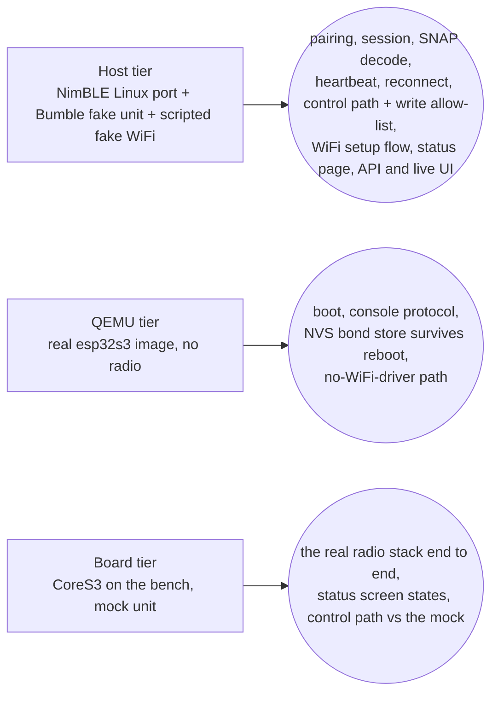
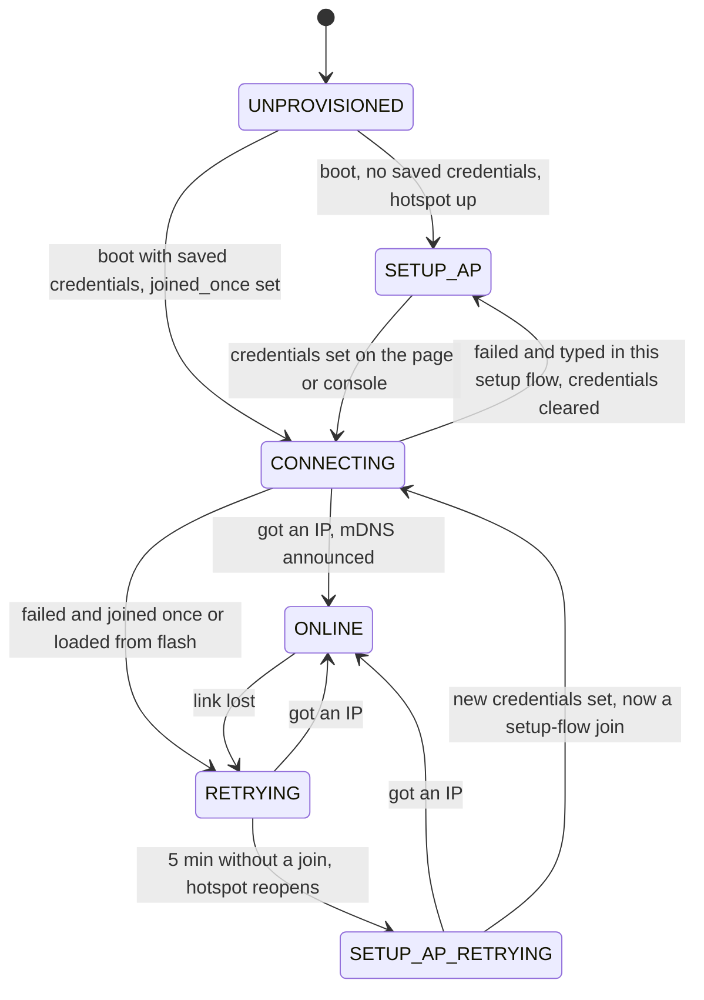

# ESP32 firmware (satellite, #154)

**Status: sub-projects 1 and 2b/3a of #154 + the status display + the control path (#154 B) —
reads everything and controls the cooler, camping mode, lighting (since 2026-10-07 the wake-up
light too, with the web page's clock), air heater and energy mode (no roof). Bonded to the real
{term}`camper unit` since 2026-10-08 (paired while {term}`buspi` stayed connected — the unit serves several
centrals at once) and controlling it live; before that proven on the Linux host tier against the
{term}`fake unit <Mock unit>`, in QEMU, and on the {term}`CoreS3 <Satellite>` bench against the mock unit. It holds its link while the van
is parked (#279), runs the same water guard as calictl, and answers a write whose link dropped
after the frame went out as *{term}`unconfirmed`* (#271).** ESP-IDF + NimBLE firmware for an
ESP32-S3 "satellite" (the M5Stack CoreS3) that pairs with the camper unit and reads its state
independently of `calictl`/buspi — the explicit target for the pairing state machine
(`calictl/pairing.py`, `R_PAIRING_SM`) that the web wizard already runs. Its writes are the `1003`
{term}`liveness heartbeat <Heartbeat>` (the same one the Pi build uses to keep reads fresh) and, since #154 B, the
control frames of five functions — the same bytes `calictl.control` builds, held identical by
golden vectors, through one write allow-list that never admits the roof's `1401` (see
[Control path](#control-path) below). Everything here is proven on Linux (a NimBLE host build
against a fake unit) and on an emulated chip (QEMU); a real CoreS3 runs it on a Linux bench
against the mock camper unit (the Board tier below) and in the van against the real unit (DEVICE
rows in `docs/business-logic/evidence-ledger.md`; `firmware/README.md`'s "On-board verification"
section is the checklist that run followed). Since the WiFi/web
slice the firmware also joins a WiFi network (set up through its own hotspot + captive portal) and
serves a status page + JSON state API and, on the home network, the calictl web UI with its
controls live — see [Network: WiFi setup and the status page](#network-wifi-setup-and-the-status-page)
below, and the owner how-to [How to put the ESP32 satellite on your WiFi](howto-esp-wifi-setup.md).

The full build/porting detail (every NimBLE/Bumble adaptation, exact pins, warnings policy) lives
in [`firmware/README.md`](https://github.com/ckeller42/open-california/blob/main/firmware/README.md)
in the repository; this page is the traceability + orientation view.

## Three test tiers



| Tier | What it proves | What it cannot prove | Run locally |
|---|---|---|---|
| **Host + Bumble** (CI `firmware-host-e2e`) | The firmware's C code — pairing runner, session, console — driving the **real upstream NimBLE host stack** (Linux port) over HCI-over-TCP against a Bumble virtual controller linked to the repo's fake unit (`tools/fake_unit_peripheral.py`). Proves pairing (KEYBOARD_ONLY + MITM + SC), bond persistence/reconnect, the full `SNAP` read-all against `calictl.protocol.decode`, the 1003 heartbeat, notification push, link-drop recovery, that the unit sees no control write while no command is sent — and the control path (`tests/firmware/test_control_e2e.py`): every app-recorded cooler/camping/lighting/air-heater/energy action sent through `POST /api/command` reaches the fake unit byte-exact with the lighting commit ≥ 300 ms after its frame (since 2026-10-07 the app's wake-up edits too, the REQUEST_CONFIG pull included), the console `set` too, roof, stairs, clock-less wake-up and unknown commands and a roof, `1003`, wrong-length or empty frame handed straight to the transport write nothing (the allow-list choke point), `403` over the setup hotspot, `409` while a command runs, an ATT refusal is `502` with no commit, the heartbeat keeps ticking through commands. | Nothing about the real esp-nimble port or a real radio — this is upstream NimBLE 1.10 on Linux, not the ESP-IDF-vendored esp-nimble 1.6-based stack (gap documented in `firmware/README.md` Pins). | `firmware/host/fetch_nimble.sh && make -C firmware/host cali-host && python -m pytest tests/firmware -v` (Linux only, needs a 32-bit toolchain — see `firmware/README.md` "Host build notes" for the Docker recipe on macOS) |
| **QEMU boot** (CI `firmware-qemu`) | The **real ESP-IDF image** (compiled for the esp32s3) boots in Espressif's QEMU: the console line protocol on the no-controller path, and the NVS-backed bond store (`cali_kv_*`) surviving a reboot, including a CRC-broken record recovering as "unpaired" instead of crashing. | Bluetooth — QEMU's esp32s3 machine has no radio, so BLE stays with the host tier and hardware. | `docker run --rm -v "$PWD":/project -w /project/firmware espressif/idf:v6.1 bash -c '. $IDF_PATH/export.sh >/dev/null && idf.py -B build-qemu -D SDKCONFIG=build-qemu/sdkconfig -D SDKCONFIG_DEFAULTS="sdkconfig.defaults;qemu/sdkconfig.qemu" build && cd /project && pip install -q pytest && CALI_QEMU=1 python -m pytest tests/firmware/test_qemu_boot.py -v'` |
| **Host web e2e** (CI `firmware-host-e2e`, `tests/firmware/test_web_e2e.py`) | `cali-host --http PORT --fake-wifi SCRIPT`: the WiFi runner, captive DNS and web endpoints on the same 100 ms tick as the BLE session, over `net_host.c` (POSIX sockets on 127.0.0.1 + a scripted fake WiFi radio) and the Bumble fake unit. Proves the setup flow (fresh boot -> setup mode -> POST credentials -> station), a wrong password falling back to setup with the credentials cleared, saved credentials reconnecting after a restart + `DELETE /api/wifi`, `/api/state` equal to the console's `SNAP` after pairing, a WiFi loss leaving the BLE link and heartbeat alone, the page rendering in Chromium (EN + DE), the setup flow clicked in Chromium (a wrong password shows the wrong-password text, the right one the `http://calictl-esp.local` link; EN + DE), and the pairing wizard over `/api/pairing` in station mode and over the setup hotspot (`test_pairing_web_e2e.py`: wrong passcode, pairing screen closed, stale bond, `409 busy`, clicked in Chromium EN + DE). | The real esp_wifi/lwIP/mdns stack, a real phone's captive-portal detection, radio coexistence — the fake WiFi only replays the script's outcomes. | `tools/ci.sh firmware` (Linux; on a Mac see `firmware/README.md` "Host build" for the Docker recipe) |
| **QEMU no-WiFi-driver** (CI `firmware-qemu`, `test_qemu_boot.py::test_no_wifi_driver_boots_and_serves_nothing`) | The QEMU image is built with `CONFIG_CALI_WIFI=n` (no esp_wifi call compiled in): it logs `LOG wifi: driver unavailable` once, keeps WiFi off (`status` has no `wifi` member, `wifi status` -> `LOG wifi: not enabled`), listens on nothing, and does not reboot — the same path a board takes when `esp_wifi_init`/`esp_wifi_start` fails. | Anything about a working WiFi driver (QEMU's esp32s3 has no WiFi). | The QEMU command above |
| **Board** (bench, not CI) | The real CoreS3 on a Linux bench against the mock camper unit (`tools/applab/fake_unit_ble.py` on a USB BLE dongle) and a second WiFi stick: flashing from `flasher_args.json`, the USB-Serial/JTAG console, esp-nimble passkey pairing + reconnect by bond, the setup hotspot -> `POST /api/wifi` -> station join, and the spec's seven status-display states (setup, joining, online, pairing, connected, stale, link lost) + dimming by remote `screenshot` (2026-10-01, `tools/esplab_display_walk.sh`; dated rows in `docs/business-logic/evidence-ledger.md`). **The control path ran on the board 2026-10-07:** `tools/esplab_control_walk.py --url http://calictl-esp.local --fifo … --record …` against the mock unit — every app-recorded action byte-exact at the mock (31 cases, 3 clean walks — a firmware before the wake-up light; 2026-10-08 again with it, 32 cases incl. the app's wake-up edits and a wake-up card edit from Chromium), roof/wake-up refused with no `1401`, console `set`, `403 setup_mode` over the real setup hotspot, the heartbeat through commands, the 30 s water re-read, and a fridge toggle from the UI in Chromium (BOARD rows in `docs/business-logic/evidence-ledger.md`). **The pairing wizard ran on the board 2026-10-08:** unpair/reset, pair in station mode and over the setup hotspot's `/app`, a wrong passcode retried, `403` for a control write over the hotspot. **Probe before replace ran on the board 2026-10-08:** *Connect now* with the unit's pairing screen closed keeps the working bond (no passkey, `SNAP` flows); after the unit forgot its bonds a passkey re-pair bonds afresh; with the unit gone the bond is kept and the satellite reconnects on its own once it is back (hardware watch item 10 found on the way). | The real camper unit (the bench has only the mock; the van's DEVICE rows since 2026-10-08 cover the real unit), a phone's captive portal, the van's radio environment, the control path against a real unit's ACK timing and refusals (the mock ACKs at once), the water *stale push then correct read* ordering (not stageable with the mock's console; session-fake tier only), and the hardware watch items below that need the real unit. | `tools/esplab_display_walk.sh` on the bench (header lists its env); `firmware/README.md` "Status display" |
| **Pure-C unit tests** (in the normal `test`/`pytest` job, no BLE) | The pairing state machine (`pairing_sm.c`) replays the same golden vectors as `calictl.pairing`; the runner and the session+console compile and run against scripted fake transports on any host with a C compiler (macOS included). The network pieces too: the WiFi SM replays `tests/vectors/wifi_sm.json` from its Python twin (`tools/wifi_sm_ref.py`), the HTTP core (`http_core.c`), captive DNS (`captive_dns.c`), web handlers (`web.c`, incl. `POST /api/command` against a fake sequencer), JSON writer and the host `cali_net` (`net_host.c`) each run under a small C driver, and the WiFi runner runs next to the BLE session in `test_session_fake.py`. The control twin (`control.c`) replays every vector of `tests/vectors/control.json` byte for byte and its allow-list is scanned exhaustively (`test_control_parity.py`; the Linux host tier repeats both with an i686 `-m32` build, the ESP32-S3's 32-bit `long`); the sequencer (`control_run.c`) runs against the scripted transport in `test_session_fake.py` (arming, one at a time, ATT error, link drop, late ACK, interleaved heartbeat/notify, the follow delay). | Real NimBLE call sequencing (that's the host tier's job); real sockets under load; any radio. | `python -m pytest tests/firmware/test_pairing_sm_parity.py tests/firmware/test_runner_fake.py tests/firmware/test_session_fake.py tests/firmware/test_wifi_sm_parity.py tests/firmware/test_http_core.py tests/firmware/test_captive_dns.py tests/firmware/test_web_handlers.py tests/firmware/test_json.py tests/firmware/test_net_host.py tests/firmware/test_control_parity.py -v` |

CI also builds the release esp32s3 image compile-only (job `firmware-build`, container
`espressif/idf:v6.1`, uploads the images + `flasher_args.json`) — it does not run the image
anywhere, just proves `cali_core` + `cali_ble_nimble` (unchanged from the host build) compile
clean against ESP-IDF's real esp-nimble under the host's `-Wall -Wextra -Werror` strictness.

## Console line protocol

Identical on the host build (stdin/stdout) and the device (UART/USB-Serial-JTAG console) —
`firmware/components/cali_core/include/cali_console.h`:

- **In**, one command per line: `pair` (start pairing), `passkey N` (the code the unit displays,
  ignored unless waiting for one), `forget` (drop the bond), `status` (reprint `STATE`), `quit`
  (host only — exits the process; no-op on the device), the WiFi commands `wifi set <ssid>
  <psk>`, `wifi status`, `wifi forget`, `wifi scan` (see [the network section](#network-wifi-setup-and-the-status-page);
  `LOG wifi: not enabled` while WiFi is off), and `set <function> <what> [value]` — a control
  command in calictl's `set` vocabulary (`set cooler power on`, `set lighting kitchen 5`,
  `set lighting save_profile 3 amber`; the value is the rest of the line, `""` when absent), see
  [Control path](#control-path). The console is physical access (USB), so `set` works in every WiFi
  mode; it answers `LOG control: <fn>/<what> …` lines — `sending` then `sent`, or `refused: <reason>`,
  `bad value`, `no such control`, `not ready (no armed link or no state yet)`, `busy`, or a
  failure (`failed: the unit refused the write`, `failed: write not issued`, `failed: link lost`,
  `timed out`).
- **Out**, one line each: `STATE {json}` (the pairing state machine's snapshot — the same keys as
  calictl's `/api/pairing`; the `status` command's line gains a `"wifi"` member once WiFi runs), `SNAP {"t":ms,"fn":{...}}` (every function the session holds a frame
  for, `codec_decode`d, in `CODEC_CHARS` order), `LOG text` (everything else, including every
  watch item below).

The session's read-all follows `calictl.device.read_all`: subscribe every notifying {term}`state char <GATT characteristic>`,
let the 1003 heartbeat run `CODEC_HEARTBEAT_WARMUP_MS` (generated from
`calictl.device.HEARTBEAT_WARMUP_S`'s default, 2 s) so the liveness registers and sensors refresh,
then read every function in order. A read completion and a notification both replace the
function's frame, so the **last frame to arrive wins** — the app's order (it subscribes, then
reads, and one decoder takes both; decompile 2026-10-07, calictl `R_READ_LAST_FRAME_WINS`). The
old "a notification beats the read latch" rule (the session skipped the read of a pushed function)
is gone: a stale water push on the subscribe no longer hides the correct read. The first `SNAP` of
a link follows that pass.

While the link stays up, **water (`1302`) is re-read every `CALI_SESSION_WATER_REREAD_MS` (30 s)**
after the read-all; its completion replaces the frame and prints a `SNAP`. 30 s is calictl's
`POLL_INTERVAL`, at which calictl reads 1302 on every poll; the ESP has no other periodic re-read
(it holds one link and otherwise lives on notifications), so this is the one timer. A parked latch
served at connect is corrected on the same link, no reconnect needed. Only water is re-read here.
This is a calictl-ism, not the app's: the app has no 1302 re-read timer at all (its only periodic
re-reads are screen pollers for 1102/1602/1902/1004 while those screens are open); it gets a fresh
1302 read on every reconnect instead.

## Network: WiFi setup and the status page

The firmware joins a WiFi network and serves a status page, a JSON state API and — in station mode
— the calictl web UI with `POST /api/command` on port 80 — the same C code on the host tier
(`cali-host --http`) and the device. Owner-facing steps:
[How to put the ESP32 satellite on your WiFi](howto-esp-wifi-setup.md).

**Pieces** (`firmware/components/cali_core/`, all platform-free C99, no malloc, reaching the network
only through the `cali_net_t` socket/WiFi table in `include/cali_net.h`):

| File | Role |
|---|---|
| `wifi_sm.c` | The WiFi provisioning/connectivity state machine — a line-for-line C twin of `tools/wifi_sm_ref.py` (no strings, radio or clock; time only as `WEV_TICK`'s argument). |
| `wifi_run.c` | The WiFi runtime: feeds `cali_net` events + ticks into the SM, runs its actions on `cali_net`, the captive DNS and the kv store, and owns the one BLE-coex gate (scans). |
| `http_core.c` | A single-connection HTTP/1.1 responder (below). |
| `captive_dns.c` | The setup hotspot's DNS: every A query answered with `192.168.4.1`, plus the table of OS captive-portal probe paths. |
| `web.c` | The endpoints and the page. |
| `snapshot.c` | The `fn` object shared by the console's `SNAP` and `/api/state`. |
| `status.c` (`include/cali_status.h`) | `cali_status_get()`: one `cali_status_t` snapshot (pairing state + bonded address, link up, last-`SNAP` age, WiFi mode/SSID/IP/RSSI/last failure, uptime, fw). `/api/state`'s `device` block and the screen both read it, so they cannot disagree. |
| `display_model.c` (`include/cali_display_model.h`) | The pure status-display model: a `cali_status_t` in, three rows (colour + EN/DE text), the footer mode and the brightness out — no LVGL, no clock (`R_FW_STATUS_DISPLAY`). |
| `components/cali_display/` (board build only) | The CoreS3 painter: the `espressif/m5stack_core_s3` board package + LVGL, ticked every `DISPLAY_REFRESH_MS` from the main loop, plus the `screenshot` console command (`shot.c`). Excluded from the host and QEMU builds (`CONFIG_CALI_DISPLAY`). |

Platforms: `components/platform/host/net_host.c` (POSIX sockets on 127.0.0.1 + a scripted fake WiFi,
`cali_net_host.h`) and `components/platform/esp/net_esp.c` (esp_wifi + esp_netif + lwIP sockets +
the `espressif/mdns` component, pinned `==1.13.1`). The constants are generated into
`csrc/net_consts.h` from `tools/wifi_consts.py` (`R_NET_CONSTS_SINGLE_SOURCE`): setup SSID
`calictl-esp-setup`, passphrase `calictl-setup`, address `192.168.4.1`, hostname `calictl-esp`
(DHCP + mDNS `calictl-esp.local`, `_http._tcp` on port 80), `NET_AP_CLOSE_MS` 30000,
`NET_RETRY_MIN_MS` 1000 -> `NET_RETRY_MAX_MS` 60000, `NET_SETUP_AFTER_MS` 300000, page poll
`NET_PAGE_POLL_MS` 2000, `NET_JSON_MAX` 8192, SSID 1–32 bytes, PSK 8–63 bytes.

### The WiFi state machine



Not drawn: `CREDS_FORGET` (console `wifi forget`, `DELETE /api/wifi`) goes from **every** state to
`SETUP_AP` — station stopped, credentials erased, hotspot up. Rules the diagram compresses:

- **Retry.** In `RETRYING`/`SETUP_AP_RETRYING` the station re-joins on a backoff that starts at
  1000 ms and doubles to a 60000 ms cap; saved credentials are **never** wiped by a failure there.
- **Credentials from flash count as "joined once"** (ruling R6): booting with saved credentials and
  an unreachable router retries forever — after 5 min the setup hotspot opens alongside
  (`SETUP_AP_RETRYING`), the retries go on. Only credentials typed in the current setup flow are
  cleared by a failed join (a typo never bricks setup: back to `SETUP_AP`, hotspot still up).
  "Saved" means saved **and joined**: kv `wifi_ok` is `0` from `wifi set`/`POST /api/wifi` until the
  first IP makes it `1`. Credentials that never joined (a typo, then a power cut before the failure)
  boot through `SETUP_AP` into a setup-flow join instead, so a failure clears them (#273 M1). No
  `wifi_ok` key (stored by older firmware) counts as joined.
- **Hotspot close.** Once `ONLINE`, a hotspot that is still up closes 30000 ms later (the phone that
  did the setup gets to see the "connected as" answer first).
- **Replacing credentials** (`wifi set` or a `POST /api/wifi` while online/retrying/mid-join,
  rulings R14/R16): the runner takes the SM through a forget that keeps the new credentials (station
  down, hotspot up) and joins them as a setup-flow join — a typo lands the device back in setup,
  like a first-time flow, and the old network is not restored.
- **Mode** reported by the page and console (`cali_wifi_mode`): `setup` in `SETUP_AP` /
  `SETUP_AP_RETRYING`; `station` in `ONLINE`, and in `CONNECTING`/`RETRYING` when `joined_once`;
  `off` otherwise (`UNPROVISIONED` = WiFi off, and a setup-flow join in progress).

Console lines (`LOG wifi: …`, exact texts from `cali_wifi_run.h`/`console.c`): `setup hotspot up
(calictl-esp-setup)`, `setup hotspot closed`, `joining <ssid>`, `online <a.b.c.d>`, `lost`,
`failed <not_found|auth|other>`, `credentials cleared`, `credential erase failed`, `credentials
replaced, reconnecting`, `setup hotspot failed to start`, `captive DNS unavailable`; from `wifi set`
also `usage: wifi set <ssid> <psk>`, `bad ssid`, `bad psk`, `storing credentials failed`; before the
WiFi runtime booted `not enabled`; on the device also `driver unavailable`. `wifi status` answers `LOG wifi:
<setup|station|off> ssid=<ssid|-> ip=<a.b.c.d|-> rssi=<dBm|-> scan=<n>`. The passphrase is never
printed: the console does not echo input, an unknown/mistyped `wifi` line is logged by its first
word(s) only, and the line buffers are wiped after every command (on the ESP the console queue's
slot keeps its copy until a later line reuses it).

### Endpoints (`web.c`, contract in `include/cali_web.h`)

**HTTP caching.** Every static answer (`/`, `/app`, `/device`, the manifest, the icons) carries a
strong `ETag`: the quoted FNV-1a 64 of the exact bytes served (`web.c` `set_static`), so it changes
with them on any build, a dirty local one included. A `GET` whose `If-None-Match` lists it (or is
`*`; weak `W/` matches too) is answered `304 Not Modified` by the HTTP core: no body, no
`Content-Type`/`Content-Length`, `ETag` and `Cache-Control` kept. The HTML and the manifest stay
`no-cache` (revalidated on every load, so an OTA shows at once; an unchanged UI costs a ~200 B
304 instead of the 65 KB bundle). Dynamic JSON (`/api/state`, `/api/wifi`, `/api/pairing`) is
`Cache-Control: no-store`, never an `ETag`. buspi's `calictl/web.py` does the same for its static
`calictl/webui/` files (a SHA-256 prefix tag, `no-cache`); its `/api/*` stays `no-cache`.

| Method + path | Answer |
|---|---|
| `GET /` | Station mode: 200 `text/html; charset=utf-8` — the calictl web UI bundle, `app_bundle_gen.h`'s `WEB_APP_HTML_GZ` with `Content-Encoding: gzip` and `Cache-Control: no-cache` (see [the satellite UI](#the-satellite-ui-r_fw_shared_ui)). Setup/off mode: the setup page (as `GET /device`). Every static answer here and below carries a strong `ETag` (see *HTTP caching* under this table). |
| `GET /device` | 200 `text/html` in every mode — the WiFi setup page (the provisioning form, shown over the setup hotspot or while a join runs; the status rows live in the calictl UI's Device status screen since #267): `strings_gen.h`'s `WEB_INDEX_HTML`, the byte array generated from `firmware/web/index.html` + `page.js` + `strings.json` (EN + DE) by `tools/gen_c_dict.py`; it links to the calictl UI — `/` in station mode ("Open the camper UI"), `/app` elsewhere ("Open the camper UI to pair the unit" while no bond is stored). One source of bytes on both tiers; no `EMBED_FILES`, no LittleFS. |
| `GET /app` | 200 the calictl web UI bundle (as `GET /` in station mode) in **every** WiFi mode — over the setup hotspot `/` is the setup page, and `/app` is where the pairing wizard is reached (`R_FW_PAIRING_WIZARD`). |
| `GET /manifest.webmanifest`, `/sw.js`, `/apple-touch-icon.png`, `/icon-192.png`, `/maskable-icon-192.png`, `/favicon.ico`, `/favicon-32x32.png`, `/favicon-16x16.png` | 200 in **every** WiFi mode, the manifest `Cache-Control: no-cache`, the icons `max-age=86400` (never `immutable`: their URLs never change), each with an `ETag` — the home-screen files the UI bundle links (`application/manifest+json`, `image/png`, `image/x-icon`): `firmware/web/pwa_assets_gen.h`, generated by `tools/gen_c_dict.py` (`pwa_assets`) from the same `calictl/webui/` files buspi serves. The icons are byte-for-byte; the manifest is derived — only the icons served here (no 512 px, flash) and `start_url` `/app`, the UI in every mode. 70,230 B of flash, outside the bundle's `WEB_APP_GZ_MAX`. Plus `/sw.js` (`text/javascript`, `no-cache`), the offline shell's service worker, registered only on HTTPS (`R_UI_PWA_OFFLINE`). |
| `GET /api/pairing` | 200 calictl's `pairing_snapshot()`: `{"state","attempts","error","address","radio_busy":false}` — the console `STATE` members (one emitter, `cali_snapshot_pairing`); `address` = the bonded identity while bonded, or idle/error with a stored bond. |
| `POST /api/pairing` | calictl's wizard request `{"action":"start"\|"passkey"\|"cancel"\|"reset","value":"<6 digits>","confirm":true}`, in **every** WiFi mode (connection management, not a control write). web.py's checks in its order, calictl's error bodies `{"error":<code>}`: 400 `bad_json` (the fixed-shape parser: unknown keys, a non-string `action`, a non-bool `confirm`), 400 `bad_action`, 400 `confirm_required` (reset without `confirm:true`), 400 `bad_passkey` (not a 6-digit **string**), then 409 `busy` for `start`/`reset` while a control command is pending (the single link is in use). Then the runner — `start` = console `pair` (idempotent: ignored unless idle/error), `passkey` = `passkey N` (ignored unless waiting), `cancel` (only while a flow runs, scanning … verifying; otherwise a no-op, so a stale cancel never drops a bonded link), `reset` = `forget` (drops the bond) — and 200 with the post-action snapshot. Deliberate differences from calictl: Content-Type is not checked (calictl: 415), unknown keys / a non-string `action` / a non-bool `confirm` are `bad_json`, a `cancel` outside a flow changes nothing. |
| `GET /api/state` | 200 JSON `{"t","fn","device"}` — `fn` = the `SNAP` object (every function the session holds a frame for, `codec_decode`d, `CODEC_CHARS` order); `device` = `pairing {state,address}`, `link {up,last_snap_age_ms}`, `wifi {mode,ssid,ip,rssi}`, `control {writes}` (`POST /api/command` accepted: station mode), `uptime_ms`, `fw`, `ota {state,available_sha,progress_pct,error}` (`R_FW_OTA`), `time {source,synced,boot,up}` (`R_FW_TIME`), `sd {state,total_mb,free_mb,last_seq,dropped}` (`R_FW_SD_LOG`), `res {heap_free_kb,heap_min_kb,psram_free_kb,cpu_pct}` (the satellite's own resources; each `null` when unknown), `battery {pct,mv,usb,charging,runtime_min}` (`R_FW_BATTERY`; each `null` when unknown — host, QEMU), `auto_camper {enabled,state}` (`R_FW_AUTO_CAMPER`; `state` `idle`/`armed`/`restoring`), `display {state,lux,prox,brightness_pct,sensor,auto,prox_wake,min,max,offset}` (`R_FW_DISPLAY_WAKE`; the live members `null` without a screen — host build, QEMU), `ux {enabled}` (the "Send usage data" switch, [UX telemetry](#ux-telemetry-r_ux_telemetry)), `water_held` (`fn.water` is the held last-plausible reading), `water_held_age_ms` (only while held and the baseline was measured on this boot — an NVS-restored one has no time; the UI shows "🕒 measured 2 h ago"). Built whole in one handler call into the `NET_JSON_MAX` (8192 B) buffer (a full 14-function snapshot is ~4.5 KB); overflow -> 500 + `LOG http: overflow`. |
| `GET /api/wifi` | 200 JSON `{"mode","ssid","ip","rssi","last_error","scan":[{"ssid","rssi","secure"}]}` (the last scan's list, up to 16); `last_error` is why the last join failed (`"not_found"`, `"auth"`, `"other"`) or `null` (none yet, or cleared by new credentials or by joining) — the setup page turns it into one of three texts; in setup mode it also asks for a fresh scan for the next GET. |
| `POST /api/wifi` | Body exactly `{"ssid":"…","psk":"…"}` (fixed-shape parser). SSID 1–32 bytes, PSK 8–63 bytes (open networks unsupported) -> stored in the kv store, handed to the runner -> 200 `{"ok":true}`; else 400 `{"ok":false,"error":"json"|"ssid"|"psk"}`, a kv failure 500 `"store"`. |
| `DELETE /api/wifi` | Forget the WiFi (-> `SETUP_AP`) -> 200 `{"ok":true}`. |
| `POST /api/command` | calictl's control request `{"function","what","value","confirm"}` plus the optional `local_now` (the page's clock for `lighting wakeup`, see [Control path](#control-path)) (`value` a string, integer or null — booleans/fractions/nesting 400 `bad_json`). **Station mode only**: anywhere else 403 `setup_mode` (ruling B: never over the setup hotspot). Then web.py's 400 `missing_function_or_what` / `confirm_required` (airheater, roof), then the sequencer (`cali_control.h`): accepted -> the answer waits for the write ACKs (`CALI_HTTP_PENDING`, <= `CALI_CTL_DEADLINE_MS`) -> 200 `{"ok":true,"applied":null,"state":null,"error":null,"function":fn}` (`applied` never true: no readback; plus `"unconfirmed":true` when the link dropped after a frame went out — it may have landed, #264) or 502 `write_failed` / 504 `write_timeout`; a gate or "Only via buspi or the app" -> 200 `{"ok":true,"applied":false,"refused":<text>,…}`; 400 `bad_value` / `unknown_control`, 409 `busy`, 503 `not_connected`. The core caps a pending answer at `CALI_HTTP_PENDING_MAX_MS` (2 x the deadline; 504 text/plain) so a handler that never answers cannot wedge the single connection. Deliberate differences from calictl: Content-Type is not checked (calictl: 415), `-0` passes as the text `"-0"` (refused as not on/off where calictl reads OFF — the safe direction), a >= 64-byte value is `bad_json` before the gates (the console `set` gates first; both refuse). |
| `GET /api/log?since=<seq>&max=<n>` | One page of the SD log for buspi's `calictl esp-ingest` (`R_FW_LOG_API`, [below](#sd-log-r_fw_sd_log)), in every WiFi mode: 200 `application/x-ndjson`, the record lines with `seq > since`, oldest first, at most `max` (default 2000) and what fits the 400 KB PSRAM page buffer, then the trailer `{"next":<last seq sent, or since>,"more":<bool>,"boot":<current boot>,"lost":<n>}`. 400 `bad_value` (any other query), 503 `no_card` / `sd_read`, 409 `busy`, 405 `method`. |
| `POST /api/ota` | `{"action":"check"\|"install"}` (`R_FW_OTA`, [Firmware update from GitHub](#firmware-update-from-github-r_fw_ota)): starts the OTA task -> 200 `{"ok":true}` at once, progress in `/api/state` `device.ota`. Station mode only (403 `setup_mode`), 400 `bad_json`/`bad_action`, 409 `busy`, 503 `ota_unavailable` (host build, QEMU). |
| `POST /api/auto_camper` | `{"enabled":<bool>}` (exactly that object; serve's endpoint, `R_FW_AUTO_CAMPER`): saves the toggle -> 200 `{"ok":true,"auto_camper":<bool>}`. Station mode only (403 `setup_mode`), 400 `bad_json`, 500 `store`. |
| `POST /api/display` | `{"auto"?,"prox_wake"?,"min"?,"max"?,"offset"?}` (`R_FW_DISPLAY_WAKE`, [Screen wake and brightness](#screen-wake-and-brightness-r_fw_display_wake)): merged into the stored settings -> 200 `{"ok":true}`. Station mode only (403 `setup_mode`), 400 `bad_json` (another key, a key twice, a non-bool flag, a non-integer percent), 400 `bad_value` (min 1–50, max 20–100, min < max, offset −50…50), 500 `store`. |
| `POST /api/ux` | The web UI's usage beacon (`R_UX_TELEMETRY`, [UX telemetry](#ux-telemetry-r_ux_telemetry)): calictl's `web.ux_batch` shape and rules. Station mode only (403 `setup_mode`), body > 2048 B 413 (the core's 2 KB request buffer answers most of those first); "Send usage data" off -> 204, nothing recorded; not exactly the shape -> 400 `{"error":"bad_ux"}` (calictl's body); else one SD record per event and 204. Content-Type is not checked (a beacon string is text/plain). |
| `POST /api/ux_setting` | `{"enabled":<bool>}` (exactly that object): the `/device` "Send usage data" switch -> kv `ux_on` -> 200 `{"ok":true,"ux":<bool>}`. Station mode only (403 `setup_mode`), 400 `bad_json`, 500 `store`. |
| other method on `/api/state`, `/api/wifi`, `/api/command`, `/api/ota`, `/api/auto_camper`, `/api/display`, `/api/ux`, `/api/ux_setting` or `/api/pairing` | 405 `{"ok":false,"error":"method"}` |
| an OS captive-portal probe path (setup mode) | 302 `Location: http://192.168.4.1/` — `/generate_204`, `/gen_204` (Android), `/hotspot-detect.html`, `/library/test/success.html` (Apple), `/connecttest.txt`, `/ncsi.txt` (Windows), `/canonical.html`, `/success.txt` (Firefox) |
| any other path | setup mode: 302 `Location: /`; station mode: 404 |

**HTTP core** (`include/cali_http.h`):
one connection at a time, one request per connection, every response `Connection: close`;
requests up to `NET_HTTP_REQ_MAX` (2048 B) of headers, no chunked bodies (400), 413/431 on
oversize; the response is streamed across as many ticks as the socket needs (`tcp_send` "would
block" = retry next poll — never blocks, never spins); a connection idle for `CALI_HTTP_IDLE_MS`
(5000 ms) is closed — one that has sent no byte yet after `CALI_HTTP_FIRST_BYTE_MS` (1000 ms), so a
preconnect or captive-portal probe cannot hold the core for 5 s — except while a handler's answer is pending (`CALI_HTTP_PENDING`, below). The
page polls `/api/state` every 2000 ms; while a command pends the single connection is held, so a
poll waits up to the command's deadline (the UI shows "Sending…", never the offline banner).

### The pairing wizard (`R_FW_PAIRING_WIZARD`)

The satellite pairs from its web page with the **same** wizard calictl serves on buspi (⋮ →
*Bluetooth pairing…*, or the *No camper unit is paired yet* banner's *Set up remote control*):
`/api/pairing` answers in calictl's contract, so `calictl/webui/app.js` runs it unchanged. The
endpoint is a thin mapping onto the runner the console drives — `start` = `pair`, `passkey` =
`passkey N`, `reset` = `forget`, plus `cancel` — so the console and the page can never disagree
(both read one emitter). It works over the **setup hotspot** too: there `/` is the setup page, and
the device page links to `/app` (*Open the camper UI to pair the unit*), the UI in every mode,
read-only (controls stay station-only). Only the device-specific hints differ from buspi's: no Pi
scanner, daemon or `CALICTL_ADDR` advice; instead *until the satellite connects*, *stop a
Raspberry Pi with calictl near the van*, *Saved on the satellite — survives a restart*.
`radio_busy` is always `false` (no co-resident scanner). When a flow ends without a new bond —
cancelled, failed (`error`) or reset — the session reconnects by a kept bond as at boot, like
calictl's poll resuming once the flow is idle/error. `start`/`reset` are `409 busy` while a
control command holds the link.

**Probe before replace** (calictl's #201, `pairing_bluez.connect` / `_probe_bond`): starting the
wizard never destroys a working bond. When the unit the scan found is the one the bond is for
(its resolvable address resolves with the bond's IRK — `ah()`, PSA crypto), the transport
connects by the bonded identity and `pair()` first re-encrypts with the stored key. A key that
works is **kept**: `ENC_OK` without SMP, the runner reads `1004` and the flow ends `bonded` — even
with the unit's "Gerät verbinden" screen closed. Only proof that the key is stale drops it: the
unit answers the encryption with an authentication-class status (HCI `0x05` / `0x06`) — the bond is
deleted and a fresh SMP pairing runs on the same link — or hangs up for that reason (NimBLE first
reports the drop as an encryption result `BLE_HS_ENOTCONN`; the probe waits for the disconnect
reason), and the runner's retry pairs afresh. Anything else (an unreachable unit =
`connect_failed`, a link lost for another reason such as `0x13`, a timeout) keeps the bond, and
the retry probes again; unlike calictl, a link that came up but never encrypted is not taken
as proof (NimBLE reports a definite status; the user still has *Bluetooth reset / re-pair*). A
unit no stored bond matches — another camper, issue #255 — is paired as before; **one bond only** (#255): once a pairing is
verified (`bonded`: encrypted, the auth char read — the runner's `PERSIST_BOND`, any pair path:
console `pair` or the wizard) the transport deletes every other stored bond
(`keep_only_bond`, `LOG ble: dropped the bond of another unit`), so the next boot reconnects to the
unit just paired and `address` is its identity. A pairing that fails or is cancelled before that
keeps the old bond. The match runs over **every** stored bond: by identity, compared type-agnostically
(a controller that resolved the address reports it typed `PUBLIC_ID`/`RANDOM_ID`, the bond is
stored typed public/random), or by the RPA resolving with that bond's IRK; a PSA failure is logged
(`LOG pair: psa_… failed`) and the unit treated as unbonded. An SMP pairing that starts (passkey,
repeat-pairing) ends the probe, so its encryption result is never reported as "the stored bond
works". Logs show the raw HCI code (`0x06`), not NimBLE's wrapped `0x206`.

On the CoreS3 (BOARD 2026-10-08) the ESP32-S3 controller already resolves the unit's address in
the scan (the bond's IRK is on its resolving list): the advertising report carries the identity
with a *resolved* address type (`BLE_ADDR_PUBLIC_ID`/`RANDOM_ID`). In that board run the match
compared the type too, so it did not fire and `LOG pair: the unit found is our bonded peer …`
never printed — the connect to that resolved address still reached the same identity and the
probe ran on it (`pair: probing the stored bond`). Since then identities are compared
type-agnostically, so the board path logs the match too (board-verified 2026-10-08 on `013877a`). The
host-side `ah()` path only matters on a controller that does not resolve; PSA `ah()` itself was
checked on the board against the Core spec sample vector (Mbed TLS 4). Evidence ledger, "ESP32
satellite probe before replace — BOARD rows".

### Control path

The satellite sends control frames for **five functions — cooler (`1101`), camping mode (`1201`),
lighting (`1501`), energy (`1601`), air heater (`1701`)** — and nothing else. **Not the roof:** it
answers the refusal `Only via buspi or the app` (the UI greys it with the same words), an owner
ruling (a motor on a satellite with no ignition gate of its own). Every lighting command is
carried: `door_contact`, `profile`, `save_profile N [colour]` (with the SET_COLOR preface), the
zones, `power`, `all` and, since 2026-10-07, `wakeup` (below).

**The wake-up light** (`R_FW_WAKEUP`, spec `2026-10-07-esp-wakeup`). *Decision 3 of the control-path
plan — "the wake-up light stays with buspi or the app, the ESP has no clock and no latch" — was
superseded on 2026-10-07 by spec 2026-10-07-esp-wakeup.* The edit needs two things the ESP does not
have on its own, and gets them like this:

- **The clock is the web page's.** The shared UI adds `local_now` to every `lighting wakeup`
  request: the browser's wall clock read as UTC, `Math.floor((Date.now() - new
  Date().getTimezoneOffset() * 60000) / 1000)`, the same "local time packed as UTC" the app uses, so
  the unit wakes at the HH:MM the user typed in the browser's own time zone. calictl accepts and
  ignores it; the C twin's wake-up builder uses it as its only clock (no SNTP, no time-zone
  setting). `local_now` must be a JSON integer ≥ `1767225600` (2026-01-01T00:00Z), else `400
  bad_value`; missing or `null` → refused with *the wake-up light needs the time from the web page —
  set it there*. There is no skew check (owner ruling R1): a wrong browser clock gives a wrong
  wake-up time, as in the app. The console `set lighting wakeup …` has no page, so it is always
  refused with that clock reason.
- **The rest of the edit comes from the unit's own config.** The session latches the unit's
  lighting config (wake-up time + light value, {term}`door contact`, stored {term}`favourites <Favourite>` — a C twin of
  `semantics.lighting_config`, held to it by `T_FW_LIGHT_CFG_PARITY`) from every 1502 frame the unit
  sends (READ or NOTIFY), never from a write. The latch is **shown across links** (`/api/state`
  `fn.lighting` carries the four raw latch keys, interpreted by `semantics.js`, so the wake-up card
  keeps its values over a reconnect) but **gates and fills commands per link**: a previous link's
  config never fills an edit on the new one. A change of the bonded identity (forget, or a bond to
  another unit) drops the stored frames and the latch, so another unit's config is never shown. The
  favourite gate reads the same latch.
- **The REQUEST_CONFIG pull, inside one command** (calictl's ruling R5). When the edit needs a
  config field this link has not seen, the sequencer first writes `LIGHT_REQUEST_CONFIG` + the
  commit (after `CODEC_FOLLOW_DELAY_MS`), waits up to `CODEC_CONFIG_PULL_MS` (2000 ms) for the
  unit's reply, re-plans with `local_now` + the seconds elapsed, then writes the wake-up frame + its
  commit — or, still unknown, refuses with `WAKEUP_UNKNOWN` (*wake-up config not known yet (the unit
  has not reported it): give on|off with the edit*) and writes nothing more. The default-filled
  frame, which would silently disarm a phone-set alarm, is never written. A pulling command has one
  deadline of `CALI_CTL_DEADLINE_MS` + `CODEC_CONFIG_PULL_MS` = 6 s, under the HTTP core's 8 s
  pending cap; the sequencer stays `busy` for all of it.

**Python is the authority** (`R_FW_CONTROL_TWIN`). `tools/gen_c_dict.py` emits every constant,
table and gate text the C twin needs into `csrc/control_consts.h` (the allow-list `CALI_CTL_CHARS`
with each function's control char + exact frame length, `CALI_LIGHT_COMMIT`, zone/colour/mode
tables, `CALI_REASON_*` = `control.REASON_*`), and `tools/gen_control_vectors.py` asks
`control.command_precondition` / `build` / `preface_for` / `commit_for` over a value grid × state
variants and over every app-recorded action, in `device.actuate`'s write order, into
`tests/vectors/control.json`. `control.c` (`cali_ctl_plan`) is a hand-written C99 port of the five
builders and the six gates and must reproduce every vector byte for byte
(`tests/firmware/test_control_parity.py`); both generators have `--check`, so a wording or builder
change in Python fails CI until the header/vectors are regenerated. The ESP's bytes equal calictl's,
and calictl's equal the app's on every recorded action (since ruling R1 the cooler frames are
app-identical too — every untargeted field at the app's leave-unchanged value, `State=3` in the
level/mode/timer frames; CAPTURE 2026-10-10: the real app's cooler, lighting and camping frames on
the real unit are byte-identical to calictl's, `docs/business-logic/evidence-ledger.md`). A value that is not `on`/`off`/`true`/`false`/
`1`/`0` for an on/off command is refused, never read as OFF (R3), and cooler `night_on`/`night_off`
are refused while no cooler state is known (R4) — the same `REASON_*` texts on both sides.

**Allow-list choke point** (`R_FW_WRITE_ALLOWLIST`). One function, `cali_ctl_write_ok(char, len)`,
admits exactly `1101`/6, `1201`/1, `1501`/16, `1601`/1, `1701`/6 bytes; the sequencer calls it
before every write and the NimBLE transport's `write` (`ble_nimble.c` `t_write`) calls it again for
any caller, so a roof frame (`1401`), the heartbeat char through the control path (`1003`), an
oversize/short or empty frame are refused before NimBLE sees them (`LOG ble: write …/… refused: not
on the control allow-list`). No roof builder exists; the generator asserts `1401` is absent. The
`1003` heartbeat has its own fixed-target write (`write_heartbeat`); CCCD writes only enable
notifications. The old read-only guard (`-DCODEC_NO_ENCODE` + an `nm` check, `R_FW_READ_ONLY`) is
retired — the C builders need `codec_encode`.

**Arming and sequencing** (`R_FW_CONTROL_API`, `control_run.c`). The ESP session writes the `1003`
heartbeat for the whole life of a link, so there is no per-write arm: a command is accepted when
`cali_session_ready()` — link up, first read-all done, and the link up for at least
`CODEC_ARM_DELAY_MS` (3000, from calictl's `ARM_DELAY_S`) — and the target function's state was read
**on this link** (a frame from a previous link is kept for display but never trusted by a gate or a
builder); otherwise `not_connected`. The gates read the latest frame, so a notification that flips a
gating field is honoured by the very next command. One command at a time (`busy` otherwise, also
while a timed-out write still awaits its ACK); the planned frames go out one at a time with
response; a lighting commit (`0e00…`) follows each frame at least `CODEC_FOLLOW_DELAY_MS` (300)
after the previous write's ACK — the sequencer runs on the 100 ms tick and cannot see the ACK's own
time, so the real gap is 300–400 ms, never less (the app streams at ~500 ms). An ATT error fails the
command with no further frame (no commit after a refused frame); a link drop mid-command fails it;
the whole command gives up after `CALI_CTL_DEADLINE_MS` (4 s; 6 s for a wake-up that pulls the
config first, above). Success means every write was ACKed —
the ESP does no readback check (`applied: null`). The UI then confirms from the unit's own state:
it watches the next `/api/state` polls (up to 5 s) for the field the control shows (a toggle, a
slider, a select, or the All-lights master) to reach the sent value, and says "✓ Applied". When
the value does not appear in time, or the control has no such field, it says "Sent — the unit
didn't confirm it" ("Sent — check the lamp" for lighting).

**`POST /api/command`** takes calictl's request shape and answers in calictl's response shape, so
the shared UI works unchanged (route table above; contract in `cali_web.h`). The answer is deferred
until the sequencer is done (`CALI_HTTP_PENDING`: the handler is re-asked every poll, no idle
timeout meanwhile, capped at `CALI_HTTP_PENDING_MAX_MS` = 8 s with a text/plain 504), so a refused or
timed-out write is never reported as "Sent". **Station mode only:** over the setup hotspot, during a
setup-flow join or unprovisioned the endpoint answers `403 setup_mode` before anything reaches the
control module, and `/api/state` reports `device.control.writes: false` so the UI greys every control.
The endpoint has **no login**, like calictl's `/api/command`: the project owner's ruling is that every
device on the local network is trusted, so the web UI gets no authentication, origin check or
write-path hardening (the same stance as the WiFi how-to's "no login" paragraph).

| Status | Body | When |
|---|---|---|
| 200 | `{"ok":true,"applied":null,"state":null,"error":null,"function":fn}` | every write ACKed (`applied` never `true`) |
| 200 | `{"ok":true,"applied":false,"refused":<reason>,"state":null,"error":null,"function":fn}` | a `command_precondition` gate; "Only via buspi or the app" (roof, any other function); a wake-up without `local_now` (the clock reason); a wake-up whose config the REQUEST_CONFIG pull did not bring (`WAKEUP_UNKNOWN`) |
| 400 | `{"ok":false,"error":"bad_json"}` | not the fixed shape; `value` a boolean, fraction, nested, or ≥ 64 bytes; unknown or duplicate key |
| 400 | `missing_function_or_what` / `confirm_required` | calictl's own codes (`confirm` is required for `airheater` and `roof`) |
| 400 | `bad_value` / `unknown_control` | `control.build` would raise (`CommandError` or `TypeError`) / would return `None`; `bad_value` also for a `local_now` that is not a JSON integer ≥ `1767225600` (ESP-only key; calictl ignores it) |
| 403 | `setup_mode` | not in station mode (ESP-only) |
| 405 | `method` | anything but POST |
| 409 | `busy` | a command is running, or a timed-out write still awaits its ACK (ESP-only) |
| 502 | `write_failed` | the unit refused a write (ATT error), or the link dropped before any frame went out — no commit follows (ESP-only) |
| 503 | `not_connected` | no armed link, or the function's state not read on this link (ESP-only) |
| 504 | `write_timeout` | no ACK within `CALI_CTL_DEADLINE_MS` (+ `CODEC_CONFIG_PULL_MS` for a wake-up that pulls the config) (ESP-only) |

Deliberate differences from calictl (all in the refusing direction, the UI never sends them):
Content-Type is not checked (calictl answers 415); an integer `value` is passed as its decimal text
and `-0` stays `"-0"` (refused as not on/off where calictl reads OFF); a ≥ 64-byte value is
`bad_json` before the gates (the console `set` gates first — a long `timer_set` with the fridge on
is *refused* there, *bad* here; both refuse); `CommandError` is `400 bad_value` instead of the
message, and `TypeError` (e.g. `level` with `null`) is a 400 where calictl answers 500.

The UI turns the three codes the owner can act on into sentences (`setup_mode`, `busy`,
`not_connected`); every other code shows `Command failed: <code>`. **Proof tiers:** vectors
(`tests/test_control_vectors.py`) → pure-C parity (`test_control_parity.py`) → the sequencer on
the scripted transport (`test_session_fake.py`) → the endpoint on a fake sequencer
(`test_web_handlers.py`, `test_http_core.py`) → the real HTTP core + NimBLE against the Bumble fake
unit (`test_control_e2e.py`, `test_web_e2e.py` with the UI in Chromium) → the CoreS3 bench
(**BOARD** 2026-10-07, against the mock unit) → the real unit (**DEVICE** since 2026-10-08: cooler, wake-up and door contact live-verified; the bytes are calictl's, which equal the real app's).

### The satellite UI (`R_FW_SHARED_UI`)

In station mode `GET /` serves calictl's own web UI — the same `calictl/webui` bytes buspi serves,
inlined into one document by `tools/gen_c_dict.py` (`render_app_bundle`), gzipped with `mtime=0`
(reproducible bytes) into `firmware/web/app_bundle_gen.h`; `--check` compares the decompressed
document, so a stale bundle fails CI. The browser does the interpretation: the firmware's raw
`/api/state` goes through `calictl/webui/semantics.js`, the JavaScript twin of
`calictl/semantics.py`, pinned to it by the golden vectors in `tests/vectors/semantics.json`.
`adaptSatellite` turns the body into the daemon's state shape and synthesizes `_meta`; `online` =
link up and snapshot age ≤ 10 s (`SAT_STALE_S`), the same instant the CoreS3 screen goes stale.
`_meta.read_only` is the inverse of the firmware's `device.control.writes` (`writes` is true in station
mode; `read_only = !writes`): with `writes` true the controls are **live** — the page POSTs calictl's `/api/command` body and requests nothing but `/`,
`/api/state`, `/api/command`, the wizard's `/api/pairing` and the home-screen manifest + icons (the icons cached a day, then revalidated) — except the pop-top roof, which stays greyed
with the hint `Only via buspi or the app`; without it (setup mode, or an older firmware without the
field) every control is greyed and the "Satellite — display only" banner shows. The firmware's
own answers get a sentence: `403 setup_mode` → "Controls work only on your home WiFi — not over
the setup hotspot", `409 busy` → "The satellite is still sending the previous command — try again
in a moment", `503 not_connected` → "Not connected to the camper unit yet — try again in a few
seconds"; a success is "✓ Applied" once the unit's state shows the sent value, otherwise
"Sent — the unit didn't confirm it" (no readback on the ESP — see above). The wake-up card is
live since 2026-10-07: it shows the config the unit last reported (the latch keys in `fn.lighting`,
also from a previous link). Until the unit has reported one it shows *Wake-up settings not known
yet — the unit has not reported them*: only the time is live (empty, never an invented 00:00) and
an edit sends the time alone, so the sequencer pulls the config and writes with it, or refuses with
`WAKEUP_UNKNOWN`, which the page shows; the switch, areas, brightness and lead time stay disabled
(empty fields would look like "no area set"). The same holds on the daemon's page. Every edit sends
`local_now` (so does the daemon's page, which ignores it) and is confirmed from the unit's state —
time, switch, areas, brightness and lead time all matching — else "Sent — the unit didn't confirm
it". The UI sends
at most one `/api/state` poll at a time (WebKit would otherwise stack one per tick on the
single-connection core while a command pends). The German texts of these four satellite-only
strings are **proposals** (the app has none of them; `strings.de.js`): *Nur über buspi oder die
App*, *Steuerung nur im eigenen WLAN — nicht über den Einrichtungs-Hotspot*, *Der Satellit sendet
noch den vorherigen Befehl — gleich noch einmal versuchen*, *Noch nicht mit der Camper-Einheit
verbunden — in ein paar Sekunden noch einmal versuchen*. The two wake-up refusals (no app string
either) are owner-confirmed (2026-10-08): *Das Wecklicht braucht die Uhrzeit der Webseite — dort einstellen* (the clock reason) and
*Wecklicht-Einstellungen noch nicht bekannt (die Einheit hat sie nicht gemeldet): Ein/Aus mit
angeben* (`WAKEUP_UNKNOWN`, which calictl answers too). Device and WiFi details are the calictl UI's
⋮ menu "Device status" (#267); its "Open setup" goes to `/device`, the WiFi setup page.

Known gaps (accepted):

- No roof from the satellite (above); no `applied: true` — the UI confirms
  from the unit's reported state instead (above).
- Water stale-hold is the same rule as calictl's `freshness.implausible_water_drop`: the unit
  reports 1 L whenever it is {term}`not measuring <Water latch>`, so a fresh drop to that latch is held (baseline in NVS
  `water_good`; see `value-freshness.md`), and a new level is adopted only after 5 s unchanged — the
  unit's ~4 s ramp from 1 L to the real value once it measures (`freshness.settle_water`). The ESP
  links `csrc/ports.c` — one C water guard, parity-tested against calictl.
- The wake-up light takes the browser's clock unchecked (ruling R1): a phone or laptop with a wrong
  clock or time zone sets a wrong wake-up time, as the app would.
- No auto-camper.
- UI changes reach the satellite only with a firmware rebuild + reflash.

**Measured first load** (2026-10-02, thinky → CoreS3 over a 2.4 GHz home network, bench mock unit,
`tools/esplab_ui_load.py`, 5 cold runs, fresh browser context each): median `loadEventEnd`
**960 ms**, median time to a live state **1065 ms** (curl of the 51,574 B gzip body alone: median
0.91 s). The bundle is 51,574 B gzipped, 79 % of `WEB_APP_GZ_MAX` (65,536 B). Re-measured with the live
controls (2026-10-07, 3 cold runs): median `loadEventEnd` **1030 ms**, live state **1138 ms**.

**Why it took ~1 s, and the fix (2026-10-10):** the transfer is send-buffer-bound, not CPU- or
radio-bound. `http_core`'s `pump()` writes until the socket buffer is full and resumes on the next
100 ms tick, so throughput = send buffer / 100 ms: lwIP's default 5760 B gave ~57 KB/s (buspi → ESP,
van WiFi: 57,659 B in 1.18 s, first byte 0.17 s; `/api/state` 0.16 s). `CONFIG_LWIP_TCP_SND_BUF_DEFAULT`
is now 23040 B (16 x MSS) → ~3 ticks. WiFi modem sleep stays on (IDF requires it with BT + WiFi
coexistence), which is the 65-120 ms ping; it costs each request one round trip, not throughput.
The bundle is now ~59.2 KB, **90 % of `WEB_APP_GZ_MAX`** — watch it (2026-10-10, with the manifest/icon links). Budget raised to 96 KB on 2026-10-12 (65,472 B after #322; only tests read it).
The per-screen ⋮ → Help sheets (#314, EN + DE text, ~6.3 KB gzipped) took it to ~71.6 KB.

**Where the credentials live:** the kv store keys `wifi_ssid` / `wifi_psk` — NVS namespace `cali`
on the device (esp_wifi's own NVS copy is off: `WIFI_STORAGE_RAM`, `CONFIG_ESP_WIFI_NVS_ENABLED=n`),
`<store>/wifi_ssid.kv` / `wifi_psk.kv` on the host — in plain text (CRC-framed, not encrypted), per
the project's trusted-LAN stance.

**BLE coexistence** (ruling R15): WiFi events never reach the BLE session or its heartbeat — they
share only the tick. The one gate is scans: `cali_wifi_run_scan()` holds a scan back while a BLE
pairing flow is **active** (runner state not idle/bonded/error — a failed pairing does not block
it) and starts it on the first tick after the flow ends.

**Size** (ruling R18): the WiFi stack (net80211, wpa_supplicant + PSA crypto, lwIP, pp/phy, mdns)
adds ~615 KB (+615,632 B) to the release image — `cali_fw.bin` 463,248 B -> 1,078,880 B — so `partitions.csv`
gave the factory app **3 MB** on the 16 MB flash (66 % free); the plan's ~250 KB estimate was off
by about 2.5x. Details: `firmware/README.md` "WiFi build". Since the firmware update (`R_FW_OTA`,
below) the app has **two 3 MB OTA slots** instead of the factory partition.

## Running without buspi

Since 2026-10-11 the satellite runs on its own: no USB link to {term}`buspi`, and its readings still
reach buspi's history once buspi is back. The pieces, each detailed in its own section below:

- **Power** — its own 5 V USB-C supply in the van. The satellite cannot measure its own power draw
  (the CoreS3's AXP2101 has no current ADC, see *Device resources* below);
  use an inline USB-C meter.
- **Updates** — over the air from the `esp-latest` GitHub release, on request, with automatic
  rollback ([Firmware update from GitHub](#firmware-update-from-github-r_fw_ota), #311, #318).
  Live-verified on the board 2026-10-11: install of a newer build, and `ota invalid` → rollback.
  `tools/esplab/flash_ci.sh` over USB stays the recovery path.
- **Time** — SNTP once on WiFi, else the camper unit's own clock from `1004`
  ([Time](#time-r_fw_time), #312, #315). The unit clock runs 3–5 s behind NTP with ignition on and
  off, but is sometimes all-zero for hours while parked; records then carry `ts: null`.
- **Log** — every unit frame on the microSD card ([SD log](#sd-log-r_fw_sd_log), #315; `ok` on a
  32 GB card on the board).
- **Collector** — buspi pulls the log over `GET /api/log` and writes only the minutes its own
  polls missed (`python -m calictl esp-ingest`, `source=esp`; #320, set-up in
  [the Pi setup](raspberry-pi-setup.md#esp-ingest-gap-fill)).
- **Auto camper** — the restore-after-park runs on the satellite too
  ([Auto camper mode](#auto-camper-mode-r_fw_auto_camper), #319).
- **Access** — on the van LAN at `http://192.168.8.183` (static lease) or `http://calictl-esp.local`;
  from anywhere on the tailnet over HTTPS at `https://busnet.tail0e7f29.ts.net:8443/` (the van
  router's `tailscale serve`, tailnet-only, never funnel; buspi-config #83). HTTPS gives the shared
  UI a secure context (installable app); the plain LAN address stays the fallback.

Owner how-to: [How to run the satellite on its own](howto-esp-standalone.md).

## Firmware update from GitHub (`R_FW_OTA`)

The satellite updates itself from the prerelease
[`esp-latest`](https://github.com/ckeller42/open-california/releases/tag/esp-latest), **only on
request** (no automatic update). CI's `firmware-release` job (push to `main` only, after
`firmware-build`) uploads the merge commit's `cali_fw.bin` and then `manifest.json`
(`{"sha","size","sha256","run_id","built_at"}`), each with `--clobber`; `[skip ci]` commits never
run it, so the release is always a real merge commit.

| Partition | Offset | Size |
|---|---|---|
| `nvs` (bonds, WiFi, water baseline) | 0x9000 | 0x6000 (unchanged) |
| `phy_init` | 0xf000 | 0x1000 (unchanged) |
| `otadata` | 0x10000 | 0x2000 |
| `ota_0` | 0x20000 | 0x300000 |
| `ota_1` | 0x320000 | 0x300000 |

**The flow** (`cali_core/ota.c`, portable; `components/cali_ota`, ESP only): `POST /api/ota
{"action":"check"}` (or the console `ota check`) has the OTA task — never the owner task, which keeps
the BLE session and the web server — fetch the manifest over HTTPS (ESP certificate bundle,
following GitHub's redirect to its asset host; a `?t=<uptime ms>` query per check plus
`Cache-Control`/`Pragma: no-cache`, since on 2026-10-11 GitHub's edge served the ESP the replaced
manifest for ~2 min while other clients saw the new one — a check right after a merge may still
need a retry if GitHub lags). Its `sha` starting with the running `device.fw`
(the build's `git describe`, a sha prefix) is `up_to_date`; anything else is `available`.
`{"action":"install"}` then streams `cali_fw.bin` into the inactive slot with `esp_https_ota`, reads
the slot back and checks its SHA-256 against the manifest (a release replaced mid-download fails
here, `error: checksum`), and only then sets the boot partition and restarts. Progress is
`device.ota` in `/api/state`: `{"state": idle|checking|up_to_date|available|downloading|verifying|rebooting|error,
"available_sha", "progress_pct", "error": manifest|download|checksum|commit|null}`. `/api/ota` is
**station mode only** (`403 setup_mode` over the hotspot, like `/api/command`); `409 busy` while one
runs; `503 ota_unavailable` on the host build and the QEMU image (no OTA I/O). The `/device` page
has a *Firmware update* row: the running sha, *Check for update*, and *Install `<sha7>`* once one is
available.
After a merge, `tools/esplab/ota_deploy.sh [sha|main] [esp-url]` runs check → install → rollback
window from a shell (USB recovery: `flash_ci.sh`, below).

**Rollback** (`CONFIG_BOOTLOADER_APP_ROLLBACK_ENABLE=y`): the new slot boots *pending verify*. The
app marks itself valid after **60 s of a healthy run** — the owner tick alive and the web server
listening; no BLE link needed, since the van may be asleep. A crash or reset before that boots the
previous slot. Console `ota invalid` (`esp_ota_mark_app_invalid_rollback_and_reboot`) forces that
rollback for the board test; `ota status` logs `device.ota` and the running slot.

**Migration** (once, over USB): `tools/esplab/flash_ci.sh <run-id>` of the first build with this
layout writes the bootloader, the partition table, `ota_data_initial.bin` (blank otadata: boot
`ota_0`) and the app at `0x20000` — never NVS, so the bond and WiFi credentials survive (the link
comes back without a re-pair). After that, an update is `curl -X POST http://<esp>/api/ota -d
'{"action":"install"}'` (or the button); `flash_ci.sh` stays the USB recovery path. A **new** board gets `cali_fw_full.bin` (the merged
image `firmware-build` makes with `esptool merge-bin @flash_args`; it erases NVS) from the same
release: [How to set up a new satellite](howto-esp-first-flash.md).

**Heap (field 2026-10-12, fw 38339ca):** with IDF's defaults the network stack lived in internal
RAM — the internal heap's low-water mark reached 0 a few minutes after boot (large `/` and
`/api/log` responses: lwIP pbufs + WiFi dynamic TX copies), `heap_free` fell to 8 KB during a
download (mbedTLS's 16 KB record buffer), one download failed and `/api/log` pages were dropped,
while 7.7 MB of PSRAM sat unused. `sdkconfig.defaults` now puts mbedTLS
(`CONFIG_MBEDTLS_EXTERNAL_MEM_ALLOC`) and lwIP/WiFi buffers (`CONFIG_SPIRAM_TRY_ALLOCATE_WIFI_LWIP`,
8 static DMA TX buffers) in PSRAM. Not yet measured on the board: the download time.

## Time (`R_FW_TIME`)

The SD log (`R_FW_SD_LOG`, below) stamps every record with `boot`, `up`, `ts` and `tsrc` at log time
(design decision A): the timestamp is on the card, never computed at ingest; buspi back-stamps only
the records of a boot that have no `ts` yet, from the first stamped record of that boot (`up` is
monotonic within a boot).

- **`boot`** — an NVS counter (kv key `boot_count`, 4 bytes LE, namespace `cali`; never a bond, WiFi
  or water key), +1 on every boot (`cali_time_init`, right after `cali_platform_init`; `LOG time:
  boot N`). A corrupt record restarts it at 1 (logged).
- **`up`** — `cali_uptime_ms()`.
- **`ts` / `tsrc`** — `cali_time_ts()`: epoch ms UTC from the best source at that moment, in this
  order:
  1. **`ntp`** — the system clock once SNTP synced on THIS boot. `components/cali_sntp` (ESP only)
     runs `esp_netif_sntp` with the DHCP-offered server (option 42, index 0) and `pool.ntp.org`
     (index 1), restarted on every station lease (`IP_EVENT_STA_GOT_IP`), re-synced hourly (lwIP
     default); `LOG time: sntp synced` once.
  2. **`unit`** — the camper unit's own clock from the last usable `1004` frame (`CarTime*`, local
     Europe/Berlin; year + 1900, month + 1, as `calictl.semantics.vehicle()`), converted to UTC with
     the POSIX rule `CET-1CEST,M3.5.0,M10.5.0/3` (implemented by hand in `cali_time_unit_utc`, no global
     `TZ`/`tzset`) and advanced by uptime since that frame. A frame with day 0 (the unit's all-zero
     clock) or in the ambiguous hour (last Sunday of October, 02:00–02:59 local) is skipped; the
     previous anchor keeps counting. The March gap hour (02:xx, no such local time) maps as CET, the
     same instant as 03:xx CEST. The session's IO hook feeds every `1004` notify/read to
     `cali_time_on_vehicle` before the record is stamped, so a `1004` record carries its own clock.
     Measured on buspi's trace (2026-09-16 … 10-11): the unit clock runs 3–5 s behind NTP.
  3. none → `"ts": null, "tsrc": null`.

`device.time` in `/api/state`: `{"source": "sntp"|"unit"|"none", "synced": <bool>, "boot": <int>, "up": <ms>}` —
`source` is what the next record would use: `sntp` once synced, else `unit` while a unit anchor is
held, else `sntp` with `synced: false` while SNTP runs but has not synced yet, else `none`. `synced`
only from this boot's SNTP callback (a RAM flag; never a "clock looks plausible" check, so a clock
that survived a reset is not synced); `boot` + `up` let buspi anchor the running boot from its own
clock; `none` on the host build and the QEMU image (no SNTP, no unit frames; the host build never
counts boots, `boot` 0 there). The `/device` page shows it as one line (*Clock synced (SNTP) · boot
17*, *Clock from the camper unit · boot 17*).

## SD log (`R_FW_SD_LOG`)

Every unit frame and link change, stamped at log time, as JSONL on the CoreS3's microSD card, so
buspi can later fill the gaps of its own history (`calictl esp-ingest`, `R_ESP_INGEST_GAPFILL`, see [the Pi setup](raspberry-pi-setup.md#esp-ingest-gap-fill)).

- **Format** — one record per line, the shape of calictl's `CALICTL_BLE_TRACE` (`calictl/trace.py`;
  `trace.read_events` reads a segment as it is) plus `seq`, `boot`, `up`, `ts`, `tsrc`:
  `{"seq":1042,"boot":17,"up":523110,"ts":1789639127412,"tsrc":"unit","ev":"notify","char":"1602","fn":"energy","hex":"00d040…"}`.
  `ev`: `notify` / `read` (the frame as the unit sent it, before the water guard), `snap` (the
  session's held frame of every function, every 5 min while the link is up, so one segment always
  holds the whole state), `connect` / `disconnect` (with `"addr": null`: the card never holds the
  unit's MAC). No calictl `t` field (the stamp is `ts`); the 1003 heartbeat and control writes are
  not logged.
- **Files** — `/sdcard/log/<first seq>.jsonl`, a new segment once the next line would pass 1 MB
  (~1 segment a day). At mount, `seq` resumes from the newest segment's last complete line; a line
  cut by a power loss is truncated away first (`LOG sdlog: … ends in a cut record`), so `seq` has no
  gap and every line parses. No per-record NVS writes. Above 90 % used, the oldest segment is deleted
  (never the open one). Needs FAT long file names (`CONFIG_FATFS_LFN_HEAP`, the IDF default).
- **Writer** — the owner task stamps each record (`cali_sdlog_io`, the session's
  `cali_session_on_io` hook; `cali_sdlog_tick` for the snapshot) and queues it (64 records, never
  blocking); a full queue drops the record and counts it (`device.sd.dropped`). Nothing is queued
  while the card is not `ok` (no card = no log, not a growing drop count). The SD task
  (`components/cali_sdcard`, ESP only, 8 KB stack) appends, `fflush` + `fsync` every 10 s (a power
  cut loses ≤ 10 s), and holds `bsp_display_lock` for every card access (the card shares `SPI3_HOST`
  with the LCD).
- **Mount** — after the display init (no display = no SD: the QEMU image), on the SD task:
  `bsp_feature_enable(BSP_FEATURE_SD, true)` (AW9523 P0.4 + AXP2101 ALDO4 3.3 V), an sdspi device on
  the existing `SPI3_HOST` bus (never initialised again), CS GPIO4, `esp_vfs_fat_sdspi_mount` with
  `format_if_mount_failed = false`. Never the `BSP_ERROR_CHECK`-wrapped `bsp_sdcard_mount` (it aborts
  without a card: a boot loop). No card-detect pin: while absent, a retry every 5 min; a failed write
  or `fsync` (card pulled) unmounts and remounts at once, which sets the state; a second failure
  within 5 min (a card that mounts but cannot be written) is `error` and waits out the 5 min, and a
  card with less than one segment free after pruning (filled by other files) is `error`, so a bad
  card never makes the SD task remount in a loop under the display lock.
- **`GPIO[4]` warning** — `gpio: conflict found for GPIO[4]` at unmount (the SD probe saw it) comes from
  IDF's own `sdspi_host_remove_device`: it re-configures its CS pin, still reserved as an output by its
  own `sdspi_host_init_device`, as an input, which `gpio_config` flags (`esp_driver_gpio`: "Right now,
  we just give a warning"). Nothing else owns GPIO4 on the CoreS3 (`BSP_SD_SPI_CS`); a remount shows
  it once more. Harmless, left as is.

- **`GET /api/log`** (`R_FW_LOG_API`) — buspi pulls the log page by page: every complete record
  with `seq > since` in seq order, across segments, at most `max` (default 2000) and what fits the
  page buffer (400 KB, PSRAM), then one trailer line
  `{"next":<the page's last seq, or since>,"more":<bool>,"boot":<current boot>,"lost":<n>}`.
  `more` = records were left for the next page (ask again with `since=next`); `boot` tells the
  ingest which unstamped records may still get a `ts` (the current boot's); `lost` = seqs after
  `since` whose segment was deleted at 90 % full (the page resumes from the oldest segment). A line
  without its `\n` (half-written) is never sent. The web handler only requests the page
  (`cali_sdlog_page_request`, then `CALI_HTTP_PENDING`); the SD task reads it under the display lock
  after an `fsync` (FATFS publishes a file's size only on sync), so the owner task never touches the
  card. No card or no page buffer (host, QEMU) = 503 `no_card`. The paging core
  (`cali_sdlog_page`) is plain stdio, host-tested against a temp dir.

`device.sd` in `/api/state`: `{"state": "absent"|"error"|"ok", "total_mb", "free_mb", "last_seq", "dropped"}` —
`total_mb`/`free_mb` (FAT, MiB) only while `ok`, else `null`; `last_seq` = the last record fsynced to the card
(`null`: none yet; it trails the queue by up to 10 s); `error` = a card answered but holds no usable FAT (`ESP_FAIL`) or the log directory
cannot be opened. The `/device` page and the shared UI's *Device status* card (menu → Device status)
show one **Storage** row: *SD 28.1 of 29.7 GB free · log #1042*, *No SD card* or *SD card error*, plus
*N records dropped* when `dropped > 0`, EN + DE.

### Diagnostics on the SD log (`R_FW_DIAG_LOG`)

The firmware's own health, events, timings and warnings go into the same JSONL stream as extra
`ev` types (same `seq`/`boot`/`up`/`ts`/`tsrc` stamp; `calictl.trace` readers and
`tools/trace_compare` skip an `ev` they do not know). `cali_core/diag.c` builds the record body
(host-tested), `cali_sdlog_text` stamps and queues it from any task (one static record behind a
try-lock: a concurrent caller, a full queue or a body over 287 B is dropped and counted in
`device.sd.dropped`; no card = not logged). The queue moved to PSRAM (64 x 312 B). No client MAC or
IP and no user-typed value is ever recorded.

| `ev` / `kind` | When | Fields |
|---|---|---|
| `diag` | every 60 s (app_main) | `heap_free`, `heap_min` (internal heap, B), `psram_free`, `cpu_pct` (since the previous diag), `stack_min` `{owner, sd, display, ota, console, lwip}` (high-water mark, B), `wifi_rssi`, `ble_rssi` (`null` offline / unlinked), `link_up`, `uptime_s` |
| `evt` `boot` | once per boot, when the card takes it | `reset_reason` (`esp_reset_reason`: `poweron`/`sw`/`panic`/`task_wdt`/`int_wdt`/`brownout`/…), `fw`, `boot`, `prev_up_s` (the previous boot's last diag uptime, RTC no-init RAM: survives a reset, `null` after power-on) |
| `evt` `panic` | right after `boot`, when the previous boot panicked (`R_FW_PANIC_CAPTURE`, below) | `task` (the task running on the panicking core), `reason` (the exception, or abort()/assert's details; <= 47 chars), `bt` (up to 16 backtrace PCs, innermost first, space-separated bare hex) |
| `evt` `link_up` | link encrypted (session.c) | `reconnect_ms` (down -> up; `null` for the first link of a boot), `attempts` (`connect_bonded` calls since) |
| `evt` `link_down` | an up link went | `reason` (`disconnected`/`connect_fail`/`enc_fail`/`heartbeat`/`discover`/`connect_timeout`/`enc_timeout`/`stop`), `status` (the transport status: NimBLE, HCI = 0x200 + code, e.g. 531 = 0x13), `dur_ms` |
| `evt` `wifi_up` / `wifi_down` | station online / lost (wifi_run.c) | `rssi`, `ip_changed` (bool, never the address) / `reason` `lost`, `rssi`, `dur_ms` |
| `evt` `net` | a failed join | `err` `join`, `reason` (`not_found`/`auth`/`other`) |
| `evt` `cmd` | a control command ends (control_run.c) | `fn`, `what` (never the value), `result` (`ack`/`refused`/`elsewhere`/`bad_value`/`none`/`busy`/`not_ready`/`failed`/`timeout`/`unconfirmed`), `latency_ms` (0 = answered at once), `src` (`web`/`auto_camper`/`console`) |
| `evt` `ota` | every state transition (ota.c) | `state`, `dur_ms` since the request, `error` on `error` |
| `evt` `auto_camper` | a decision (as serve's log) | `decision` (`armed_engine_shed`/`restoring`/`restored`/`stood_down`/`gave_up`), `soc`, `fails` |
| `evt` `sd` | a failed write/fsync, once remounted | `err` (`write`/`fsync`), `again` |
| `evt` `display` | reserved for the display-wake PR | `state` (`on`/`dim`/`off`), `src` (`tap`/`prox`/`alert`) |
| `perf` (HTTP) | every response (http_core.c) | `route` (the path, no query; a 404 is `other`, an unparsed request `-`), `status`, `bytes` sent, `ms` accept -> last byte (100 ms poll clock) |
| `perf` (BLE) | read/write/heartbeat completions (ble_nimble.c) | `char`, `op` (`read`/`write`/`hb`), `ms`; every op of a char asked at most once a second, else 1 in 10; heartbeats at most one a minute |
| `log` | an `ESP_LOGW`/`ESP_LOGE` line (`esp_log_set_vprintf` hook) | `lvl` (`W`/`E`), `tag`, `msg` (<= 117 chars); at most 20 a minute, then one `{"ev":"log","dropped":n}` when the minute ends |

buspi's `calictl esp-ingest` writes these records to InfluxDB as they are, at their time, one
measurement per `ev` — `esp_diag`, `esp_perf` (tag `route` or `char` + `op`), `esp_evt` (tag
`kind`), `esp_log` (tags `lvl`, `tag`) — with no gap-fill rule, for the dashboard's 📟 ESP satellite
row (`R_ESP_INGEST_DIAG`, [raspberry-pi-setup](raspberry-pi-setup.md#esp-ingest-gap-fill)).

`cali_log` lines have no level and stay console-only. Size: a stamped line is ~70 B + the body. A
day fully linked with no browser open: diag 1440 x ~300 B = 0.43 MB, water re-reads 2880 x ~125 B =
0.36 MB, heartbeat perf 1440 x ~125 B = 0.18 MB, a few kB of events — about 1 MB/day on top of the
frame log; an open web UI adds ~150 B per request.

### Panic capture (`R_FW_PANIC_CAPTURE`)

There is no coredump partition (adding one changes the partition table, which needs a USB flash), so
a panic leaves its own small record instead. `app_main.c` wraps `esp_panic_handler`
(`-Wl,--wrap=esp_panic_handler`, `main/CMakeLists.txt`; ESP-IDF's own esp_system tests do the same):
before the IDF's handler prints the Guru Meditation and resets, the wrapper writes the task name, the
reason (`info->reason`, or the abort()/assert details) and up to 16 backtrace PCs (the same frame walk
as the console backtrace, stopping at the first insane frame) into a `cali_panic_t` in RTC no-init
RAM, sealed with a magic and an FNV-1a checksum. RTC no-init RAM survives the panic reset but not a
power-off; garbage after a power-on fails the checksum and is never logged. The next boot prints
`PANIC {"task":…,"reason":…,"bt":…}` on the console and, right after the `evt boot` record (whose
`fw` names the build), logs `evt panic` and clears the capture. No card: the capture is kept and logged by
the first later boot that has one (a second panic first overwrites it).

**Symbolize** with the ELF of the build that crashed (`fw` in the boot record = its commit):

```
# the newest main merge: cali_fw.elf on the esp-latest release (manifest.json names its sha)
gh release download esp-latest -p cali_fw.elf -p manifest.json -R ckeller42/open-california
# an older build: the firmware-esp32s3 artifact of that commit's CI run (kept 90 days)
gh run download <run-id> -n firmware-esp32s3 -R ckeller42/open-california   # cali_fw.elf among the images
docker run --rm -v "$PWD":/w -w /w espressif/idf:v6.1 \
  xtensa-esp32s3-elf-addr2line -pfiaC -e cali_fw.elf 4200abcd 40375f00 …   # the bt entries as they are
```

The ELF must be the exact build: a local rebuild of the same commit is not byte-identical in
general.

### Device resources (`device.res`)

`{"heap_free_kb", "heap_min_kb", "psram_free_kb", "cpu_pct"}`, shown as a **Resources** row on
`/device` and in the *Device status* card (*RAM 61 KB free (lowest 38) · PSRAM 7302 KB free · CPU 4
%*): internal heap free now and the lowest since boot (`heap_caps_*` of `MALLOC_CAP_INTERNAL`), PSRAM
free (`null` without PSRAM: the QEMU image), and the busy % of both cores since the previous
`/api/state` (the first: since boot) from the idle tasks' run time
(`CONFIG_FREERTOS_GENERATE_RUN_TIME_STATS`, esp_timer clock, 64-bit counters; one timer read per
context switch). All `null` on the host build.

**Power is not measured.** The CoreS3's PMU, the AXP2101, has voltage ADCs (VBUS, VBAT, VSYS, the TS
pin) and a die temperature, but **no current measurement** (its predecessor AXP192 had current ADCs;
the AXP2101 dropped them; its fuel gauge only estimates the battery's charge), so the satellite
cannot know its power draw. The board package (`espressif/m5stack_core_s3` 4.1.0) exposes none of the
AXP2101's ADCs either (it only writes the LDO enable/voltage registers), so not even the VBUS input
voltage is shown. Power needs an external meter (a USB-C power meter inline with the 5 V supply).

## Auto camper mode (`R_FW_AUTO_CAMPER`)

calictl serve's "restore camping after you park" (`docs/business-logic/auto-camper-mode.md`) on the
satellite. The unit sheds camping mode when the engine starts and refuses it while driving; the
firmware remembers what was on and turns it back on once you park.

- **The decision is calictl's.** `cali_core/auto_camper.c` is
  `calictl.automation.auto_camper_restore_decide` in C (arm on the ignition rising edge with camping
  on, manual off while parked clears the debt, open a 120 s window on the falling edge, restore,
  stand down below 20 % SoC or on a battery warning, give up after 3 tries or when the window ends).
  `tools/gen_auto_camper_vectors.py` writes the Python function's answers to
  `tests/vectors/auto_camper.json`; the C twin must return the same state, action and notice text for
  every case.
- **The controller** (`auto_camper_run.c`, on the owner tick after `cali_session_tick`) runs one step
  every 30 s (serve's poll; `CALI_AC_STEP_MS`) while the session is ready, over this link's frames:
  ignition = `vehicle.TerminalOneFive` **or** `campingmode.Enable` (the unit's own terminal-15
  mirror, so a step that lands between the shed's `1202` push and the `1004` push still arms instead
  of reading a manual off), camping master/USB/lights as `semantics.campingmode`, SoC =
  `SocTwoBattAfs` x 10 (0-10), warning = `SleepWarning` / `WarningLevelActive` / `WarningLevelTwo`.
  A function not read on this link is unknown and freezes the step (no edges). A restore goes out
  through the control sequencer as `campingmode master on`, then `usb on` / `lights on` as they were
  before the drive — the same frames as `POST /api/command`, one at a time, each retried while the
  sequencer is busy or the master's push has not arrived, for at most one step.
- **Persisted.** The toggle is kv key `ac_on` (1 byte, missing = **on**) and the restore debt kv key
  `ac_state` (10 bytes, written only when it changes), namespace `cali`; never a bond, WiFi or water
  key. serve keeps a wall-clock deadline; the ESP may boot with no wall clock yet (no SNTP, no unit RTC), so a reboot inside the
  window opens a fresh window (the tries so far carry over, so they stay bounded). Switching it off clears the debt, and so does switching it back on (an off whose debt write failed must not leave a stale restore behind); if the debt write fails, the toggle is not stored either (500 `store`).
- **Log** lines as serve's: `auto-camper[armed_engine_shed|restoring|restored|stood_down|gave_up]: …
  (ignition=… camping=… soc=… warn=… fails=… owe=…)`, `auto-camper: ENABLED|disabled`, and at boot
  `auto-camper: on|off[ (restore owed)]`.
- **The `/device` page** shows it (*Auto camper on — …*, *⟳ will restore on park*) with a Turn
  off / Turn on button (station mode only, EN + DE); `/api/state` `device.auto_camper`
  `{enabled, state}`.
- **buspi and the ESP both on:** both may restore after the same park. Harmless: the decision skips
  once camping reads on (the second sees it on and reports `restored`), and the camping frame is
  full-packet with every other field at the leave-unchanged sentinel, so a second `master on` writes
  the same state again.

The step period is test-tunable on the host build only (`acstep <ms>`, cali-host's stdin).
**Not yet proven on the van:** a real drive (the shed, the post-park lock — buspi's 2026-10-11
journal needed 2 tries over ~1.5 min — and the ESP's link through the crank).

## Screen wake and brightness (`R_FW_DISPLAY_WAKE`)

The CoreS3 screen is dark when nobody uses it (spec `docs/superpowers/specs/2026-10-11-esp-display-wake-design.md`):

- **States** `on -> dim -> off`: on for `DISPLAY_DIM_AFTER_MS` (60 s) after the last wake event, dim
  until `DISPLAY_OFF_AFTER_MS` (5 min), then the backlight is off (panel and LVGL keep running).
  **Wake events:** a touch; a hand near (the proximity count above `DISPLAY_PROX_NEAR` for two reads in
  a row — the rising edge only, so something parked in front never pins it on; far again below
  `DISPLAY_PROX_FAR`); the WiFi or camper row turning red or amber. A tick of a number or a change to
  green/grey does not wake it (before this, any colour or wording change did).
- **A wake tap is swallowed:** a press that starts while the screen is dim or off only wakes it; LVGL
  sees no press until that finger lifts (`cali_display_touch_gate`, wrapped around the board
  package's touch read).
- **Brightness** follows the room light: a log curve from `min` at ≤ 1 lux to `max` at ≥ 1000 lux,
  an EMA on log10(lux) with a 3 s time constant, and the applied level moves only on a change of
  more than 15 % (a 1 s headlight sweep does not move it). Dim = 30 % of the on level, at least 3 %.
  The owner's **offset** (−50…+50 points) is added to the on level (curve, or `max` with `auto` off) and
  clamped to `min`…`max`; dim follows it (30 % of the shifted level). With no valid reading for 5 s (sensor absent, I2C error, ALS data invalid) it falls back to
  `DISPLAY_BRIGHT_PCT` / `DISPLAY_DIM_PCT` (100 / 10) and `device.display.sensor` says `absent` /
  `error`. With `auto` off: `max`, dim 30 % of it.
- **Sensor:** the LTR-553ALS-WA (ambient light + proximity, I2C `0x23`) on the board package's own
  I2C bus (`bsp_i2c_get_handle()`; BSP 4.1.0 has no helper for it). It sits on the camera/proximity
  flex and is powered by the camera rails (AXP2101 ALDO3 + BLDO1/2), which the BSP switches on only
  in `BSP_FEATURE_CAMERA`: init enables that feature and waits 100 ms before probing `0x23` (without
  it the chip NACKs and `sensor` reads `absent`). ALS gain 8x / 100 ms, PS 4
  pulses at 50 mA, read every `DISPLAY_REFRESH_MS` (200 ms) under the display lock; its INT pin
  reaches no ESP GPIO. The lux formula is Lite-On's family formula (cited in `display.c`); absolute
  lux behind the cover glass is uncalibrated.
- **Settings** (kv namespace `cali`, one byte each): `disp_auto` (default on), `disp_prox` (on),
  `disp_min` (8), `disp_max` (100), `disp_off` (0, a signed byte); `POST /api/display` (station mode)
  changes any of them, the next display tick applies them. The `/device` page's **Screen** row shows
  the state, brightness with its range and the room light, plus the two switches and a −/+ offset
  stepper in 5-point steps (EN + DE); min/max only through the API (the page budget).
- **Calibration knobs** (`cali_display_model.h`): `DISPLAY_LUX_LOW/HIGH`, `DISPLAY_LUX_TAU_MS`,
  `DISPLAY_DEADBAND_PCT`, `DISPLAY_PROX_NEAR/FAR` — one bench/van pass owed (hardware watch item 8).

## Battery (`R_FW_BATTERY`)

The CoreS3 has a 500 mAh cell. Rough runtimes, **unmeasured**: ~2–2.5 h with the screen on, ~4–5 h
with it off. The AXP2101 power chip (I2C `0x34`, the board package's bus) is read every 10 s by
`display.c` on the owner task: fuel-gauge percent (`0xA4`), battery voltage (`0x34/0x35`, mV), VBUS
good = on USB and battery present (`0x00`), charge direction (`0x01` bits 6:5). Init sets only the
battery-voltage ADC bit (`0x30` bit 0) and the gauge enable (`0x18` bit 3) when clear; no power rail
is touched. No chip, a failed read or no screen (host, QEMU): every member `null`.

- **Runtime estimate** (`cali_core/battery.c`): there is no current ADC, so it is the **measured
  slope** of the gauge percent while discharging (no USB, not charging), over a 10-min window —
  `runtime_min = pct / drop rate`, only once the window spans ≥ 5 min **and** the percent dropped ≥ 2
  points (the gauge is integer %), else `null`. USB back or charging resets the window. The slope
  averages the real mix of screen off / woken / dimmed; right after a wake it still reflects the
  screen-off rate for up to one window.
- **Screen:** the battery is in the **footer only** — `http://calictl-esp.local · Akku 64 % ~2 h 10`
  (EN `Batt …`), on USB `… · USB 87 % lädt` (EN `charging`) / `… · USB 100 %`; plain text (the
  Latin-1 fonts have no ⚡). It never wakes the screen (only a status row turning red/amber does);
  the setup-mode footer is unchanged.
- **GUI:** a Battery line on `/device` and a *Satellite battery* row in the shared UI's Device
  status (EN + DE).

## UX telemetry (`R_UX_TELEMETRY`)

How the web UI is used, on buspi and on the satellite (spec 2026-10-11 ESP diag log, part C): the
shared `calictl/webui/app.js` batches usage events and sends them with
`navigator.sendBeacon('/api/ux', …)` — at most one beacon per 10 s, plus one on `pagehide` — to
whichever runtime served the page.

- **Events** — `view {screen}` (every screen change, and the first screen), `control {fn, control}`
  (the control id, e.g. `cooler`/`power` — **never the value**), `timing {ttfb, dcl, tiles}` (once per
  load: time to first byte, DOMContentLoaded, first render of the tiles; ms since navigation start),
  `error {msg}` (`window.onerror` / `unhandledrejection`: message + `file:line` with the file reduced
  to its name, printable ASCII, cut at 200 chars). Each beacon:
  `{"sid":"3f9a1c0b7d2e4a65","ua_class":"ios","standalone":true,"origin":"lan","events":[{"type":"view","screen":"cooler"},{"type":"control","fn":"cooler","control":"power"}]}`
  — `sid` a random per-tab id (memory only), `ua_class` `ios|android|mac|other`, `standalone` (home
  screen app vs browser), `origin` from the page's host name (`busnet…` -> `busnet`, the van router's
  tailnet HTTPS proxy; `buspi…` -> `buspi`; else `lan`, the van LAN's `192.168.8.x` included). At most 16 events and 1 KB per beacon (oldest dropped),
  since the satellite's whole request, headers included, must fit 2 KB.
- **Only while `_meta.ux` is true** — events before the first `/api/state` wait for it; when it is
  false they are dropped. An old firmware without `device.ux` reads as false (nothing sent), and a
  beacon that 404s is ignored (a beacon has no answer to read) — telemetry never breaks the page.
- **calictl** (`POST /api/ux`, any Content-Type): `web.ux_batch` validates; one INFO journal line
  (`ux sid=… ua=ios standalone=1 origin=lan view:cooler control:cooler.power …`) and, with Influx
  configured, one point per event in measurement **`ui_ux`** (tags `type`, `ua_class`, `origin`,
  `standalone`, `screen`/`fn`/`control`; fields `n`=1, `sid`, `ttfb`/`dcl`/`tiles`, `msg`; stamped at
  the beacon's receive time + the event's index in ns, so identical events of one beacon stay two). 204;
  `CALICTL_UX=0` switches it off (`_meta.ux` false, 204 without a record).
- **ESP** — the same rules in C (`web.c` `api_ux`, parsed twice: validate all, then record, so a bad
  beacon leaves nothing on the card). One SD text record per event,
  `{"seq":…,"boot":…,"up":…,"ts":…,"tsrc":…,"ev":"ux","sid":…,"ua_class":…,"standalone":…,"origin":…,"type":"control","fn":"cooler","control":"power"}`,
  through `cali_sdlog_text` (the diagnostics' text records, `R_FW_DIAG_LOG`; a record body stays under
  `CALI_SDLOG_DATA_MAX`, so an escape-heavy error message is cut on the card to fit). No
  card: none (a full queue counts in `device.sd.dropped`). The `/device` page row **Send usage data:
  on/off** (EN + DE) with Turn off / Turn on (station mode only) sets kv `ux_on` (1 byte, missing =
  on) through `POST /api/ux_setting`; `device.ux {enabled}` -> `_meta.ux` (`semantics.js`
  `adaptSatellite`).
- **Privacy** — no values (a control's id, never what it was set to), no free text but an error
  message, no client IPs (neither runtime records the peer address; the SD record and the Influx
  point have no address field), no user identity (the per-tab id is random, never stored, and
  differs per tab and load), and an off switch on each runtime (`/device` "Send usage data",
  `CALICTL_UX=0`).
- **Influx + Grafana** — buspi's `calictl esp-ingest` writes each SD `ux` record as the `ui_ux` point
  calictl writes for its own beacons (same tags and field types), tagged `source=esp` (calictl's own
  have no `source`; `R_ESP_INGEST_DIAG`). The dashboard's **🧭 UI usage** row reads both: views per
  screen, controls used, page-load p50/p95, script errors.

The `/device` page budget `NET_HTTP_BODY_MAX` grew 24 -> 28 KB for the usage-data row (flash only).

## CI jobs (`.github/workflows/ci.yml`)

| Job | Runs |
|---|---|
| `test` (the normal matrix) | `tests/firmware`'s pure-C tests (pairing + WiFi SM parity, runner fake, session fake incl. the control sequencer, HTTP core, captive DNS, web handlers incl. `POST /api/command`, JSON, host `cali_net`, the control twin's vector parity + allow-list scan) via `-m "not linux_only"` — no BLE, runs on every Python version; plus the control vectors' freshness (`tests/test_control_vectors.py`) and the satellite UI e2e over a stub (`tests/e2e/test_satellite.py`) |
| `codec-parity` | `gen_c_dict` / `gen_codec_vectors` / `gen_control_vectors --check` and the C parity modules (`test_control_parity.py` among them) with `gcc` |
| `firmware-host-e2e` | The NimBLE-Linux + Bumble end-to-end tier, incl. the WiFi/web e2e, the control path (`test_control_e2e.py`) and the page in Chromium with a live fridge toggle reaching the fake unit (`tools/ci.sh firmware`) |
| `firmware-build` | Compiles the release esp32s3 image against ESP-IDF's real esp-nimble; uploads the flashable images |
| `firmware-release` | Push to `main` only: uploads `cali_fw.bin` + `manifest.json` to the `esp-latest` prerelease (the OTA source, `R_FW_OTA`), plus the first-flash `cali_fw_full.bin` and `cali_fw.elf` (symbols for a panic backtrace, `R_FW_PANIC_CAPTURE`); the only job besides `coverage-badge` with `contents: write` |
| `firmware-qemu` | Builds the QEMU-probe variant (no WiFi driver) and boots it in QEMU |

## Hardware watch items (unresolved until the CoreS3 board runs)

These are called out explicitly because none of them can be exercised by the host or QEMU tiers —
each is a genuine gap between "compiles and passes on Linux/QEMU" and "runs correctly on the real
chip":

1. **Bond-store guard.** ESP-IDF's esp-nimble can silently swap our NVS-backed bond store for a
   RAM-only one at host sync (`CONFIG_BT_NIMBLE_STATIC_TO_DYNAMIC`, see ruling below) unless
   guarded. Two guards ship (`STATIC_TO_DYNAMIC=n` in `sdkconfig.defaults`, plus
   `cali_ble_store_ensure()` re-installing the callbacks and logging `LOG store: ERROR bond store
   callbacks were replaced by the BLE stack, re-installed`), but whether esp-nimble itself leaves
   the store alone on real hardware is unverified — **first flash: pair, reboot, the unit must
   reconnect by bond with no passkey and no `store: ERROR` line.**
2. **Local-IRK `WARN`.** With the guard above (`STATIC_TO_DYNAMIC=n`), NimBLE still asks the
   store for a `BLE_STORE_OBJ_TYPE_LOCAL_IRK` object at every sync; `ble_store_kv.c` answers
   `ENOTSUP` for it, so NimBLE generates a new random local IRK every boot and logs `WARN Failed
   to persist local IRK (rc=…)`. Believed benign (we connect by the *unit's* identity address, not
   our own), but unverified on real hardware.
3. **Host-task stack size.** `CONFIG_BT_NIMBLE_HOST_TASK_STACK_SIZE=8192` (the NimBLE host task
   runs all of `cali_core` — SM, runner, session, console) is a guess, not measured; check the
   high-water mark on hardware before trusting it under load.
4. **USB-Serial/JTAG console.** The CoreS3's USB-C is the S3's native USB, not UART0 (UART0 only
   reaches the M5-Bus header) — ruling R9 below. The release build uses
   `CONFIG_ESP_CONSOLE_USB_SERIAL_JTAG=y`; this has never been tried against a real
   `/dev/cu.usbmodem*` port.
5. **`esp_bt_controller_init` under QEMU.** Not a hardware item but a QEMU limitation worth
   knowing before it's mistaken for one: QEMU's esp32s3 machine has no BT low-power clock, so
   `esp_bt_controller_init` **asserts** (reboot loop) instead of returning an error — the QEMU
   probe build (`CONFIG_CALI_QEMU_PROBE`) skips `nimble_port_init()` entirely rather than relying
   on the no-controller fallback path. The no-controller fallback itself (`LOG ble: controller
   unavailable`, console still answers) is what a real board would take if its radio genuinely
   failed to init, and *that* path is what QEMU exercises.
6. **Device-only NimBLE options (final review I1).** esp-nimble has options upstream NimBLE (the
   host tier) lacks or defaults differently; `sdkconfig.defaults` pins them to the host syscfg:
   `CONFIG_BT_NIMBLE_ENABLE_CONN_REATTEMPT=n` (else a {term}`0x3e <HCI reason code>` establishment failure — this unit's
   known failure — is re-attempted inside the stack and comes up unencrypted),
   `CONFIG_BT_NIMBLE_MAX_CONNECTIONS=1`, `CONFIG_BT_NIMBLE_EXT_ADV=n`/`EXT_SCAN=n` (extended
   discovery events are not handled) and NimBLE log level WARNING. On the board: a failed connect
   must show as one `CONNECT_FAIL`-driven retry of the SM/session (no silent second link), the
   unit must be found by the legacy scan, and no NimBLE INFO lines may appear between the console
   lines.
7. **The control path on real esp-nimble (BOARD 2026-10-07, against the mock unit).** Everything about writes was
   first proven on upstream NimBLE 1.10 on Linux: the write-with-response op, the `WRITTEN` completion
   (which can fire inside the `write()` call when the op fails at once — the sequencer sets
   in-flight before writing for that reason), the ACK timing behind the heartbeat on the one ATT
   queue, and `py_int`'s saturation at `LONG_MAX` (32-bit `long` on the ESP32, 64-bit on the host;
   every bound is ≤ 255 so no outcome should change). On the board (CI image of `8b1eda0`):
   `tools/esplab_control_walk.py` against the mock unit reported `"problems": []` three times (31
   cases), roof/wake-up were refused with no `1401` in the mock's recording (that firmware predates the
   satellite's wake-up light), a POST over the setup
   hotspot was `403`, and a fridge toggle from the UI landed as one `1101` write. The lighting
   commit followed its frame by 399–550 ms (≥ 300 ms as required; measured write to write at the mock, so the
   tail above 400 ms is likely the ACK lagging the write — ACK times were not measured). **2026-10-08** (CI
   image of `6ac867c`, the satellite's wake-up light): 3 clean walks of 32 cases incl. the app's 4 wake-up
   edits (`:239` as the {term}`REQUEST_CONFIG` pull + refusal), no `1401`, commits 397–550 ms after their frame; a
   wake-up card edit from Chromium landed byte-exact with the config latched and, with none, as the pull
   then the frame (*✓ Applied*). Still open: a real unit's ACK timing and refusals.

8. **Screen wake + light sensor (`R_FW_DISPLAY_WAKE`, never on the board yet).** Read `device.display`
   `lux`/`prox` in the dark van, under a lamp and in daylight, and with a hand at 5–10 cm and nothing
   in front, then set `DISPLAY_PROX_NEAR/FAR` and `DISPLAY_LUX_LOW/HIGH`; check the boot log shows
   `display: light sensor ltr553 part 0x92` (not `no light sensor`), that reaching toward the screen
   wakes it in ≤ 1 s, that a tap on a dark screen presses nothing, that it is off after 5 min and that
   an alert wakes it.

## The unit's own ATT requests (GATT server on, #279)

The unit is a GATT client too: right after every connect it sends the {term}`central` an **{term}`ATT Exchange MTU Request`**
(Client RX MTU 247; btmon on buspi's {term}`held link <Persistent session>` 2026-10-10). BlueZ and Android answer it. The
device build was central-only, which in IDF v6.1 also drops NimBLE's {term}`GATT server`
(`BT_NIMBLE_GATT_SERVER` depends on `BT_NIMBLE_ROLE_PERIPHERAL`); esp-nimble then discards the request
unanswered (`ble_att.c` `ble_att_rx_handle_unknown_request`), the unit's 30 s ATT transaction timeout
expires and it ends the link with HCI `0x13` — the field "kick" every ~30 s after connect (issue #264) that #266
paced around (drops measured 30.0 s / 31.3 s after `connect_bonded`, ~23 s after the read-all SNAP).
`sdkconfig.defaults` now enables the peripheral role for its GATT server only (no advertising, no
service registered), matching the host syscfg the host tier proves (`BLE_ROLE_PERIPHERAL 1` — why the
host tier never showed it). Guarded by `tests/firmware/test_sdkconfig_gatt_server.py`; the fake unit
can send the same request and hang up unanswered after 30 s (`tools/fake_unit_peripheral.py`
`mtu_request` knob, off by default, `T_FAKE_UNIT_MTU_REQUEST`). **Fixed by #279 (`faaf7b0`):** on the
real unit, parked and locked (2026-10-10), the satellite held its link with no `link lost` and kept
re-reading water every 30 s. #266's paced 30 s reconnect was then removed: a unit hang-up now takes
the ordinary 1 s→60 s backoff, like calictl's supervisor. A held link without heartbeats is not dropped either (buspi held one > 2 min
with the heartbeat off, 2026-10-10) — the `1003` heartbeat arms writes, it does not keep the link
alive.

## Network watch items (board only)

The host tier replays scripted WiFi outcomes and QEMU has no WiFi, so these wait for the CoreS3:

1. **BLE + WiFi coexistence.** The S3 shares one 2.4 GHz radio (IDF's default software coex).
   With the setup hotspot up and a phone attached, the BLE link must hold, the `1003` heartbeat keep
   its period and `SNAP`s keep their cadence; the same while the station scans and joins.
2. **Captive portal per OS.** Join `calictl-esp-setup` from iOS, macOS, Android and Windows: the
   sign-in sheet should open the page by itself (DNS answers everything with `192.168.4.1`, probe
   paths get a 302). Record per OS whether it pops, and that `http://192.168.4.1` always works.
3. **mDNS.** `http://calictl-esp.local` from iOS, macOS and Android (Android's `.local` support
   varies — the router list and `wifi status` are the documented fallbacks).
4. **Single-connection HTTP.** Browsers open several parallel connections; the core serves one at
   a time. Check the page stays responsive with one tab, and how it degrades with two or three.
5. **ESP event behaviours assumed from the IDF docs** (`net_esp.c`, join generations): our own
   `esp_wifi_disconnect` ends an attempt with reason `ASSOC_LEAVE` (8); the disconnect event carries
   the SSID; `esp_wifi_connect` straight after `esp_wifi_disconnect` works; a `SCAN_DONE` arrives
   when a join aborts a running scan (the 15 s scan watchdog is the backstop).
6. **Typo, then the fix.** Type a wrong password, then the right one within ~2 s: `LOG wifi:
   online` must follow and no `LOG wifi: failed auth`.
7. **Out of range and back.** Leave the saved network out of range for minutes, then restore it:
   at most one `esp_wifi_connect` per driver attempt (`LOG net:` stays quiet), `ONLINE` within one
   retry period of the AP returning, the hotspot opening after 5 min and closing 30 s after the join.
8. **Size + heap.** The 1,078,880 B image in the 3 MB partition (now an OTA slot; the image is
   1,945,552 B with OTA, 2026-10-11) flashes from the build's own
   flasher args; DIRAM use (160,018 B, 46.8 %) leaves the NimBLE host task and the 8 KB JSON buffer
   room under real traffic.
9. **Pairing start during a WiFi scan.** The coexistence gate is one-way: a WiFi scan never starts
   while a pairing flow runs, but `POST /api/pairing {"action":"start"}` is accepted while a scan
   (the hotspot's own at `AP_START`, or one the setup page asked for) is still running. Over the
   hotspot this is now the main pairing path: press *Connect now* right after the hotspot comes up
   and check the flow still reaches `waiting_passkey` (no scan-refused or connect-timeout retries).
10. **Pairing start during the session's pending reconnect (FOUND on the board 2026-10-08; FIXED,
   host-proven — `test_start_while_the_session_reconnects_scans`; board-verified 2026-10-08 on `013877a`:
   no `rc=15`, the unit found after its return, bonded without a passkey).** Since the
   fix `t_start_scan` cancels a pending connect first and defers the scan to the cancel's
   completion. The original finding:
   With a bond kept and the unit out of reach, the session holds a pending `connect_bonded`. *Connect
   now* then runs the runner's `START_SCAN` action **before** `on_state(scanning)` stops the session
   (`runner.c` `step()`: actions, then the state callback), so `ble_gap_disc` is refused
   (`E NimBLE: ble_gap_disc_ext_validate rc=15`, `BLE_HS_EBUSY`; `t_start_scan` defers only after
   our own connect cancel) and the flow sits in `scanning` until `error` / `timeout` — 2/2 on the
   board, the second with the unit advertising again ~10 s into the flow (never found). The bond is
   kept and the session reconnects afterwards.

## Design rulings worth knowing

- **R9 — device console is USB-Serial/JTAG, not UART0.** The plan originally assumed UART0; a
  console nobody can type into makes pairing impossible on the CoreS3 (its USB-C is the native
  USB, UART0 only reaches the M5-Bus header). The QEMU variant keeps UART0 (QEMU emulates UART,
  not USB-Serial/JTAG) via its own `sdkconfig.qemu` overlay — same console line protocol either
  way, different driver at compile time.
- **R5 — host build pins upstream NimBLE 1.10, not the IDF's 1.6.** ESP-IDF v6.1 vendors
  esp-nimble based on NimBLE 1.6.0, whose Linux TCP socket transport doesn't link
  (`ble_hci_sock_cmdevt_tx` missing); 1.10.0 is the first release with a complete `linux_tcp`
  port. The GAP/SM/GATT API used here is unchanged across that gap, and Task 8 (the
  `firmware-build` job) compiles the same `cali_ble_nimble.c`/`ble_store_kv.c` unmodified against
  the real esp-nimble 1.6-based tree to catch any skew at compile time.
- **R7 — no SM transition for a link drop while waiting for a passkey.** Both the C port and
  `calictl.pairing.py` end `WAITING_PASSKEY` only via the 60 s timeout, not an immediate retry on
  disconnect. Kept intentionally identical (golden-vector parity between the two); flagged as a
  shared follow-up, not a firmware-only gap.
- **R8 — `STATE` mirrors calictl, not the link.** After booting with a stored bond the pairing
  state machine is `idle` (address = the bonded identity) even before any link is up — whether
  the *session* actually holds a connection is a separate concern the console does not report
  (the same split calictl's `/api/pairing` vs `/api/state _meta` makes).
- **R10 — a corrupt bond record on real NVS boots unpaired, not crashed.** Proven end to end only
  on the QEMU/host tiers (`test_qemu_boot.py`'s `kvprobe corrupt`, `test_ble_store_kv.py`); the
  ESP path exercises the same `platform_esp.c` CRC check, so this is the strongest evidence short
  of hardware.

## Traceability

Requirements are authored as `sphinx-needs` objects next to the code they constrain (or, where the
implementation is C — not autodoc'd — in the docstring of the Python test module that verifies
it, a "shim" `sphinx-needs` can parse; see `firmware/README.md`'s own traceability section for the
human-readable version of the same trace). `docs/api.rst` pulls those test modules in via
`.. automodule::` so their objects are collected here.

```{eval-rst}
.. req:: The firmware writes no control frame: its only characteristic-value write is the 1003 heartbeat
   :id: R_FW_READ_ONLY
   :status: retired

   **Retired 2026-10-06 (#154 B, the ESP control path):** superseded by ``R_FW_WRITE_ALLOWLIST``
   (what may be written) and ``R_FW_CONTROL_API`` (when and how). ``-DCODEC_NO_ENCODE`` and both
   ``nm`` link checks are gone — ``control.c`` needs ``codec_encode`` — and no test links here any
   more. The text below is kept as the history of the read-only firmware (#154 A).

   The firmware never actuates the vehicle. Three mechanisms, each with a stated scope:

   - **Compile time (every firmware build: ``cali-host``, ``cali-host-jw``, the ESP-IDF release and
     QEMU images).** ``csrc/codec.c`` is compiled with ``-DCODEC_NO_ENCODE`` (``firmware/host/Makefile``'s
     ``codec.o`` rule, which both host binaries link; ``PUBLIC`` on the ESP-IDF ``csrc``
     component). The macro was introduced for this firmware; with it ``codec_encode`` is neither
     declared nor defined, so any firmware reference fails to build (implicit declaration under
     ``-Werror``). This is the primary guard.
   - **Link time (``cali-host`` and every ``cali_fw.elf`` — release and QEMU variants; not
     ``cali-host-jw``, which is covered by the shared ``codec.o`` above).** A post-link ``nm`` check
     (``firmware/host/Makefile``'s ``cali-host`` rule, ``firmware/CMakeLists.txt``'s ``POST_BUILD``)
     fails the build if the symbol ``codec_encode`` is in the binary. It is a secondary check:
     should ``nm`` itself fail, it passes (fails open).
   - **Transport surface (structural, both builds).** ``cali_transport_t``
     (``firmware/components/cali_core/include/cali_transport.h``) has no generic write: its only
     characteristic-value write is ``write_heartbeat``, whose target ``ble_nimble.c`` fixes to
     ``CODEC_CHAR_HEARTBEAT`` (``0x1003``) — the liveness counter ``calictl/device.py`` also runs on
     the Pi to keep reads fresh. The only other ATT writes are the CCCD descriptor writes of
     ``subscribe`` (``0x0001``: enable notifications on a state char). No control characteristic is
     ever written; the host e2e tier observes this at the fake unit (zero control writes over a
     whole pair + read-all + heartbeat run).

.. req:: The firmware's control frames and gates are byte-identical to calictl's
   :id: R_FW_CONTROL_TWIN
   :status: implemented
   :tags: esp32, control

   For cooler, campingmode, lighting (power, zones, ``all``, ``profile``, ``save_profile`` with its
   SET_COLOR preface, ``door_contact``), airheater and energy, the firmware shall plan exactly the
   writes ``calictl.control`` would — the same ``command_precondition`` refusal texts, the same
   frames from ``control.build``, the same lighting commit after each frame — on every vector of
   ``tests/vectors/control.json`` (generated from the Python, ``--check`` in CI). The roof is
   answered "Only via buspi or the app"; ``lighting wakeup`` follows ``R_FW_WAKEUP``. The twin is
   ``firmware/components/cali_core/control.c`` (``cali_ctl_plan``), pure C99 over the generated
   ``csrc/control_consts.h``.

.. req:: The satellite sets the wake-up light with the page's clock and the unit's own config
   :id: R_FW_WAKEUP
   :status: implemented
   :tags: esp32, control, lighting

   ``lighting wakeup`` shall be planned exactly as ``calictl.control`` would with its clock pinned to
   the request's ``local_now`` (the page's wall clock read as UTC); without ``local_now`` it shall be
   refused with the clock reason. The edit's unit-reported fields come only from the unit's own 1502
   frames on the current link; with none known the firmware shall pull them with REQUEST_CONFIG, wait
   at most ``CODEC_CONFIG_PULL_MS`` and then build or refuse with ``WAKEUP_UNKNOWN``.

.. req:: The firmware writes only the five control chars at their frame length, and the 1003 heartbeat
   :id: R_FW_WRITE_ALLOWLIST
   :status: implemented
   :tags: esp32, control, safety

   The firmware's only characteristic-value writes shall be the ``1003`` liveness heartbeat
   (``write_heartbeat``) and control frames to the five chars of ``CALI_CTL_CHARS``
   (``csrc/control_consts.h``, generated from ``tools/gen_c_dict.ESP_CONTROL_FUNCTIONS``: ``1101``
   cooler, ``1201`` camping mode, ``1501`` lighting, ``1601`` energy, ``1701`` air heater), each at
   exactly its control frame length. One function, ``cali_ctl_write_ok``
   (``firmware/components/cali_core/control.c``), decides it, and both the sequencer
   (``control_run.c``, before every write) and the NimBLE transport's ``write`` (``ble_nimble.c``
   ``t_write``, for any caller) call it. The roof's ``1401`` is never on the list (the generator
   asserts it); no roof builder exists. CCCD writes only enable notifications.

.. req:: Control commands: armed link, one at a time, station mode only
   :id: R_FW_CONTROL_API
   :status: implemented
   :tags: esp32, control, web

   The firmware shall accept a control command from ``POST /api/command`` (calictl's request and
   response shape) only in station mode, and from the console ``set <fn> <what> [value]``; a
   command is accepted only on an armed link (up ``CODEC_ARM_DELAY_MS`` with its first read-all
   done) and when the function's state has been read on that link; it writes the planned frames
   one at a time with response, a lighting commit at least ``CODEC_FOLLOW_DELAY_MS`` after the
   previous ACK; it reports
   success only after every write was ACKed, a refused write or a lost link as a failure (no
   further frame), and gives up after ``CALI_CTL_DEADLINE_MS``; a second command while one runs
   — or while a timed-out write still awaits its ACK — is refused (busy). The sequencer is
   ``firmware/components/cali_core/control_run.c``, ticked by the session. ``POST /api/command``
   (``web.c``) answers in calictl's request and response shape — ``applied`` never ``true`` (no
   readback check), a gate's refusal as ``{"applied":false,"refused":<text>}`` — and only after the
   sequencer's done callback: the HTTP core holds the connection (``CALI_HTTP_PENDING``, no idle
   timeout meanwhile) so a refused or timed-out write is a 502/504, never "Sent". Outside station
   mode (setup hotspot, setup-flow join, unprovisioned) it is ``403 setup_mode`` before anything
   reaches the control module; ``/api/state`` reports it as ``device.control.writes``.

.. req:: SM I/O capability and MITM must be set before any link exists
   :id: R_FW_IO_CAP_BEFORE_LINK

   NimBLE reads ``ble_hs_cfg.sm_io_cap``/``sm_mitm`` when it builds or answers the first SMP
   Pairing Request, so those fields must be set **before the host syncs**, i.e. before any link
   is opened — not inside the pairing action itself. Setting them late (io/MITM applied only once
   pairing is already under way) makes NimBLE negotiate Just Works instead of the
   passkey-entry method the unit requires, and the unit refuses it. This is the exact 2026-09-26
   ``calictl`` bug (the pairing agent registered its I/O capability after ``Device1.Pair()`` had
   already started SMP): ``firmware/components/cali_ble_nimble/ble_nimble.c``'s
   ``cali_ble_nimble_init()`` sets ``sm_io_cap = BLE_HS_IO_KEYBOARD_ONLY`` / ``sm_mitm = 1`` at
   init time, before ``nimble_port_run()``. A host-only regression build,
   ``make cali-host-jw`` (``-DCALI_TEST_LATE_IO_CAP``), reproduces the bug on purpose — it
   installs Just Works at init and only switches to keyboard-only inside the pairing call, one
   step too late — so the fake unit refuses it and ``test_just_works_build_is_refused`` proves the
   firmware (and the test setup) would actually catch this class of regression, not just assert
   it away. Never compiled into a device build (``#error`` if ``ESP_PLATFORM`` is also defined).

.. req:: WiFi provisioning — setup hotspot, captive portal, station join with retry, credentials in the kv store
   :id: R_FW_WIFI_PROVISION

   A satellite with no saved WiFi opens a WPA2 setup hotspot (``calictl-esp-setup``, fixed
   passphrase, address ``192.168.4.1``) whose DNS answers every A query with its own address and whose
   HTTP server redirects the OS captive-portal probe paths to the setup page, so a phone that joins
   is led to it. Credentials entered there (or with the console's ``wifi set``) are validated (SSID
   1-32 bytes, PSK 8-63 bytes — open networks unsupported), stored in the kv store (``wifi_ssid`` /
   ``wifi_psk``) and joined as a station; on success mDNS announces ``calictl-esp.local`` and the
   hotspot closes ``NET_AP_CLOSE_MS`` later. A failed join of credentials typed in the current setup
   flow clears them and returns to the hotspot; credentials that joined before or were loaded from
   flash are never wiped by a failure — the station retries on a 1 s to 60 s doubling backoff and
   reopens the hotspot alongside after ``NET_SETUP_AFTER_MS`` (5 min) without a join. ``wifi forget``
   / ``DELETE /api/wifi`` erase them and reopen the hotspot from any state. The state machine is a
   pure C twin of ``tools/wifi_sm_ref.py`` (golden-vector parity). A board whose WiFi driver cannot
   start boots with WiFi off and the BLE side unaffected.

.. req:: Status page and JSON state over a bounded, non-blocking, single-connection HTTP server
   :id: R_FW_HTTP_STATUS

   The firmware serves, on both tiers from the same C code, a WiFi setup page (one generated byte
   array from ``firmware/web/index.html`` + ``page.js`` + ``strings.json``, EN + DE) and ``GET /api/state``: the
   ``fn`` object of the console's ``SNAP`` line plus the device's pairing, link, WiFi, uptime and
   firmware version, built as one consistent snapshot into a fixed ``NET_JSON_MAX`` (8192 B) buffer
   — an overflow answers 500, never a truncated body. The HTTP core serves one connection at a
   time, one request each, ``Connection: close``, with bounded request/body sizes, and streams a
   response across ticks without ever blocking or spinning the tick that also drives BLE. Its only
   control endpoint is ``POST /api/command`` (``R_FW_CONTROL_API``), whose answer may stay pending
   across polls (``CALI_HTTP_PENDING``) but never beyond ``CALI_HTTP_PENDING_MAX_MS``.

.. req:: The satellite pairs from its web page with calictl's wizard contract, also over the setup hotspot
   :id: R_FW_PAIRING_WIZARD
   :status: implemented
   :tags: esp32, web, pairing

   The firmware shall answer ``GET /api/pairing`` and ``POST /api/pairing``
   ``{"action":"start"|"passkey"|"cancel"|"reset"}`` in calictl's request and response shape —
   the snapshot ``state, attempts, error, address, radio_busy`` (``radio_busy`` always ``false``)
   with calictl's state and error names, and web.py's ``400 bad_action`` / ``confirm_required`` /
   ``bad_passkey`` — by driving the same runner calls as the console's ``pair`` / ``passkey N`` /
   ``forget`` (plus cancel), in every WiFi mode including the setup hotspot. ``start`` is
   idempotent; ``passkey`` takes only a 6-digit string; ``reset`` needs ``confirm:true`` and drops
   the bond; ``start`` and ``reset`` answer ``409 busy`` while a control command is pending. The
   calictl web UI, served at ``GET /app`` in every mode (and at ``/`` in station mode), runs its
   pairing wizard unchanged on the satellite; only the device-specific hints differ. Pairing writes
   no control characteristic.

.. req:: The CoreS3 screen shows device, WiFi and camper-unit status
   :id: R_FW_STATUS_DISPLAY
   :status: implemented
   :tags: esp32, display

   The satellite's screen shall show three rows — device running, WiFi (setup hotspot / joining /
   online with SSID, IP and signal / off with reason), camper unit (not paired / pairing / connected
   with data age / stale after 10 s / link lost) — in German or English, using the same status
   snapshot as ``/api/state``; when it is lit and how bright: ``R_FW_DISPLAY_WAKE``.

.. req:: The CoreS3 screen wakes on a tap, a hand near or an alert, and follows the room light
   :id: R_FW_DISPLAY_WAKE
   :status: implemented
   :tags: esp32, display

   The satellite's screen shall be on for 60 s after a wake event — a touch, a hand near the
   LTR-553 proximity sensor (two reads in a row over the threshold, with hysteresis), or a status row
   newly turning red or amber — then dim, and off (backlight off) after 5 min; a tap that wakes it
   shall not reach a widget. Its brightness shall follow the LTR-553 ambient light on a log curve
   between a minimum and a maximum, smoothed (EMA, ~3 s) and changed only beyond a 15 % deadband,
   falling back to fixed levels after 5 s without a valid reading. The settings (auto brightness,
   wake on hand, min, max, a −50…+50 brightness offset clamped to min..max) persist in NVS, ``/api/state`` reports ``device.display`` and
   ``POST /api/display`` changes them (station mode only); the ``/device`` page shows it, EN + DE.

.. req:: The satellite reports its own battery and a measured runtime estimate
   :id: R_FW_BATTERY
   :status: implemented
   :tags: esp32, display

   The firmware shall read the CoreS3's AXP2101 every 10 s (fuel-gauge percent, battery voltage, USB
   present, charging) with only the battery-voltage ADC and the fuel-gauge enable bits ever written,
   and estimate the runtime from the measured percent slope while discharging (a 10-min window; an
   estimate only after ≥ 5 min and ≥ 2 points dropped; reset on USB or charging). ``/api/state``
   reports ``device.battery`` ``{pct, mv, usb, charging, runtime_min}`` (each ``null`` when unknown);
   the screen shows it in the station footer only (never a wake trigger), the ``/device`` page and the
   shared UI's Device status show it, EN + DE.

.. req:: WiFi never disturbs the BLE session; scans wait for an active pairing flow
   :id: R_FW_WIFI_BLE_COEX

   WiFi events (join, loss, retries, hotspot up/down) never call into the BLE session: the link,
   the ``1003`` heartbeat cadence and notification-driven ``SNAP`` lines continue unchanged through a
   WiFi loss and reconnect. The only coupling is scans: a WiFi scan is deferred while a BLE pairing
   flow is **active** (runner state not idle, bonded or error — a failed pairing does not block it)
   and started on the first tick after it ends.

.. req:: The satellite updates itself on request from the GitHub release, verified, with rollback
   :id: R_FW_OTA
   :status: implemented
   :tags: esp32, ota

   On request only (``POST /api/ota``, station mode only, or the console), the firmware shall fetch
   the ``esp-latest`` release's ``manifest.json`` over HTTPS on its own task (never blocking the BLE
   session or the web server), report ``up_to_date`` when its sha is the running build's and
   ``available`` otherwise, and on install write ``cali_fw.bin`` into the inactive OTA slot, check
   the SHA-256 of what landed against the manifest, and only on a match switch the boot partition
   and restart; any failure leaves the boot partition untouched. A new image stays revocable until
   it has run 60 s healthy (tick alive, web server listening); a reset before that boots the
   previous slot. Progress is ``device.ota`` in ``/api/state``.

.. req:: The satellite counts its boots and keeps SNTP or unit-clock time for the log stamps
   :id: R_FW_TIME
   :status: implemented
   :tags: esp32, time

   The firmware shall count every boot in NVS (``boot``, +1 per boot, under its own key) and, whenever
   the WiFi station has a lease, sync its clock over SNTP (``pool.ntp.org`` plus the DHCP-offered
   server), so a log record can carry ``boot``, ``up`` (uptime ms), ``ts`` (epoch ms UTC) and
   ``tsrc``. Source order: ``ntp`` once this boot's first sync completed; else ``unit``, the camper
   unit's clock from the last usable ``1004`` frame (local Europe/Berlin, converted with
   ``CET-1CEST,M3.5.0,M10.5.0/3``, advanced by uptime; a day-0 frame or one in the DST-ambiguous
   hour is skipped); else none. ``/api/state`` reports ``device.time``
   ``{source: sntp|unit|none, synced, boot, up}`` (``synced`` only from this boot's SNTP sync, never a
   plausible-clock check) and the ``/device`` page shows it.

.. req:: The satellite logs every unit frame to its SD card, stamped, in 1 MB segments
   :id: R_FW_SD_LOG
   :status: implemented
   :tags: esp32, sd, log

   The firmware shall append every unit frame the session sees (notify and read), every link up/down
   and, every 5 min while linked, a snapshot of every held frame to ``/sdcard/log/<first seq>.jsonl``
   as JSON lines in calictl's ``CALICTL_BLE_TRACE`` shape plus ``seq``/``boot``/``up``/``ts``/``tsrc``
   (stamped at log time, ``R_FW_TIME``); roll segments at 1 MB, resume ``seq`` from the newest
   segment's last complete line (truncating a line cut by a power loss), delete the oldest segment
   above 90 % full, ``fsync`` at least every 10 s, and never block the owner task (a bounded queue;
   overflow drops and counts). A missing or unreadable card never aborts or reboots the firmware: it
   retries the mount every 5 min. ``/api/state`` reports ``device.sd``
   ``{state: absent|error|ok, total_mb, free_mb, last_seq, dropped}``, shown as a Storage row on the
   ``/device`` page and in the shared UI's Device status card, EN + DE.

.. req:: The satellite records its own health, events, timings and warnings on the SD log
   :id: R_FW_DIAG_LOG
   :status: implemented
   :tags: esp32, sd, log, diagnostics

   The firmware shall append to the SD log (``R_FW_SD_LOG``), with the same stamp: a ``diag``
   record every 60 s (heap, PSRAM, CPU, per-task stack high-water marks, WiFi/BLE RSSI, link,
   uptime); ``evt`` records for boot (with the reset reason), BLE link up/down (reason, duration,
   reconnect time, attempts), WiFi up/down and join failures, every control command's result
   (function and control name, never the value; latency; source), OTA transitions, auto camper
   decisions and SD errors; a ``perf`` record per HTTP response (route, status, bytes, time) and per
   BLE operation, sampled per characteristic; and ``ESP_LOGW``/``ESP_LOGE`` lines as ``log``
   records, at most 20 a minute plus a dropped count. Records come from any task without blocking
   (dropped and counted when the queue is full) and never hold a client's MAC or IP address.

.. req:: The satellite keeps the backtrace of a panic and logs it on the next boot
   :id: R_FW_PANIC_CAPTURE
   :status: implemented
   :tags: esp32, diagnostics, sd

   On a panic, the firmware shall keep the task name, the panic reason (cut) and up to 16 backtrace
   PCs in RTC no-init memory, guarded by a magic and a checksum, without a coredump partition (an
   OTA-only change). The next boot shall print it on the console and log it as an ``evt`` ``panic``
   record after the boot record (``R_FW_DIAG_LOG``), then clear it; a capture that fails its magic,
   depth or checksum is never logged. CI shall keep each build's ``cali_fw.elf`` so the PCs can be
   symbolized.

.. req:: The satellite restores camping mode after you park, as calictl serve does
   :id: R_FW_AUTO_CAMPER
   :status: implemented
   :tags: esp32, automation, camping

   The firmware shall run calictl's restore-after-park decision (``R_AUTO_CAMPER_RESTORE``) as a C
   twin held equal by vectors generated from the Python function: remember the pre-drive camping
   config when the engine sheds it, re-assert it through the control path on the ignition falling
   edge within a bounded window and tries, respect a manual off and stand down on low battery or a
   warning. The toggle (default on) and the restore debt persist in NVS; ``/api/state`` reports
   ``device.auto_camper`` ``{enabled, state}``, ``POST /api/auto_camper`` switches it (station mode
   only) and the ``/device`` page shows and switches it (EN + DE).

.. req:: The satellite serves its SD log page by page over HTTP
   :id: R_FW_LOG_API
   :status: implemented
   :tags: esp32, sd, log

   ``GET /api/log?since=<seq>&max=<n>`` shall answer the complete log records with ``seq > since``
   in seq order across segments, at most ``max`` (default 2000) and what fits the page buffer, then
   a trailer ``{"next", "more", "boot", "lost"}`` (``lost`` = seqs in deleted segments, the page
   resuming from the oldest one); never a half-written line. The card is read only by the SD task;
   no card = 503 with a JSON error.

.. req:: The satellite serves the calictl web UI from its own BLE data, controls live except the roof
   :id: R_FW_SHARED_UI
   :status: implemented
   :tags: esp32, web

   In station mode the firmware shall serve at ``GET /`` the calictl web UI — the same
   ``calictl/webui`` sources inlined and gzipped into one generated byte array — which interprets
   the firmware's raw ``/api/state`` in the browser with ``calictl/webui/semantics.js``, a twin of
   ``calictl/semantics.py`` held equal by golden vectors. The UI shows its controls live when the
   firmware reports ``device.control.writes`` (station mode), posting calictl's ``/api/command``
   body (with the page's clock ``local_now`` on every wake-up edit), except the pop-top roof, which
   stays greyed with the firmware's own refusal text ("Only via buspi or the app"); without the
   flag every control is greyed. The
   firmware's WiFi setup page stays at ``GET /device``, and at ``GET /`` outside station mode.
   Every static page and asset carries a strong ``ETag`` derived from its exact bytes, and a
   matching ``If-None-Match`` is answered ``304 Not Modified`` without a body; the pages and the
   manifest stay ``Cache-Control: no-cache`` (always revalidated, so a new firmware's UI shows on
   the next load), and ``/api/*`` is never cached.

.. req:: The shared web UI opens instantly and offline on a secure origin, and is installable
   :id: R_UI_PWA_OFFLINE
   :status: implemented
   :tags: web, esp32

   On a secure origin only (the tailnet HTTPS fronts of buspi and the satellite; plain ``http`` on
   the LAN stays unchanged) the web UI shall register the service worker ``/sw.js``, served by
   calictl and the firmware with an ``ETag`` and ``Cache-Control: no-cache``. It caches the app
   shell (the page at ``/`` and the same-origin files it links; the satellite's ``/app`` is the same
   bundle) stale-while-revalidate keyed on the server's ``ETag``, offers "New version — tap to
   reload" when a revalidated file changed, and never caches ``/api/*``. The page keeps the last
   ``/api/state`` in ``localStorage`` and shows it at start, read-only behind the offline banner
   with its age, until the first live poll answers.
```

- **`R_FW_PAIRING_SM`** (C twin of the pairing state machine, `firmware/components/cali_core/pairing_sm.c`)
  — verified by `T_FW_PAIRING_SM_PARITY` (`tests/firmware/test_pairing_sm_parity.py`): replays
  `tests/vectors/pairing.json` through both the Python and C implementations.
- **`R_FW_PAIRING_RUNNER`** (`firmware/components/cali_core/runner.c`, drives the SM from BLE
  transport events per `docs/business-logic/guided-pairing.md`'s "ESP mapping") — verified by
  `T_FW_RUNNER_FAKE` (`tests/firmware/test_runner_fake.py`).
- **`R_FW_SESSION`** (`firmware/components/cali_core/session.c` + `console.c`) — verified by
  `T_FW_SESSION_FAKE` (`tests/firmware/test_session_fake.py`, a scripted fake transport) and end to
  end by `T_FW_HOST_E2E` (`tests/firmware/test_host_e2e.py`).
- **`R_FW_READ_ONLY`** — retired 2026-10-06 (#154 B): superseded by `R_FW_WRITE_ALLOWLIST` and
  `R_FW_CONTROL_API`; nothing verifies it any more.
- **`R_FW_CONTROL_TWIN`** — verified by `T_CONTROL_VECTORS` (`tests/test_control_vectors.py`: the
  vectors and `control_consts.h` are fresh, every recorded app action of the five functions is a
  vector, none is refused but the time-only wake-up edit with no config known (`WAKEUP_UNKNOWN`), the frames are the app's byte for byte, the roof never appears),
  `T_FW_CONTROL_PARITY` (`tests/firmware/test_control_parity.py`: every grid and app vector through
  the C twin) and on the wire by `T_FW_CONTROL_E2E` (below); on the CoreS3 bench by the walk
  (BOARD 2026-10-07, evidence ledger).
- **`R_FW_WAKEUP`** — verified by `T_FW_LIGHT_CFG_PARITY` (`tests/firmware/test_control_parity.py`:
  the C latch equals `semantics.lighting_config` on every Mode × ProfileNumber × LightValue ×
  Timestamp case), `T_FW_CONTROL_PARITY` (the wake-up grid × clocks × latch variants and the app's
  wake-up actions through the C twin), `T_FW_LIGHT_LATCH` (`tests/firmware/test_session_fake.py`:
  latched from the unit's frames; its neighbours pin that an own write is never latched and a
  previous link's latch is shown but never gates), `T_FW_WAKEUP_PULL` (same module: the
  REQUEST_CONFIG pull inside one command; its neighbours pin the `WAKEUP_UNKNOWN` refusal with
  nothing more written, `busy` meanwhile, the 6 s deadline, a link drop during the pull, a pull
  again after a reconnect, the console's clock refusal), `T_FW_LOCAL_NOW`
  (`tests/firmware/test_web_handlers.py`: a missing or implausible page clock never reaches the
  builder), `T_SAT_UI_WAKEUP` (`tests/e2e/test_satellite.py`: the live card sends the browser's
  wall clock, Auckland time zone) and `T_FW_UI_LIVE_WAKEUP` (`tests/firmware/test_web_e2e.py`: a
  card edit in Chromium lands at the fake unit byte-exact); end to end over real NimBLE by
  `T_FW_CONTROL_E2E` (the app's wake-up edits byte-exact, `lighting-wakeup.jsonl:239` as the pull
  + refusal and as `07:00 off`); on the CoreS3 bench **BOARD 2026-10-08** (CI image of `6ac867c`, the
  walk + a card edit from Chromium with and without a latched config, evidence ledger).
- **`R_FW_WRITE_ALLOWLIST`** — verified by `T_FW_WRITE_ALLOWLIST_PURE` (exhaustive scan),
  `T_FW_SESSION_FAKE` + `test_control_roof_and_others_are_refused_without_a_write`, and
  `T_FW_HOST_E2E` (no command, no control write at the unit), and `T_FW_CONTROL_E2E`
  (`tests/firmware/test_control_e2e.py`: roof, stairs, a wake-up without `local_now` and unknown
  commands never reach the fake unit,
  and a roof, `1003`, wrong-length or empty frame handed straight to the NimBLE transport's
  `write` — cali-host's test-only `twrite` line — is refused at `t_write`).
- **`R_FW_CONTROL_API`** — verified by `T_FW_CONTROL_READY`, `T_FW_CONTROL_ATT_ERROR`,
  `T_FW_CONTROL_INTERLEAVE`, `T_FW_CONTROL_LATE_ACK` and `T_FW_CONTROL_LINK_DROP`
  (`tests/firmware/test_session_fake.py`, the sequencer against the scripted transport),
  `T_FW_COMMAND_API` + `T_FW_COMMAND_STATION_ONLY` (`tests/firmware/test_web_handlers.py`: the
  endpoint's shape, every status code, the station-mode gate, against a fake sequencer) and
  `T_FW_HTTP_PENDING` (`tests/firmware/test_http_core.py`: the deferred answer); end to end over
  the real HTTP core + NimBLE + the Bumble fake unit by `T_FW_CONTROL_E2E`
  (`tests/firmware/test_control_e2e.py`: every app-recorded action byte-exact at the unit with the
  commit's spacing, console `set`, `403` in setup mode, the heartbeat ticking through commands, an
  ATT error = `502` with no commit, ACK-and-ignore = `applied: null`, `409 busy`), which also
  verifies `R_FW_CONTROL_TWIN` on the wire, and from the browser by `T_FW_UI_LIVE_CONTROL`
  (`tests/firmware/test_web_e2e.py`: a fridge toggle in Chromium lands as calictl's frame at the
  fake unit; the same module shows a real `409 busy` as its sentence) and `T_SAT_UI_LIVE`
  (`tests/e2e/test_satellite.py`, over a stub firmware), and on the CoreS3 bench against the mock
  unit (BOARD 2026-10-07, evidence ledger).
- **`R_FW_IO_CAP_BEFORE_LINK`** — verified by `T_FW_HOST_E2E`'s
  `test_just_works_build_is_refused`, which runs the `-DCALI_TEST_LATE_IO_CAP` regression build
  against the fake unit and asserts pairing ends in `error` (the unit refusing Just Works).

- **`R_FW_WIFI_PROVISION`** — verified by `T_WIFI_SM_REF` (`tests/test_wifi_sm_ref.py`, the Python
  twin's transition rules), `T_FW_WIFI_SM_PARITY` (`tests/firmware/test_wifi_sm_parity.py`, the C SM
  replaying `tests/vectors/wifi_sm.json`), `T_FW_CAPTIVE_DNS` (`tests/firmware/test_captive_dns.py`),
  `T_FW_NET_HOST` (`tests/firmware/test_net_host.py`, the host `cali_net` + fake-WiFi script),
  `T_FW_WEB_E2E` (`tests/firmware/test_web_e2e.py`, the setup flow end to end on the host tier) and
  `T_FW_QEMU_NO_WIFI_DRIVER` (`tests/firmware/test_qemu_boot.py`, the no-driver path on the real
  image). The runner's rules (typo, retry, forget, replace) are also exercised in
  `test_session_fake.py`'s `test_wifi_*` cases.
- **`R_FW_HTTP_STATUS`** — verified by `T_FW_HTTP_CORE` (`tests/firmware/test_http_core.py`),
  `T_FW_WEB_HANDLERS` (`tests/firmware/test_web_handlers.py`), `T_FW_JSON_WRITER`
  (`tests/firmware/test_json.py`), `T_FW_WEB_STRINGS` (`tests/test_web_strings.py`, the page's
  generated strings), `T_FW_ESP_SCREENSHOT_FIXTURES` (`tests/test_ux_gallery_esp_fixtures.py`, the
  docs screenshots' fixtures keep the handlers' JSON shape) and `T_FW_WEB_E2E`.
- **`R_FW_WIFI_BLE_COEX`** — verified by `T_FW_WIFI_LOSS_SESSION` (`tests/firmware/test_session_fake.py`)
  and `T_FW_WEB_E2E`'s `test_wifi_loss_keeps_ble_link`; the scan gate by `test_session_fake.py`'s
  `test_wifi_scan_deferred_while_ble_pairing_is_active` / `test_wifi_scan_not_blocked_by_pairing_error`.
  Real radio coexistence is board-only ([network watch item 1](#network-watch-items-board-only)).
- **`R_UI_PWA_OFFLINE`** — verified by `T_UI_PWA_OFFLINE`, `T_UI_PWA_UPDATE`, `T_UI_PWA_INSECURE`,
  `T_UI_PWA_SATELLITE` (`tests/e2e/test_pwa.py`, Chromium on 127.0.0.1, a secure context) and
  `T_FW_SW_SERVED` (`tests/firmware/test_web_handlers.py`).
- **`R_FW_SHARED_UI`** — verified by `T_SEMANTICS_JS_PARITY` (`tests/test_semantics_js_parity.py`,
  `semantics.js` vs the Python golden vectors), `T_FW_APP_BUNDLE` (`tests/test_app_bundle.py`, the
  generated bundle) and `T_FW_SHARED_UI_HOST` (`tests/firmware/test_web_e2e.py`, the host tier's
  `STATE` equals Python's), `T_SAT_UI_LIVE` (`tests/e2e/test_satellite.py`: controls live, calictl's
  body posted, the roof greyed with the reason in EN and DE, the firmware's 403/409/503
  sentences, no offline banner while a command pends) and `T_FW_UI_LIVE_CONTROL`
  (`tests/firmware/test_web_e2e.py`, the same against the real firmware + fake unit), plus the
  board run of the display-only UI (`tools/esplab_ui_load.py`, see
  [the satellite UI](#the-satellite-ui-r_fw_shared_ui)) and of the live UI (2026-10-07: a fridge
  toggle lands as one `1101` write, roof + wake-up greyed — a firmware before the wake-up light;
  evidence ledger).
- **`R_FW_PAIRING_WIZARD`** — verified by `T_FW_PAIRING_API`, `T_FW_PAIRING_BUSY`,
  `T_FW_PAIRING_PROBE_KEEPS_BOND` (`tests/firmware/test_pairing_web_e2e.py`: Connect now on a
  bonded satellite with the unit's pairing screen closed ends bonded, bond kept, `SNAP` flows),
  `T_FW_PAIRING_HOTSPOT` (`tests/firmware/test_web_handlers.py`: the shape, every code, busy, every
  WiFi mode, `/app`), `T_FW_PAIRING_WIZARD_E2E` (`tests/firmware/test_pairing_web_e2e.py`: start →
  passkey → bonded → `SNAP` over real NimBLE + the fake unit, station and hotspot, a wrong passcode,
  the unit's pairing screen closed, a stale bond after the unit's Bluetooth reset, cancel/reset,
  `409 busy`), `T_FW_PAIRING_WIZARD_UI` (same module: the wizard clicked in Chromium against the host
  firmware, EN over the hotspot's `/app`, DE at `/`), `T_SAT_UI_PAIRING_WIZARD` and
  `T_SAT_UI_PAIRING_HOTSPOT` (`tests/e2e/test_satellite.py`, over a stub: EN + DE, the satellite's
  own hints, the busy sentence); on the CoreS3 bench **BOARD 2026-10-08** (CI image of `ab47e22`,
  against the mock unit, Chromium on thinky): unpair/reset with the confirm dialog, pair from the
  wizard in station mode and at the setup hotspot's `/app`, a wrong passcode retried, `403` for a
  control write over the hotspot, writes on `1003` only (evidence ledger). On the real unit the
  2026-10-08 bond was made while buspi stayed connected (DEVICE rows in the evidence ledger).
- **`R_FW_OTA`** — verified by `T_FW_OTA_SM` (`tests/firmware/test_ota.py`: the state machine
  against a fake fetcher and slot — same sha = `up_to_date`, another = `available`, install = download,
  SHA-256, commit, restart in that order, a checksum mismatch / download failure / bad manifest =
  `error` with the boot partition never switched), `T_FW_OTA_API` (`tests/firmware/test_web_handlers.py`:
  `/api/ota`'s codes, station mode only, `device.ota` in `/api/state`) and `T_FW_OTA_PAGE`
  (`tests/e2e/test_esp_page.py`: the `/device` row posts check/install, EN + DE). The HTTPS download,
  the flash read-back and the rollback are board-only (owed: an install, then `ota invalid` →
  rollback).
- **`R_FW_TIME`** — verified by `T_FW_TIME` (`tests/firmware/test_time.py`: the counter +1 per run
  over the real host kv store, a corrupt record restarts at 1, `ts` none until the first sync, a
  new boot starts unsynced, `device.time`'s shape), `T_FW_TIME_QEMU` (`tests/firmware/test_qemu_boot.py`:
  boot 1 then 2 in real NVS) and `T_FW_TIME_PAGE` (`tests/e2e/test_esp_page.py`: the `/device` clock
  line, EN + DE), and the unit clock by `T_FW_TIME_UNIT` (`tests/firmware/test_time.py`: every
  quarter hour across both DST switches of 2026 and 2027 against `zoneinfo` Europe/Berlin, the
  October hour that happens twice = none, day 0 = none, a skipped frame keeps the anchor, `ts`
  advances with uptime, `ntp` wins over `unit`). SNTP and the unit clock over the air are
  board-only (owed: `device.time.synced` true after a join; `source: unit` with the WiFi off).
- **`R_FW_LOG_API`** — verified by `T_FW_LOG_API_PAGE` (`tests/firmware/test_sdlog.py`: pages across a
  1 MB roll, `since` inside a segment, `max` and the buffer bound a page with `more`, `since` past
  the end, a cut last line never sent, deleted oldest segments reported as `lost`) and
  `T_FW_LOG_API_ROUTE` (`tests/firmware/test_web_handlers.py`: the route waits for the SD side's
  page, NDJSON + trailer, 503 no card / failed read, 400, 405). On the board: owed (first ingest).
- **`R_FW_SD_LOG`** — verified by `T_FW_SD_LOG` (`tests/firmware/test_sdlog.py`: `sdlog.c` against a
  temp dir — the record shape read back by `calictl.trace.read_events`, a `1004` record stamped by
  its own clock, the roll at 1 MB with `seq` running on, `seq` resumed after a cut last line, an
  empty newest segment, delete-oldest never the open one, a full queue drops + counts, no card
  queues nothing, the 5-min snapshot only while linked, `device.sd`'s shape), `T_FW_SD_LOG_TAP`
  (`tests/firmware/test_session_fake.py`: the session hands every READ/NOTIFY as sent and every link
  change to the hook) and `T_FW_SD_LOG_PAGE` (`tests/e2e/test_esp_page.py`: the `/device` Storage and
  Resources lines, EN + DE; `tests/e2e/test_satellite.py` checks the same rows in the Device status
  card). Mount, card power, `fsync` on FAT and the SD task are board-only (owed: a power cut while
  logging → the log continues, `seq` without a gap; the card pulled → `device.sd.state` `absent`, no
  reboot; `cpu_pct`/heap plausible on the board).
- **`R_FW_DIAG_LOG`** — verified by `T_FW_DIAG_LOG` (`tests/firmware/test_diag.py`: record shapes, the
  longest `diag` body fits, unknown values `null`, the boot event, the 60 s cadence, HTTP route rules,
  BLE sampling, the log mirror's W/E filter, colour stripping, 20/min + dropped count),
  `T_FW_DIAG_SDLOG` (`test_sdlog.py`: a text record shares stamp + seq, an overlong body is dropped and
  counted), `T_FW_DIAG_EVENTS` (`test_session_fake.py`: link_up/link_down with reason, status,
  duration, reconnect time and attempts; cmd with result, latency and source, no value; wifi up/down,
  a failed join, no address), `T_FW_DIAG_HTTP_PERF` (`test_http_core.py`) and `T_FW_DIAG_OTA`
  (`test_ota.py`). Board-only (owed): one reboot -> `evt boot` with its reason; a link drop ->
  `link_down`/`link_up`; heap/stack/RSSI plausible; the `esp_log_set_vprintf` hook sees IDF warnings.
- **`R_FW_PANIC_CAPTURE`** — verified by `T_FW_PANIC_CAPTURE` (`tests/firmware/test_diag.py`: a sealed
  capture becomes one `evt panic` record and is cleared, kept while the sink refuses it, a bad magic,
  checksum or depth is never logged, the longest record fits). Board-only (owed): a forced panic ->
  `PANIC {…}` on the console + `evt panic` on the card, and `addr2line` on the CI ELF names the
  faulting function.
- **`R_FW_AUTO_CAMPER`** — verified by `T_FW_AUTO_CAMPER_PARITY` (`tests/firmware/test_auto_camper_parity.py`:
  every vector of `tests/vectors/auto_camper.json` through the C twin, the vectors fresh and reaching
  every outcome), `T_FW_AUTO_CAMPER_API` (`tests/firmware/test_web_handlers.py`: default on, persisted,
  station mode only, `device.auto_camper`), `T_FW_AUTO_CAMPER_PAGE` (`tests/e2e/test_esp_page.py`: the
  `/device` row, EN + DE) and `T_FW_AUTO_CAMPER_E2E` (`tests/firmware/test_auto_camper_e2e.py`, host
  tier over real NimBLE and the fake unit's ignition coupling: drive -> shed -> park -> master + USB +
  lights restored; manual off before the drive and the feature switched off mid-drive -> no write;
  10 % SoC -> stood down; the unit ignoring the master -> exactly 3 tries, then gave up; a debt
  survives a restart). Owed: a real drive with the ESP on the van.
- **`R_FW_DISPLAY_WAKE`** — verified by `T_FW_DISPLAY_WAKE_MODEL` (`tests/firmware/test_display_model.py`:
  the on/dim/off timings, each wake source, alert-only waking, the swallowed wake tap, the lux curve,
  EMA + deadband, the sensor fallback, the offset shifting and clamping), `T_FW_DISPLAY_WAKE_API` (`tests/firmware/test_web_handlers.py`:
  `device.display`, `POST /api/display` merge/persist/ranges/station-only, the offset read back after a reboot) and `T_FW_DISPLAY_WAKE_PAGE`
  (`tests/e2e/test_esp_page.py`: the `/device` Screen row, EN + DE). The sensor driver, the touch
  wrapper and the thresholds are board-only (hardware watch item 8).
- **`R_FW_BATTERY`** — verified by `T_FW_BATTERY` (`tests/firmware/test_battery.py`: `device.battery`'s
  shape, all `null` without a reading, the estimate only after 5 min and 2 points, the 10-min window,
  the reset on USB / charging / unknown, the 10 s cadence in the sample ring), `T_FW_BATTERY_FOOTER`
  (`tests/firmware/test_display_model.py`: the station footer EN + DE, the setup footer unchanged, a
  battery change never wakes the screen; `tests/test_display_font.py` checks the glyphs + two-line
  fit) and `T_FW_BATTERY_PAGE` (`tests/e2e/test_esp_page.py`: the `/device` line, EN + DE;
  `tests/e2e/test_satellite.py` checks the Device status row). The AXP2101 read is board-only (owed:
  `device.battery` plausible on battery and on USB, the estimate after ~10 min unplugged).
- **`R_FW_STATUS_DISPLAY`** — verified by `T_FW_DISPLAY_MODEL` (`tests/firmware/test_display_model.py`,
  every row state, the 10 s stale rule, the setup footer and the bright/dim timing through a C driver
  over `display_model.c`), `T_FW_DISPLAY_FONT` (`tests/test_display_font.py`, every EN/DE screen
  string drawable with the generated fonts) and on the board by `tools/esplab_display_walk.sh`
  (screenshots of the spec's seven states + dimming, decoded by `tools/esp_shot.py`, `tests/test_esp_shot.py`; BOARD rows
  in `docs/business-logic/evidence-ledger.md`).

The full needs table for the whole project, not just firmware, is at the bottom of
[the docs home page](index.md).
