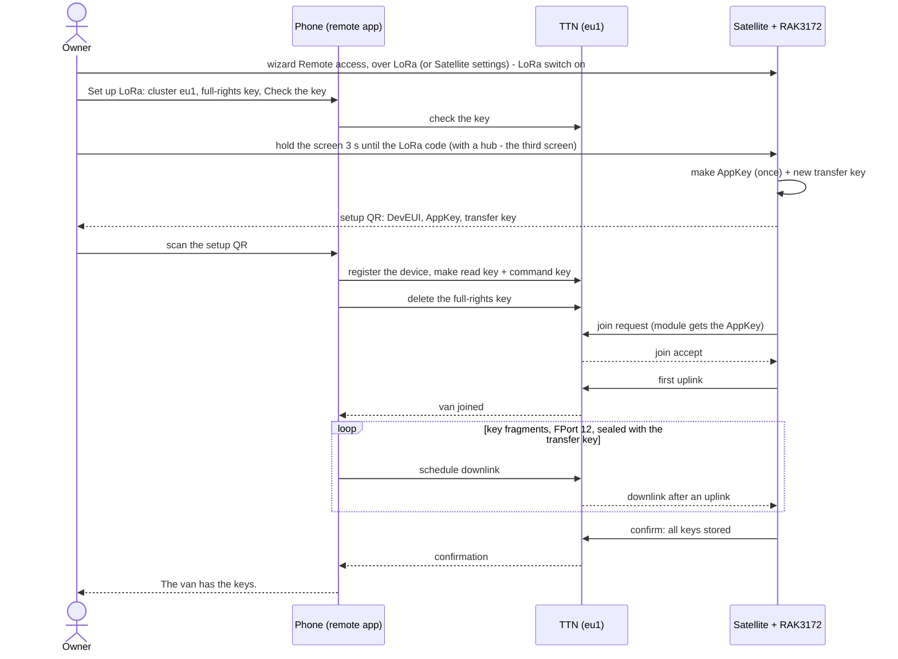

# How to read your van from anywhere with LoRa

The satellite can send a few numbers (batteries, water, solar, the cooler) over {term}`LoRaWAN` to
The Things Network. The **Open California remote app** reads them from there, so you see your van
from anywhere, with no router, no Raspberry Pi and no Tailscale in the van. The remote app is a
web page that you put on your phone's home screen. Over LoRa alone, it talks only to The Things
Network, never to your router, your Pi or the satellite, and it only shows the data. With the
remote hub set up, it also talks to your broker and sends a few commands (heater, camping mode),
over LoRa too.

To see the van over WiFi as well, and to switch the heater and camping mode from anywhere, set up the
remote hub: [How to set up the remote hub](howto-remote-hub.md).

This page takes you from nothing to the first numbers on your phone. The setup needs about ten
minutes, and you do it once.

## What you need

- A satellite (an M5Stack CoreS3) with the LoRa module fitted, switched on, and LoRa coverage at
  the van (a Things Network gateway in reach).
- A phone with mobile data. You do the setup next to the satellite, so you can scan its screen.
- A free account at The Things Network (the next section).

## 1. The Things Network console

You do this part once, on a computer or on the phone.

1. Sign up at The Things Network with a The Things ID, or log in.
2. Open the console of the `eu1` cluster (`https://eu1.cloud.thethings.network/console`). The
   satellite uses the European frequency band, so use `eu1`.
3. Create an **application**. Give it any name, for example `my-van`. Use one application for each
   van: the phone's keys are keys of the application (see [Limits](#limits)).
4. Open **API keys** of that application and create an API key. Choose **Grant all current and
   future rights**. Copy the key.

Keep the key on your phone only until step 3 below. The app uses it for a few calls: it
registers the van's device, turns on the storage that keeps the van's messages, and makes two
keys of its own: a read key and a command key. Then the app **deletes the
full-rights key** at The Things Network, and your phone forgets it. If the app says it could not
delete the key, it names the key. Open the console, open the application's **API keys**, and
delete that key there. Do not use the app again before the key is gone.

## 2. Put the remote app on your home screen

Open `https://open-california.github.io/` on your phone.

- **iPhone or iPad:** use Safari. Tap **Share**, then **Add to Home Screen**. The icon is called
  **OC Remote**. Close Safari and open the app from the home screen. Do the setup in step 3 **inside the installed app**: the installed
  app has its own storage, separate from Safari, so keys that you set up in Safari are not there.
- **Android:** use Chrome. Open the menu and tap **Install app** (or **Add to Home screen**), then
  open the app from the home screen.

## 3. Set up the van

LoRa is off on a new satellite, and the LoRa screen does not open while LoRa is off. Switch it on
once before you start: in the setup wizard's **Remote access** step, part **Over LoRa**, turn on
**This satellite has the LoRa module** (it works without a remote hub), or later, on your home WiFi, open the satellite's page, choose **Satellite settings** and
turn on the **LoRa** switch under **Advanced**. Switch LoRa on only on a satellite with the LoRa
module; while LoRa is off, the satellite does not touch the module's pins. LoRa stays on after a
restart.

Without a phone, connect the satellite to a computer with its USB-C cable, open the USB console
(see [No phone? Use the USB console](howto-esp-wifi-setup.md#no-phone-use-the-usb-console)) and type
`lora on`. The satellite answers `LOG exp: lora on`.

1. In the app, open the menu and choose **Set up LoRa**. Choose your cluster (`eu1`), paste the
   full-rights API key and tap **Check the key**. The app only checks the key in this step.
2. On the satellite, tap the screen once to light it (the touch that wakes a dark screen does not
   count), then **hold the screen for 3 seconds**. The LoRa screen opens and shows the setup code.
   With the remote hub set up, the app's code and the van's code come first: hold for 3 seconds
   once for each of them; the LoRa code is the third screen. The screen closes after two minutes,
   so do this step just before the next one.
3. Scan the code **in the app**: it opens the camera itself (do not use the phone's Camera app; the
   setup code carries keys). Allow the camera when the phone asks. Hold the phone so that the whole code is in the picture. After the scan, the app
   registers the van at The Things Network, makes the read key and the command key, and deletes
   the full-rights key.
4. Wait. **Do not hold the satellite's screen again until the app says The van has the keys.**
   Each new entry to the LoRa setup code makes a new transfer key, and the keys that the app sent
   before no longer fit.
   - The app shows that it waits for the van's first message. The first message from a new
     device can take several minutes. If the app waits more than ten minutes, check the antenna
     and the gateway coverage at the van.
   - When the first message is at The Things Network, the van has joined. The app then shows
     **Keys sent to the van** and sends the keys over LoRa, in small parts. Each part takes a
     while.
   - The app shows **The van has the keys.** when the van has received all the parts and
     confirmed them.
5. Tap **Show the van**. The numbers appear, each with its age. The page marks the data as LoRa
   and shows how old it is. A LoRa message is far slower than WiFi: the numbers are minutes old, not seconds.

If you close the app while it waits, open it again: it continues where it stopped. If the van
could not read the keys, the app tells you. Then hold the satellite's screen for 3 seconds again
until the LoRa code shows, and scan the new code. If the satellite shows its repair code instead, scan that code: the van
already has the keys, and the app finishes the setup. If the app says that the van's daily downlink
limit is reached, leave the app installed: the setup continues the next day.

## The LoRa setup in one picture

The steps of section 3, with the messages between the app, TTN and the satellite.

## Add a second phone

The second phone needs no TTN account and no full-rights key.

1. Install the remote app on the second phone (step 2).
2. Hold the satellite's screen for 3 seconds until the LoRa code shows (with the remote hub set up,
   it is the third screen). The LoRa screen shows a **repair code**.
3. In the app, open the menu, choose **Scan the van's code** and scan the repair code. The phone
   receives the same read keys and shows the van.

## You lost a phone

Someone who has the phone can read your van's numbers until you make new keys. You need a new
full-rights API key and a visit to the van.

1. In the TTN console, open your application, open **API keys** and delete the keys that the app
   made for this van (`oc-remote-read-<device ID>` and `oc-remote-cmd-<device ID>`, for example
   `oc-remote-read-van-0abcde`), and also keys named `oc-remote-read` or `oc-remote-cmd` if
   you still have them. From then on, no phone can read the van. The keys of your other vans in
   the same application stay.
2. In the same place, create a new API key with **Grant all current and future rights** (as in
   section 1).
3. In the app on your phone, choose **Set up LoRa**, paste the new key and tap **Check the key**.
4. On the satellite, hold the screen for 3 seconds until the repair code shows (with the remote hub
   set up, it is the third screen, after the app's code and the van's code). Hold the screen for 3
   seconds once more. The satellite makes a new transfer key and shows a new setup code. The satellite does not make the read key and the command key: the phone makes them.
5. Scan the setup code. The app makes a new read key and a new command key, deletes the full-rights
   key and sends the new keys to the van, as in step 3 of the setup.
6. When the app says **The van has the keys.**, scan the new repair code on your other phones.

## Remove a van or forget LoRa

- **Remove this van** (in the app's menu) makes the phone delete the keys and the stored data
  for the van. The device stays registered at The Things Network until you delete it in the console.
- **Forget LoRa** (in the satellite's settings) makes the satellite delete its LoRa keys and switch
  LoRa off. The device also stays registered at The Things Network until you delete it there.

To remove everything, do both and then delete the device and the application in the console.

## Limits

- The read key and the command key that the app makes are keys of the application, not of one
  device: The Things Network has no API key for a single device. A phone with the keys of one van
  can read every van in the same application, and its command key can send to each of them. Keep
  each van in an application of its own, or give such a phone only to people who may see all of
  these vans.
- The data is read only. The remote app sends no commands to the van. Its only messages to the van
  are the one-time key transfer of the setup.
- The Things Network has a fair use policy: a device may use about 30 seconds of uplink airtime
  and receive 10 messages a day. The app sends at most 8 setup messages to the van in 24 hours.
- The remote app needs a network connection. It opens offline and shows the last data with its age.
