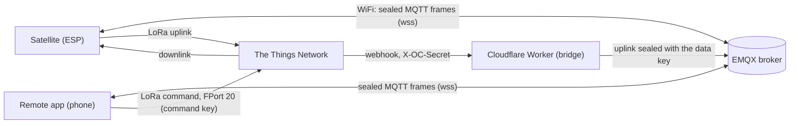

# How to set up the remote hub (broker, bridge, app)

The **remote hub** lets the Open California remote app show your van and switch a few things from
anywhere. With WiFi at the van, the satellite talks to an MQTT broker, and the app talks to the same
broker. Without WiFi, the satellite's LoRa uplinks go through The Things Network (TTN) and a small
Cloudflare Worker (the **bridge**) into the broker, and the app sends a few commands over LoRa
directly to TTN. This page builds all of it from zero, with hosted services only. It is also the
operations page: inventory, secrets, checks and recovery.

Every setup step has one action and a **Check** that proves it. Do not go on when a check fails.
Anything that this page could not confirm from the vendor's documentation is marked **check in the
console**: the console or the documentation may name or place it differently today.

Read first: [How to read your van from anywhere with LoRa](howto-lora-remote-setup.md) (TTN
account, the app on the home screen) and [How to put the ESP32 satellite on your
WiFi](howto-esp-wifi-setup.md).

## How it fits together


Blue is the internet path: the satellite and the app exchange sealed frames through the broker, end to end. Amber is the LoRa path: uplinks go through TTN to the Worker, which seals them for the broker; the four LoRa commands go from the app to TTN and down to the satellite. Green is the key exchange: the data key moves once, through the hub QR on the satellite's screen. The same links as a flowchart:



- **Topics** (`<van>` is the van name): `oc/<van>/online` (presence, last will), `oc/<van>/state`
  (retained), `oc/<van>/req`, `oc/<van>/res`, `oc/<van>/lora/<fport>` (the bridge's sealed uplinks).
- **Sealing:** every WiFi frame is AES-128-GCM with the van's **data key**: `ver | dir | nonce(12) |
  ciphertext | tag(16)`, nonce = `dir | random(7) | counter(4)`. The data key is made on the
  satellite and travels only in the hub QR. The broker carries ciphertext.
- **Over the hub** only `GET /api/*` and `POST /api/command` work. Every write to the settings
  answers `403 local_only`: **settings change only in the van's WiFi.**
- **LoRa commands** (heater on or off, camping mode on or off) are 15 bytes on FPort 20, sealed by
  the app, sent directly to TTN with the command key of the LoRa setup. The app allows at most 8 per
  rolling 24 hours. It waits 30 seconds for a WiFi answer before it uses LoRa.

**Who can read what.** LoRa uplinks are **not** sealed on the air: LoRaWAN encryption only, so TTN
can read the values. The bridge seals them with the data key before the broker, and the data key is a
Cloudflare secret. So **TTN and Cloudflare can read the LoRa uplink values; the broker cannot.** The
WiFi path is end-to-end between the satellite and your phones: the broker and Cloudflare see only
ciphertext. Not protected: when and how much the van sends, and a compromised phone.

**Why EMQX.** HiveMQ Cloud Serverless reaches end of life on 2026-12-31 and accepts no new clusters
(docs.hivemq.com, "Serverless end of life"). EMQX Cloud Serverless is the hosted broker that this
page uses.

## What you need

- An EMQX Cloud account (`https://cloud-intl.emqx.com`), a Cloudflare account, a TTN or TTS account
  with the application of your van, and a GitHub account that can create repositories in the
  `open-california` organization.
- A computer with `git`, `node` and `npm`, the GitHub CLI `gh` (logged in) and `ssh-keygen`.
- The satellite with the firmware that has the hub (a new board: [first
  flash](howto-esp-first-flash.md)), a phone, and the van's WiFi.
- Choose a **van name** now: letters, digits, `_` and `-` only. The examples use `van1`. It is one
  topic level, `oc/van1/...`.
- **No `*` in any value that goes into the hub QR:** the van name, the broker URL, the app user and the
  app password. The QR uses `*` as its separator and the satellite refuses such a value. The van
  user and password are not in the QR, but keep `*` out of them as well. `openssl rand -hex 16`
  makes safe passwords.
- A place for secrets that you control: your password manager or a file only you can read. The
  steps call it **your secret store**. (The owner's own is `~/.env`, managed with `chezmoi edit ~/.env`.)

Do not paste a secret into a chat, a file in the repository or a shell command line. The steps below
read secrets from a prompt or a pipe.

## Setup from zero

### 1. The broker: EMQX Cloud Serverless

1. Open the EMQX Cloud console (`https://cloud-intl.emqx.com`) and log in. Create a project if there is
   none.
2. Click **New Deployment** and choose the **Serverless** plan.
   **Check:** the form asks for a monthly spend limit.
3. Set the **spend limit to 0** and give the deployment a name. With 0, only the free quota
   applies and the deployment stops when it is used up (see [Inventory](#inventory)). Accept the
   terms and deploy.
   **Check:** the status becomes **Running** (a few minutes).
4. Open the deployment's **Overview**. Write down the **address** (the host name). Ports 8883
   (MQTT over TLS) and 8084 (WebSocket over TLS) are on by default.
   **Check:** the Overview shows the address and both ports.
5. Build the WebSocket URL: `wss://<address>:8084/mqtt`. The path `/mqtt` is the usual EMQX
   default: **check in the console** (the Overview or the connection guide). You need this URL
   three times: in the satellite's Hub card, in the bridge's `BROKER_WSS` and (without the path) as
   the GitHub variable `OC_HUB_ORIGIN`.
   **Check:** you have the URL written down, with the address, port 8084 and the path.
6. Create **three credentials** under **Access Control > Authentication** (**check in the
   console**). Make long random passwords (`openssl rand -hex 16`, copy them from your own
   terminal into the console; keep them in your secret store, see [Secrets](#secrets)).

   | Credential | Used by | Needs |
   | --- | --- | --- |
   | `van` | the satellite | publish `oc/<van>/state`, `oc/<van>/res`, `oc/<van>/online`; subscribe `oc/<van>/req` |
   | `app` | every phone (it is in the hub QR) | subscribe `oc/<van>/online`, `oc/<van>/state`, `oc/<van>/res`, `oc/<van>/lora/+`; publish `oc/<van>/req` |
   | `bridge` | the Cloudflare Worker | publish `oc/<van>/lora/#` (retained) |

   **Check:** the console lists three users.
7. Add the **topic permissions** (ACLs) under **Access Control > Client Authorization** (**check in
   the console**; the page offers **+ Add** with a user name, a topic, an action
   Publish/Subscribe/Both and Allow/Deny). One rule per row of the table above, for the matching
   user name, with the van name in the topic. Then add a deny-all rule for **All Users** with topic
   `#`, action Publish and Subscribe, permission Deny, so that a user has only what is allowed.
   The documentation does not say whether user-name rules work on Serverless: **check in the
   console.** If they do not, the three credentials share all topics. Then the broker's ACL is not
   a second line of defence: the data stays sealed, but a leaked app password could publish where
   the van or the bridge publishes (availability, not secrecy). Write that in your notes.
   **Check** (after step 9, which introduces the test client): with the test client, logged in as `app`, publish to `oc/<van>/req` works and
   publish to `oc/<van>/state` is refused (ACL working), or note that it is not refused.
8. Retained messages: the satellite publishes `oc/<van>/state` and `oc/<van>/online` retained,
   and the bridge publishes `oc/<van>/lora/*` retained. **Check in the console** that the deployment
   accepts retained messages: publish a retained test message as `van`, subscribe with a new client
   and see it arrive at once.
9. Test the credentials with a WebSocket test client (the console's online test client, **check in the
   console**, or any MQTT client): connect to the URL of step 5 as `app`.
   **Check:** the connection is accepted. With a wrong password it is refused. The broker's certificate
   chains to DigiCert Global Root G2, which the satellite's CA bundle trusts (checked with
   `openssl s_client`).

Optional alternative to the click path of steps 1 to 3: create the deployment with the EMQX Platform
API (`POST {platform}/deployments`, with the platform's base URL from the EMQX API documentation and
the platform API key as credential, read from your secret store, never typed into the command line). The body
holds `platform`, `region`, `connections` 1000, `tps` 1000, `deploymentType` `"serverless"`,
`deploymentVersion` `"v5"`, `projectID` and `freeTrial` `false`. The `201` answer shows
`spec.spendLimit` 0 and `spendLimitAction` `"stop"`: check both before you go on. Serverless exposes
only port 8084 (wss) and 8883 (mqtts), and the host looks like `<id>.ala.<region>.emqxsl.com` (an
example format: take the real host from the answer or the Overview). The deployment API
(`https://<host>:8443/api/v5`) needs a deployment API key, and the Platform API cannot make one for
Serverless: make it in the console. The path `/mqtt` stays **check in the console**.

The EMQX platform API key can automate the console steps. It belongs in your secret store as
`EMQX_API_KEY` and `EMQX_API_SECRET` (names only). This page does not depend on it.

### 2. Cloudflare: the bridge Worker

1. Create a free Cloudflare account (`https://dash.cloudflare.com`).
   **Check:** the dashboard opens.
2. On the computer run `git clone https://github.com/ckeller42/open-california.git`, then
   `cd open-california/bridge` and `npm install`.
   **Check:** `npx wrangler --version` prints a version.
3. Run `npx wrangler login`. A browser window opens: allow it.
   **Check:** `npx wrangler whoami` shows your account.
4. Open `bridge/wrangler.toml` and set `VAN` to your van name, `BROKER_WSS` to the URL of step 1.5
   (with `:8084/mqtt`) and `DEV_ID` to the van's TTN device ID (the **End device ID** in the TTN
   console, for example `oc-mock-01`). The bridge forwards only the uplinks of this device and ignores
   every other device of the TTN application (answer `204`). These are not secrets.
   **Check:** `git diff` shows only these three values.
5. Run the bridge's tests from the repository root: `tools/ci.sh bridge`.
   **Check:** it ends with all tests passed.
6. Commit the change and push `main` (`git commit -am "bridge: van and broker"` and `git push origin
   main`). If `main` is protected, open a pull request and merge it. The app's publish job
   (step 4.5) accepts only a tag on a commit that is on `origin/main`.
   **Check:** `git fetch && git status` says `main` is up to date with `origin/main`.
7. Make the webhook secret (at least 16 characters): `openssl rand -hex 24`. Save it in your secret
   store, for example as `OC_WEBHOOK_SECRET`. Never type it into a command line.
   **Check:** the secret store holds a value of 48 characters.
8. Store it in the Worker. The command reads the value from the pipe, so it is in no file and no
   shell history (load the value into `$OC_WEBHOOK_SECRET` from your secret store first, in `bridge/`):

   ```sh
   printf %s "$OC_WEBHOOK_SECRET" | npx wrangler secret put WEBHOOK_SECRET
   ```

   **Check:** `npx wrangler secret list` names `WEBHOOK_SECRET`. The first `secret put` may ask to
   create the Worker: **check in the console**.
9. Store the bridge user: `npx wrangler secret put BROKER_USER` and type the `bridge` user of step
   1.6 at the prompt.
   **Check:** `npx wrangler secret list` names `BROKER_USER`.
10. Store the bridge password: `npx wrangler secret put BROKER_PASS` and type the `bridge` password at
    the prompt.
    **Check:** `npx wrangler secret list` names `BROKER_PASS`. The fourth secret, `HUB_KEY`, comes in
    step 5.7: the data key does not exist yet.
11. Run `npx wrangler deploy`.
    **Check:** it prints the Worker URL, `https://oc-bridge.<your-subdomain>.workers.dev`. Then
    `curl -i https://oc-bridge.<your-subdomain>.workers.dev/ttn` answers `405` (the route exists, GET
    is refused).

### 3. TTN: the webhook

1. In the TTN console open your application and choose **Integrations > Webhooks > Add webhook >
   Custom webhook** (**check in the console**).
2. Give it an ID, for example `oc-bridge`. Format: **JSON**. Base URL: the Worker URL from step 2.11.
3. Under **Additional headers** add the header `X-OC-Secret` with the value of your webhook secret.
   Copy it from your secret store with any clipboard tool.
4. Under **Enabled event types** turn on **Uplink message** with the path `/ttn`, and turn **everything
   else off**. The bridge reads uplink messages only. No TTN API key goes to the bridge: LoRa
   commands use the app's own command key.
5. Save.
   **Check:** the webhook shows as healthy in the console (**check in the console**). A first real
   check is the [smoke test](#smoke-test-per-link).

### 4. GitHub: the app on Pages

1. Create the repository `open-california/open-california.github.io` (public) with a first commit on
   `main`, for example a README. The publish job clones branch `main`, so the branch must exist.
   **Check:** `gh repo view open-california/open-california.github.io` works.
2. In that repository open **Settings > Pages** and serve **branch `main`, folder `/`** (**check in
   the GitHub settings**).
3. Make a deploy key that can write to that repository only, and store its private half as the
   secret `REMOTE_APP_DEPLOY_KEY` of `ckeller42/open-california`, without a copy on disk:

   ```sh
   d=$(mktemp -d)
   ssh-keygen -t ed25519 -N '' -C oc-remote-app -f "$d/k"
   gh repo deploy-key add "$d/k.pub" -R open-california/open-california.github.io --allow-write --title remote-app
   gh secret set REMOTE_APP_DEPLOY_KEY -R ckeller42/open-california < "$d/k"
   shred -u "$d/k"; rm -rf "$d"
   ```

   **Check:** `gh secret list -R ckeller42/open-california` names `REMOTE_APP_DEPLOY_KEY`, and
   `gh repo deploy-key list -R open-california/open-california.github.io` shows `remote-app` with
   write access.
4. Set the repository variable with the broker origin (the URL of step 1.5 without the path). The
   build puts it into the page's `connect-src`; without it the page cannot reach the broker:

   ```sh
   gh variable set OC_HUB_ORIGIN -R ckeller42/open-california --body 'wss://<address>:8084'
   ```

   **Check:** `gh variable list -R ckeller42/open-california` shows `OC_HUB_ORIGIN`.
5. Push `main` first if it has commits that `origin/main` lacks (step 2.6 did this for the bridge
   change): the workflow stops with "tag is not on main" for a tag on a commit that is not on
   `origin/main`. Then tag that commit and push the tag (workflow `.github/workflows/remote-app.yml`):

   ```sh
   git tag remote-v1 && git push origin remote-v1
   ```

   **Check:** the run `remote-app` of that tag is green (`gh run list -R ckeller42/open-california`),
   and `https://open-california.github.io/` opens the app. A later release uses `remote-v2` and so on.

### 5. The first van setup on the phone

The first steps cannot use the hub: a fresh satellite is reachable only on its own hotspot.

1. **Hotspot and WiFi.** Follow [How to put the ESP32 satellite on your
   WiFi](howto-esp-wifi-setup.md) until the satellite is on the van's WiFi and its page opens in
   that WiFi.
   **Check:** the satellite's page shows its status over the WiFi.
2. **Hub card.** In the satellite's settings open the **Remote hub** card and fill in: broker address
   (the `wss://<address>:8084/mqtt` URL), van name, van user, van password, app user and app
   password (the `van` and `app` credentials of step 1.6). Save. The card works only in the van's
   WiFi, not over the setup hotspot.
   **Check:** the card's status says **Connected** (also `GET /api/state`: `device.hub` has
   `"configured": true` and `"online": true`).
3. **Install the app** on the phone as in the [LoRa how-to](howto-lora-remote-setup.md) (step 2), and
   do all scans inside the installed app.
4. **Hub QR.** Press the satellite's screen for 3 seconds. Each further 3-second press goes one
   screen on: the LoRa repair QR (with LoRa on) → **the hub QR** → the LoRa setup QR. (With LoRa off,
   the first press shows the hub QR.) In the app menu choose **Scan the van's code** and scan the hub
   QR. The screen closes after 120 seconds.
   **Check:** the app shows the van with **WLAN** and a short age.
5. **LoRa and TTN.** Do the LoRa setup of the [LoRa how-to](howto-lora-remote-setup.md) (section 3,
   **Set up LoRa**, with the full-rights key of your TTN application). Do not press the satellite's
   screen between the steps that the how-to names.
   **Check:** the app says **The van has the keys.**
6. **Pairing with the camper unit** in the satellite's wizard, as in the WiFi how-to
   (settings only change in the van's WiFi).
   **Check:** the app shows the camper unit's values.
7. **The data key into the bridge.** The bridge needs the data key to seal uplinks. The key is the last
   field of the hub QR text (`OCH1*<van>*<url>*<app user>*<app pass>*<key>`). Read it **without a
   shell history and without a file**: show the hub QR again (step 4) and scan it with the
   computer's camera, so that only the key goes into the pipe:

   ```sh
   zbarcam -1 --raw --nodisplay | cut -d'*' -f6 | tr -d '\r\n' | npx wrangler secret put HUB_KEY
   ```

   `zbarcam` is in the package `zbar-tools`; `-1` makes it exit after the first code.
   The value must be exactly 32 hex characters; the bridge answers 500 for anything
   else, a trailing newline included, which is why `tr` strips it. Do not read the QR text in a
   normal phone scanner app: it shows the app password and the key on the screen and in its history.
   **Check:** `npx wrangler secret list` names `HUB_KEY`, and the LoRa smoke test below passes.

## Smoke test per link

1. **Satellite → broker.** The Hub card says **Connected**. In the EMQX console (or the test client
   logged in as `app`) subscribe to `oc/<van>/#`: `oc/<van>/online` shows `1` and `oc/<van>/state`
   arrives about every 30 s as binary (sealed). Fail: wrong address, wrong `van` credentials (the card
   says **Not connected**) or the broker is stopped (see [Recovery](#recovery)).
2. **TTN → bridge → broker.**
   1. Open `npx wrangler tail` in a terminal (see [Bridge logs](#bridge-logs)).
   2. In the TTN console simulate an uplink on FPort 2 for the van's device (**Messaging >
      Simulate uplink**, **check in the console**), or wait for a real uplink.
   3. Expect a `POST /ttn` with status `204`, and a new retained message on `oc/<van>/lora/2`.
   `401`: the header value differs from `WEBHOOK_SECRET`. `500`: the secret is missing or shorter than
   16 characters, `HUB_KEY` is not 32 hex, or `DEV_ID` is empty. `502`: the broker refused the
   bridge's connection or did not answer in 5 seconds (`bridge` credential, `BROKER_WSS`). `400`: the
   body is not a TTN uplink. `204` but no new message on `oc/<van>/lora/2`: the bridge publishes with
   QoS 0, so the broker does not report a publish that its ACL refuses; check the topic permission of
   the `bridge` credential (step 1.7). The same answer comes for an uplink of a device other than
   `DEV_ID`.
   A check without TTN: `curl -i -X POST <Worker URL>/ttn -H "X-OC-Secret: $OC_WEBHOOK_SECRET" -d '{}'`
   (with the secret in `$OC_WEBHOOK_SECRET`, loaded from your secret store) answers `400`: the secret is right and the body is empty.
3. **App → broker → satellite.** In the app, switch the **air heater** or **camping mode** while the
   phone is on mobile data (not the van's WiFi). The app shows the answer within a few seconds.
   Fail: the app shows "Key changed: scan the hub QR" (rekeyed, scan again) or "No connection to the
   hub" (broker or `app` credential).
4. **LoRa command.** Turn off the satellite's WiFi (or block the broker), switch camping mode in the
   app. After 30 seconds the app sends it over LoRa and says **Sent over LoRa.** The satellite acts
   after its next downlink window (class C, usually seconds). If its camper link rests, the satellite
   wakes it and holds the command for up to 120 seconds; the console log then says
   `lora: command ... waits for the camper link`, and at the end `-> 5` (accepted) or `dropped`. Remember the budget of 8 per 24 hours:
   do not repeat this test needlessly.

## Bridge logs

`cd bridge && npx wrangler tail` streams the Worker's requests live: one line per webhook call with
its status. The bridge **logs nothing else** by design: no payload, no key, no error detail. Filter
with `npx wrangler tail --status error` (failed calls), `--format pretty` or `--search 401`
(**check `npx wrangler tail --help`**). `tail` shows only live traffic; there is no history on the free
plan unless you turn on Workers Logs in the dashboard (**check in the console**).

## Inventory

| Service | Where | What it does | Free-tier limit and what happens at the limit |
| --- | --- | --- | --- |
| EMQX Cloud Serverless | `https://cloud-intl.emqx.com`, deployment `<address>`, port 8084 (wss) | the broker | 1 M session minutes and 1 GB traffic a month (EMQX pricing page). With spend limit 0 the deployment stops when the quota is used (**check in the console**); the app then shows no connection and LoRa through the bridge also stops. |
| Cloudflare Worker `oc-bridge` | `https://oc-bridge.<your-subdomain>.workers.dev/ttn` | TTN webhook → sealed MQTT | Workers free plan: a daily request limit (**check in the Cloudflare docs**). Over the limit the Worker answers an error and TTN retries or drops; the van's LoRa values stop reaching the app, WiFi is not affected. |
| TTN / TTS application | TTN console, cluster `eu1` | LoRaWAN network, webhook, command downlinks | Fair use: about 30 s of uplink airtime and 10 downlinks a day per device. The app counts 8 commands per 24 h. |
| GitHub Pages | `https://open-california.github.io/` (repo `open-california/open-california.github.io`) | the app | Soft limits of GitHub Pages. The app opens offline from its cache; no new version until it is back. |
| GitHub Actions | repo `ckeller42/open-california`, workflow `remote-app` | builds and pushes the app on a `remote-v*` tag | Free minutes; a failed run changes nothing on the site. |
| HiveMQ | not used | | Serverless reaches end of life on 2026-12-31. |

There is no self-hosted fallback. If the hosted hub is down, the app says so.

## Secrets

Never write a value into this repository, a chat or a log. Names and places only.

| Name | Place | What it can do | How to rotate |
| --- | --- | --- | --- |
| `van` user and password | EMQX console; the satellite's flash (Hub card) | publish the van's topics, read `req` | New password in the console, then the Hub card. |
| `app` user and password | EMQX console; the hub QR; every phone | read the van's topics, publish `req` (frames still need the data key) | New password in the console, new password in the Hub card, then every phone scans the hub QR again. |
| `bridge` user and password = `BROKER_USER`, `BROKER_PASS` | EMQX console; Cloudflare secrets | publish `oc/<van>/lora/#` | New password in the console, then `npx wrangler secret put BROKER_PASS`. |
| `WEBHOOK_SECRET` | Cloudflare secret; the TTN webhook header `X-OC-Secret`; your secret store | make the bridge accept an uplink (it can feed the app fake LoRa values; the bridge still seals them) | New value in your secret store, `wrangler secret put WEBHOOK_SECRET`, new header value in the TTN webhook. |
| `HUB_KEY` (the data key) | the satellite's flash; the hub QR; every phone; Cloudflare secret | read the van's WiFi data, send valid commands | [Rekey](#lost-phone-or-leaked-key-rekey). |
| `REMOTE_APP_DEPLOY_KEY` | GitHub secret of `ckeller42/open-california`; the public half is the deploy key of the Pages repo | write to the Pages repository only | Step 4.3 again with a new key, then delete the old deploy key (`gh repo deploy-key delete`). |
| `OC_HUB_ORIGIN` | GitHub variable (not a secret) | the broker origin in the page's `connect-src` | `gh variable set`, then a new tag. |
| `EMQX_API_KEY`, `EMQX_API_SECRET` | your secret store | optional: the EMQX platform API for automation; this page does not need it | New key in the EMQX console. |
| TTN full-rights API key | the phone, once | the app deletes it after the LoRa setup | n/a |

## Deploy from a clean machine

```sh
git clone https://github.com/ckeller42/open-california.git && cd open-california
# bridge (needs node and npm)
tools/ci.sh bridge                       # the bridge's tests, before a deploy
cd bridge && npm install && npx wrangler login
npx wrangler secret list                 # the four secrets must be named
npx wrangler deploy
cd ..
# app (Pages): a tag on a commit that is on main
git tag remote-v2 && git push origin remote-v2
```

A clean machine also needs the secrets in Cloudflare and GitHub, which stay there; a new machine does
not need them again. To build the app by hand: `python3 -m tools.build_remote --out _build/remote
--hub-origin wss://<address>:8084`.

## Recovery

### Lost phone or leaked key (rekey)

A phone with the hub QR can read the van's WiFi data and send commands until the data key changes.

1. Change the `app` password in the EMQX console and in the satellite's Hub card (the old password is
   in the lost phone).
2. At the satellite, press the screen for 3 seconds and press again until the **hub QR** shows (the
   screen after the LoRa repair QR).
3. **Hold the press on the hub QR for 10 seconds.** The satellite makes a **new data key**; the QR
   changes. Old phones stop working: the app says "Key changed: scan the hub QR".
4. Scan the new hub QR on every phone you keep (**Scan the van's code**).
5. Put the new key into the bridge (step 5.7 above). **If you skip this, LoRa values stop reaching
   the app**, because the bridge still seals with the old key.
6. For LoRa, follow also [You lost a phone](howto-lora-remote-setup.md#you-lost-a-phone) (new TTN keys).

The LoRa repair QR does **not** carry the hub data: every phone scans the hub QR.

### The free tier is used up

- **Broker (EMQX):** with spend limit 0 the deployment stops. Wait for the next month, or raise the
  limit in the console (this can cost money: **check the prices in the console** first). The
  satellite and the app reconnect when it runs again. Watch the usage in the console.
- **Worker:** wait for the next day, or move to a paid Workers plan.
- **TTN:** the daily airtime is not extendable; commands wait for the next day.

### Lost account or deleted deployment

- **EMQX deployment or account gone:** make a new deployment (step 1). The address changes, so
  change it in the Hub card, in `BROKER_WSS` (`wrangler.toml`, then `wrangler deploy`) and in
  `OC_HUB_ORIGIN` (then a new `remote-v*` tag). New credentials mean a new app password: every phone
  scans the hub QR again after the Hub card is saved. The data key can stay.
- **Cloudflare account gone:** steps 2 and 3 again (the Worker URL changes: change the TTN
  webhook).
- **GitHub repository gone:** step 4 again.
- **TTN account gone:** the LoRa how-to again from section 1.

## Known limits

- LoRa frames carry no frame age (issue #508): values are marked by their uplink time at TTN, not by
  when the van measured them.
- Replay protection after a satellite reboot rests on the 120-second time check, so the satellite
  runs commands over the hub only once it has valid SNTP time. Before that it answers them with
  "The van has no network time yet"; reads still work. It ignores a retained request.
- A LoRa command that the satellite cannot run within 120 seconds (its camper link does not come up)
  is dropped. The app has already said **Sent over LoRa.**; only the console log shows it.
- The LoRa repair QR (`OCR1`) carries no hub data: every phone scans the hub QR (`OCH1`).
- TTN and Cloudflare can read LoRa uplink values (see above); the broker cannot.
- Settings (WiFi, hub, pairing, firmware update) work only in the van's WiFi.
- Over LoRa only heater and camping mode, on or off, at most 8 commands per rolling 24 hours.
- The free tiers have no service level agreement. EMQX Serverless can stop at its quota.
